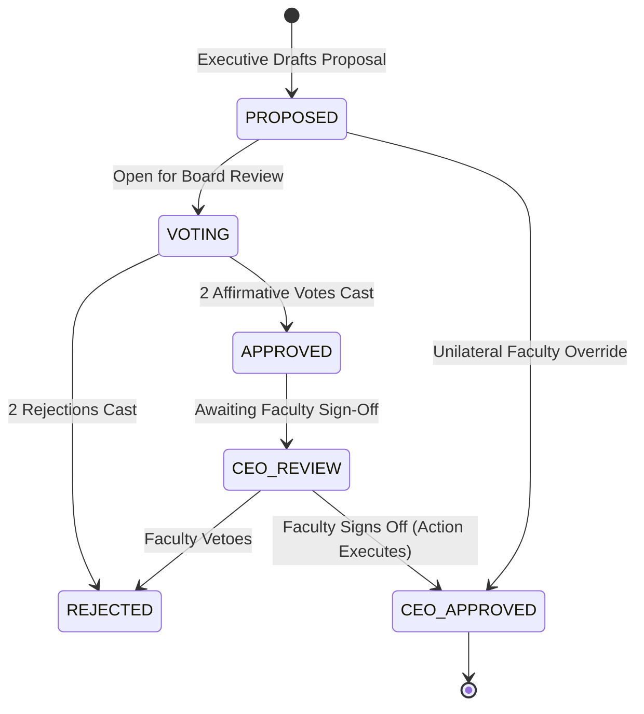

# Pointfex ERP — CEO 360 Command Center & Governance Specification

> **Module:** CEO Module (Faculty Command Center, Governance Engine & Chaos Console)  
> **Status:** Production Specification  
> **Target Audience:** Course Faculty (CEO), System Architects, Core Engineers  
> **Revision:** 2.0.0

---

## 1. Role Overview & System Authority

The Course Teacher acts as the Chief Executive Officer (CEO) of Pointfex. The CEO holds **supreme administrative, audit, and intervention authority** over the entire platform. Unlike students, the CEO does not trade or accumulate personal wealth; the CEO manages the central macro-economy, approves venture capital disbursements, triggers simulated software crises (chaos events), and penalizes collusion or misconduct.

### 1.1 Core Powers of the CEO
* **Sprint Liquidity Injection:** Authorizes and funds the ৳150,000 sprint reward pool from `SYSTEM_RESERVE`.
* **2-of-3 Governance Veto & Override:** Holds absolute veto over executive decisions, or can force-approve/reject any board proposal.
* **Chaos Event Dispatcher:** Injects real-time lab crises (scope creep, server outages, keyboard lockouts) to test student agile responsiveness.
* **Compensating Reversals & Account Freezes:** Can freeze any squad treasury or personal wallet, reverse fraudulent transactions, and penalize executives directly.
* **Chain Integrity Verification:** Audits the cryptographic HMAC-SHA256 ledger to detect unauthorized database tampering.

---

## 2. Single-Screen 360 Command Center Layout

The CEO interface delivers total visibility of studio operations in a single, unpaginated, high-density dashboard powered by real-time WebSocket subscriptions.

```
+-----------------------------------------------------------------------------------------------------------------------+
| POINTFEX VENTURE STUDIO · CEO COMMAND & AUDIT CONTROL [FACULTY SESSION]                     [STATUS: ENGINE ACTIVE]   |
+-----------------------------------------------------------------------------------------------------------------------+
| WIDGET 1: STUDIO MACRO LIQUIDITY & HEALTH                                                                             |
| Circulating Cash: ৳1,480,000 | Active Escrow: ৳450,000 | Avg Runway: 6.4 Labs | Active Clients: 4 | Valuation: ৳5.2M  |
+------------------------------------+-----------------------------------+----------------------------------------------+
| WIDGET 2: REAL CLIENT PIPELINE     | WIDGET 3: SQUAD HEALTH & DPI/PMHI | WIDGET 4: EXECUTIVE AUDIT & TAX BALANCES     |
| • Client Alpha: Milestone 2 [82%]  | • Squad 1: ৳260k | 9.2 HP | BULLISH   | • CFO Wallet: ৳42,500 (Tax Cut: ৳14,500)     |
| • Retail POS: SOW In Escrow        | • Squad 2: ৳185k | 8.4 HP | BULLISH   | • CTO Wallet: ৳36,000 (Citations: ৳16,000)   |
| • HealthApp: CTO Audit Pending     | • Squad 3: ৳94k  | 6.1 HP | STABLE    | • CHRO Wallet: ৳24,500 (Bounties: ৳6,000)    |
| • AgriTech: Client Review          | • Squad 4: ৳14k  | 2.8 HP | RISK ⚠️   | [Anomaly Flags: 0 Active Collusion Alerts]   |
+------------------------------------+-----------------------------------+----------------------------------------------+
| WIDGET 5: PENDING 2-OF-3 VOTES     | WIDGET 6: CHAOS INJECTION CONSOLE | WIDGET 7: LIVE TRANSACTION STREAM (REAL-TIME)|
| • Loan: ৳20,000 to Sq 4 [2/3 APPR] | [!] Trigger Scope Creep           | • 11:42:01 | Sq 1 -> CTO (Consult: ৳4,000)   |
| • Swap: Dev_4 -> Squad 2 [1/3 VOTE]| [!] Server Outage (৳5k Penalty)   | • 11:40:15 | Escrow -> Sq 2 (Milestone: ৳85k)|
| [1-Click CEO Approve] [Reject]     | [!] Lock Tier-A Dev Keyboard      | • 11:38:22 | Squad 4 Fine (Late MR: ৳2,000)  |
+------------------------------------+-----------------------------------+----------------------------------------------+
```

---

## 3. Business Rules & Governance Engine

### 3.1 2-of-3 Multi-Signature Governance
* **BR-CEO-01:** Any executive (CFO, CTO, or CPO) may draft a `BoardDecision` under categories `LOAN_APPROVAL`, `SWAP_REQUEST`, `POLICY_CHANGE`, or `EMERGENCY_ACTION`.
* **BR-CEO-02:** Each executive casts one vote (`APPROVE` or `REJECT`).
* **BR-CEO-03:** An executive **cannot vote on their own proposal** (`GOVERNANCE_SELF_VOTE` error).
* **BR-CEO-04:** A proposal reaches `APPROVED` status once it receives 2 affirmative votes.
* **BR-CEO-05:** An approved decision **remains dormant** until the CEO grants final approval (`ceoApproved = true`), at which point the system automatically executes the associated ledger transfers or roster updates.
* **BR-CEO-06:** The CEO may exercise emergency veto or unilateral approval at any point, bypassing the 2-of-3 vote requirement.



### 3.2 Chaos Event Injection Engine
* **BR-CEO-07:** The CEO can trigger simulated software engineering crises at any moment:
  1. `SCOPE_CREEP`: Injects unexpected functional requirements mid-sprint into a squad's task backlog.
  2. `LEAD_DEV_SICK_LEAVE`: Locks out a designated Tier-A developer from moving tasks or pushing commits for 30 minutes (enforced via a Redis key `lockout:user:{id}` with 1800s TTL).
  3. `SERVER_OUTAGE`: Issues an incident ticket. If not marked resolved within 10 minutes, BullMQ executes an automated **৳5,000 penalty** deducted from the squad treasury.
  4. `CUSTOM`: Free-form crises with custom descriptions and financial parameters.
* **BR-CEO-08:** Every chaos trigger broadcasts a high-priority Socket.io event (`chaos:triggered`) to all clients, sounding alarms in affected squad workspaces.

### 3.3 Audit Ledger & Collusion Detection
* **BR-CEO-09:** The CEO has unrestricted visibility into all accounts, balances, and historical ledger transactions.
* **BR-CEO-10:** One-Click Chain Verification: Traverses the entire `LedgerEntry` table to re-verify HMAC-SHA256 signatures from genesis. If any hash is broken, an alert highlights the tampered row.
* **BR-CEO-11:** Automated Collusion Heuristics:
  * **Wallet Growth Velocity:** Flags executives whose personal balances increase $> 50\%$ above peer averages.
  * **Reciprocal Transactions:** Identifies repeated transfers or consulting bookings between the same two accounts.
  * **Squad Citation Bias:** Flags the CTO if $> 60\%$ of all code audit fines target a single squad.

### 3.4 Direct Override & Administrative Interventions
* **BR-CEO-12:** The CEO can freeze/unfreeze any account (`Account.isFrozen = true`), blocking all debits and credits.
* **BR-CEO-13:** The CEO can execute **compensating reversals** on fraudulent or mistaken transactions, restoring balances with an audit trail.
* **BR-CEO-14:** The CEO can issue discretionary bonuses directly from `SYSTEM_RESERVE` to squads or students.
* **BR-CEO-15:** The CEO can penalize executives for missed code smells or collusion, deducting funds directly from their personal wallets.

---

## 4. API Endpoints Specification

### API-CEO-01: Fetch 360 Command Center Data
* **Method & Path:** `GET /api/v1/dashboard/ceo`
* **Access Role:** `CEO`
* **Success Response (200 OK):**
```json
{
  "success": true,
  "data": {
    "macro": {
      "circulatingCash": 1480000.00,
      "activeEscrow": 450000.00,
      "avgRunwayPeriods": 6.4,
      "activeClientContracts": 4,
      "studioValuation": 5200000.00
    },
    "squads": [
      { "id": "squad-1", "name": "Squad 1", "balance": 260000.00, "health": "BULLISH", "dpiAvg": 88.5, "pmhi": 92.0 }
    ],
    "executives": [
      { "role": "CFO", "name": "Alice", "walletBalance": 42500.00, "anomalyFlags": 0 },
      { "role": "CTO", "name": "Bob", "walletBalance": 36000.00, "anomalyFlags": 0 },
      { "role": "CPO", "name": "Charlie", "walletBalance": 24500.00, "anomalyFlags": 0 }
    ],
    "pendingDecisionsCount": 2,
    "activeChaosIncidents": 0
  }
}
```

### API-CEO-02: Trigger Chaos Event
* **Method & Path:** `POST /api/v1/chaos/events`
* **Access Role:** `CEO`
* **Request Body:**
```json
{
  "type": "SERVER_OUTAGE",
  "title": "Production Database Failure: Squad 4",
  "description": "Primary PostgreSQL node crashed. Restore or pay ৳5,000 fine within 10 minutes.",
  "targetSquadId": "uuid-squad-4",
  "penaltyAmount": 5000.00,
  "timeLimitSeconds": 600
}
```
* **Success Response (201 Created):**
```json
{
  "success": true,
  "data": {
    "eventId": "uuid-chaos-12",
    "status": "DISPATCHED",
    "expiresAt": "2026-10-29T12:50:00.000Z"
  }
}
```

### API-CEO-03: Verify Ledger Cryptographic Chain
* **Method & Path:** `POST /api/v1/ledger/verify-chain`
* **Access Role:** `CEO`
* **Success Response (200 OK):**
```json
{
  "success": true,
  "data": {
    "totalEntriesVerified": 1420,
    "chainStatus": "VALID",
    "lastVerifiedSequence": 1420,
    "brokenEntriesCount": 0
  }
}
```

### API-CEO-04: Freeze / Unfreeze Account
* **Method & Path:** `POST /api/v1/accounts/:id/freeze`
* **Access Role:** `CEO`
* **Request Body:**
```json
{
  "freeze": true,
  "reason": "Suspected unauthorized balance transfer under investigation."
}
```
* **Success Response (200 OK):**
```json
{
  "success": true,
  "data": {
    "accountId": "uuid-acc-squad-4",
    "isFrozen": true,
    "updatedAt": "2026-10-29T12:45:00.000Z"
  }
}
```

---

## 5. NestJS Implementation Blueprint

```typescript
// src/modules/chaos/chaos.service.ts
import { Injectable, BadRequestException } from '@nestjs/common';
import { PrismaService } from '../../prisma/prisma.service';
import { RedisService } from '../redis/redis.service';
import { SocketGateway } from '../socket/socket.gateway';
import { InjectQueue } from '@nestjs/bullmq';
import { Queue } from 'bullmq';
import { ChaosEventType } from '@prisma/client';

@Injectable()
export class ChaosService {
  constructor(
    private readonly prisma: PrismaService,
    private readonly redis: RedisService,
    private readonly socket: SocketGateway,
    @InjectQueue('chaos-penalties') private readonly chaosQueue: Queue,
  ) {}

  async triggerChaos(params: {
    type: ChaosEventType;
    title: string;
    description: string;
    targetSquadId?: string;
    targetUserId?: string;
    penaltyAmount?: number;
    timeLimitSeconds?: number;
    triggeredById: string;
  }) {
    const chaosEvent = await this.prisma.chaosEvent.create({
      data: {
        type: params.type,
        title: params.title,
        description: params.description,
        targetSquadId: params.targetSquadId,
        targetUserId: params.targetUserId,
        penaltyAmount: params.penaltyAmount,
        triggeredById: params.triggeredById,
      },
    });

    // 1. Enforce Sick Leave Lockout via Redis TTL
    if (params.type === ChaosEventType.LEAD_DEV_SICK_LEAVE && params.targetUserId) {
      await this.redis.set(`lockout:user:${params.targetUserId}`, 'SICK_LEAVE', 1800); // 30 min lock
    }

    // 2. Schedule Auto-Penalty Job if Time-Limited (e.g. Server Outage)
    if (params.penaltyAmount && params.timeLimitSeconds && params.targetSquadId) {
      await this.chaosQueue.add(
        'execute-chaos-penalty',
        {
          chaosEventId: chaosEvent.id,
          squadId: params.targetSquadId,
          amount: params.penaltyAmount,
        },
        { delay: params.timeLimitSeconds * 1000, jobId: `chaos_${chaosEvent.id}` },
      );
    }

    // 3. Broadcast Live Alert via WebSockets
    this.socket.server.emit('chaos:triggered', {
      id: chaosEvent.id,
      type: chaosEvent.type,
      title: chaosEvent.title,
      description: chaosEvent.description,
      targetSquadId: chaosEvent.targetSquadId,
      createdAt: chaosEvent.createdAt,
    });

    return chaosEvent;
  }
}
```

---

## 6. Edge Cases & Resilience Rules
1. **Resolution Race Condition on Chaos Outages:** If a squad fixes the crisis before the 10-minute timer expires, `resolveChaos` removes the delayed BullMQ job (`chaosQueue.remove(jobId)`) and cancels the penalty.
2. **Double-Veto Prevention:** The governance voting state machine uses Prisma atomic checks to ensure an executive cannot alter their vote once cast.
3. **Chain Recovery Protocol:** If `verify-chain` identifies a hash anomaly, the system marks the corrupted sequence in an emergency alert log without halting database read operations, enabling the faculty member to audit the exact discrepancy.
