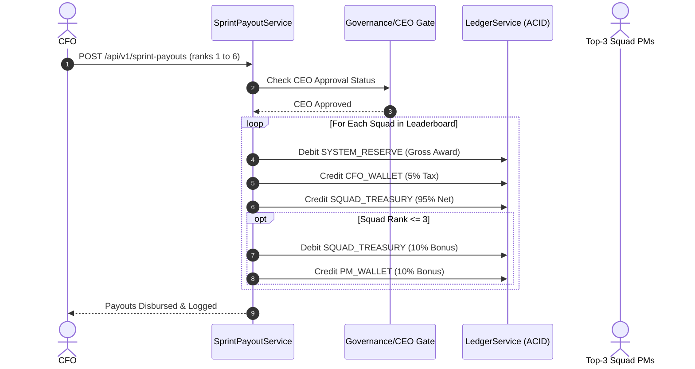

# Pointfex ERP — CFO & Central Banking Specification

> **Module:** CFO Module (Central Bank, Venture Capital, & Treasury Engine)  
> **Status:** Production Specification  
> **Target Audience:** CFO, Backend Engineers, Financial Auditors  
> **Revision:** 2.0.0

---

## 1. Role Overview & Financial Engine Architecture

The Chief Financial Officer (CFO) operates Pointfex's central banking system, liquidity reserves, and internal venture capital market. The CFO is not merely an accountant; they act as an active market participant with private capital who can invest, lend, and collect protocol revenue.

### 1.1 CFO Personal Revenue Streams
The CFO personal wallet (`PERSONAL_WALLET`) accumulates capital through four deterministic protocol incentives:
1. **Sprint Payout Protocol Tax (5%):** Automatically deducted from every squad's gross sprint award before crediting their treasury.
2. **Emergency Loan Interest (15%):** Collected entirely into the CFO wallet when borrowing squads repay their principal.
3. **Venture Equity Dividends (10%):** Paid out whenever an equity-backed squad recognizes revenue from sprint payouts or real-client milestones.
4. **Penalty Collection Commissions (20%):** Automatically cut from fines levied by the CEO, CTO, or CPO for deadline misses, slacking, or code smells.

---

## 2. Business Rules & Financial Assertions

### 2.1 Sprint Payout Engine
* **BR-CFO-01:** At the conclusion of each sprint, the CFO submits a ranked leaderboard of all active squads from 1st to $N$th place.
* **BR-CFO-02:** No two squads may share the same rank. A strict linear ordering is enforced.
* **BR-CFO-03:** Payout allocations are determined dynamically from `SystemSettings` (Default 6-squad distribution: 1st: ৳50,000, 2nd: ৳35,000, 3rd: ৳25,000, 4th: ৳20,000, 5th: ৳15,000, 6th: ৳5,000; Total Pool: ৳150,000).
* **BR-CFO-04:** The system automatically deducts `CFO_TAX_RATE` (default 5%) from each gross payout. The net amount credits the squad treasury; the tax credits the CFO wallet in a single atomic transaction.
* **BR-CFO-05:** For squads finishing in the top 3 (1st, 2nd, 3rd), the system automatically triggers a **10% PM Leadership Bonus** (`PM_LEADERSHIP_BONUS_RATE`) deducted from the squad's post-tax payout and credited to the PM's personal wallet.
* **BR-CFO-06:** The sprint payout requires final approval from the CEO (`ceoApproved = true`) before the ledger executes the transfers from `SYSTEM_RESERVE`.



### 2.2 Emergency Lending Facility
* **BR-CFO-07:** Squads whose treasury falls below ৳15,000 may submit an emergency loan application.
* **BR-CFO-08:** Loan approval requires a **2-of-3 Board Decision** (CFO + CTO/CPO) followed by CEO sign-off.
* **BR-CFO-09:** Interest is fixed at `LOAN_INTEREST_RATE` (default 15%). Total Due = $\text{Principal} \times 1.15$.
* **BR-CFO-10:** Upon repayment, the principal returns to the liquidity source (`SYSTEM_RESERVE` or `CFO_WALLET`), and the entire 15% interest is routed directly into the CFO's personal wallet.
* **BR-CFO-11:** If a squad fails to repay its loan by the conclusion of the following sprint, the loan transitions to `DEFAULTED`, the squad is flagged `BANKRUPT_RISK`, and non-essential spending is locked.
* **BR-CFO-12:** A squad with an active, unpaid loan cannot apply for additional loans.

### 2.3 Venture Investing & Equity Trading
* **BR-CFO-13:** During the planning phase of any sprint, the CFO may purchase a **10% equity stake** (`EQUITY_STAKE_PERCENT`) in up to two squads using personal wallet funds.
* **BR-CFO-14:** Equity purchase funds transfer directly from the CFO's `PERSONAL_WALLET` into the target squad's `SQUAD_TREASURY`.
* **BR-CFO-15:** For the duration of the stake, whenever the target squad receives net revenue (sprint payouts or real-client milestone releases), an automated **10% dividend** is deducted and credited to the CFO wallet.
* **BR-CFO-16:** If an equity-backed squad defaults into bankruptcy, the stake is marked inactive, and the invested capital is lost.

---

## 3. CFO Dashboard & Real-Time Analytics

The CFO control center streams live balance feeds via Socket.io:
1. **Studio Cash Overview:** Total circulating currency across all 6 squads + system reserves.
2. **Squad Runway & Burn Matrix:** Displays trailing burn rate, remaining weeks of runway, and insolvency indicators.
3. **Loan Book Registry:** Real-time status of all active, repaid, and defaulted emergency debts.
4. **Venture Equity Portfolio:** Active stakes, cumulative dividends received, and return on investment (ROI).
5. **Fee & Tax Stream:** Breakdown of CFO wallet accumulation from taxes, interest, dividends, and fines.

---

## 4. API Endpoints Specification

### API-CFO-01: Disburse Sprint Pool
* **Method & Path:** `POST /api/v1/sprint-payouts`
* **Access Role:** `CFO`
* **Headers:** `X-Idempotency-Key: <UUID>`
* **Request Body:**
```json
{
  "sprintNumber": 2,
  "rankings": [
    { "squadId": "uuid-squad-1", "rank": 1 },
    { "squadId": "uuid-squad-4", "rank": 2 },
    { "squadId": "uuid-squad-2", "rank": 3 },
    { "squadId": "uuid-squad-3", "rank": 4 },
    { "squadId": "uuid-squad-6", "rank": 5 },
    { "squadId": "uuid-squad-5", "rank": 6 }
  ]
}
```
* **Success Response (201 Created):**
```json
{
  "success": true,
  "data": {
    "sprintNumber": 2,
    "totalPoolDisbursed": 150000.00,
    "cfoTaxCollected": 7500.00,
    "pmBonusesDisbursed": 11000.00,
    "disbursedAt": "2026-10-29T12:00:00.000Z"
  }
}
```
* **Error Responses:**
  * `400 Bad Request`: Duplicate ranks provided or squad count mismatch.
  * `403 Forbidden`: CEO has not approved the payout proposal.
  * `409 Conflict`: Payout already executed for this sprint.

### API-CFO-02: Approve Emergency Loan
* **Method & Path:** `POST /api/v1/loans/:id/approve`
* **Access Role:** `CFO`
* **Headers:** `X-Idempotency-Key: <UUID>`
* **Success Response (200 OK):**
```json
{
  "success": true,
  "data": {
    "loanId": "uuid-loan-7",
    "borrowerSquadId": "uuid-squad-4",
    "principalAmount": 20000.00,
    "interestRate": 0.15,
    "totalDue": 23000.00,
    "status": "ACTIVE",
    "dueDate": "2026-11-05T23:59:59.000Z"
  }
}
```

### API-CFO-03: Execute Venture Investment
* **Method & Path:** `POST /api/v1/equity`
* **Access Role:** `CFO`
* **Headers:** `X-Idempotency-Key: <UUID>`
* **Request Body:**
```json
{
  "squadId": "uuid-squad-2",
  "investedAmount": 15000.00,
  "sprintNumber": 3
}
```
* **Success Response (201 Created):**
```json
{
  "success": true,
  "data": {
    "stakeId": "uuid-stake-1",
    "investorId": "uuid-cfo",
    "squadId": "uuid-squad-2",
    "stakePercent": 0.10,
    "investedAmount": 15000.00,
    "isActive": true
  }
}
```

---

## 5. NestJS Implementation Blueprint

```typescript
// src/modules/loans/loans.service.ts
import { Injectable, BadRequestException, ConflictException, ForbiddenException } from '@nestjs/common';
import { PrismaService } from '../../prisma/prisma.service';
import { LedgerService } from '../ledger/ledger.service';
import { TransactionType } from '@prisma/client';

@Injectable()
export class LoansService {
  constructor(
    private readonly prisma: PrismaService,
    private readonly ledger: LedgerService,
  ) {}

  async disburseLoan(loanId: string, cfoUserId: string, idempotencyKey: string) {
    const loan = await this.prisma.loan.findUnique({
      where: { id: loanId },
      include: { borrowerSquad: { include: { account: true } } },
    });

    if (!loan || loan.status !== 'ACTIVE' || loan.disbursedAt) {
      throw new BadRequestException('Loan not found or already disbursed.');
    }

    if (!loan.ceoApproved) {
      throw new ForbiddenException('Cannot disburse loan without CEO approval.');
    }

    const systemReserve = await this.prisma.account.findFirst({
      where: { type: 'SYSTEM_RESERVE' },
    });

    if (!systemReserve || !loan.borrowerSquad.account) {
      throw new BadRequestException('Required accounts do not exist.');
    }

    // Execute transfer from SYSTEM_RESERVE to SQUAD_TREASURY
    await this.ledger.executeDoubleEntryTransfer({
      senderAccountId: systemReserve.id,
      recipientAccountId: loan.borrowerSquad.account.id,
      amount: Number(loan.principalAmount),
      referenceType: TransactionType.LOAN_DISBURSEMENT,
      referenceId: loan.id,
      description: `Emergency loan disbursement for ${loan.borrowerSquad.name}`,
      idempotencyKey,
      authorizedById: cfoUserId,
    });

    return await this.prisma.loan.update({
      where: { id: loanId },
      data: {
        disbursedAt: new Date(),
        dueDate: new Date(Date.now() + 7 * 24 * 60 * 60 * 1000), // Due next sprint
      },
    });
  }

  async repayLoan(loanId: string, squadPmUserId: string, idempotencyKey: string) {
    const loan = await this.prisma.loan.findUnique({
      where: { id: loanId },
      include: { borrowerSquad: { include: { account: true } } },
    });

    if (!loan || loan.status !== 'ACTIVE') {
      throw new ConflictException('Loan is not in an active repayable state.');
    }

    const cfoUser = await this.prisma.user.findFirst({
      where: { role: 'CFO' },
      include: { account: true },
    });
    const systemReserve = await this.prisma.account.findFirst({
      where: { type: 'SYSTEM_RESERVE' },
    });

    if (!cfoUser?.account || !systemReserve || !loan.borrowerSquad.account) {
      throw new BadRequestException('Settlement accounts missing.');
    }

    // 1. Repay Principal -> SYSTEM_RESERVE
    await this.ledger.executeDoubleEntryTransfer({
      senderAccountId: loan.borrowerSquad.account.id,
      recipientAccountId: systemReserve.id,
      amount: Number(loan.principalAmount),
      referenceType: TransactionType.LOAN_REPAYMENT,
      referenceId: loan.id,
      description: `Principal repayment for loan ${loan.id}`,
      idempotencyKey: `${idempotencyKey}_principal`,
      authorizedById: squadPmUserId,
    });

    // 2. Repay Interest (15%) -> CFO_WALLET
    await this.ledger.executeDoubleEntryTransfer({
      senderAccountId: loan.borrowerSquad.account.id,
      recipientAccountId: cfoUser.account.id,
      amount: Number(loan.interestAmount),
      referenceType: TransactionType.LOAN_REPAYMENT,
      referenceId: loan.id,
      description: `Interest earnings for CFO on loan ${loan.id}`,
      idempotencyKey: `${idempotencyKey}_interest`,
      authorizedById: squadPmUserId,
    });

    return await this.prisma.loan.update({
      where: { id: loanId },
      data: { status: 'REPAID', repaidAt: new Date() },
    });
  }
}
```

---

## 6. Edge Cases & Failure Recovery
1. **Squad Insolvency on Loan Due Date:** If the borrower squad's balance is less than `totalDue`, the loan automatically flags as `DEFAULTED`. The system sends an escalation alert to the CEO to trigger a bail-in, squad restructuring, or forced asset liquidation.
2. **Simultaneous Equity Dividend Deduction:** Handled sequentially through database row locks on the squad account, preventing duplicate dividend payouts.
3. **CFO Self-Dealing Prevention:** The CFO cannot unilaterally approve loans or grant debt forgiveness; all loan disbursements require a 2-of-3 board vote and CEO sign-off.
