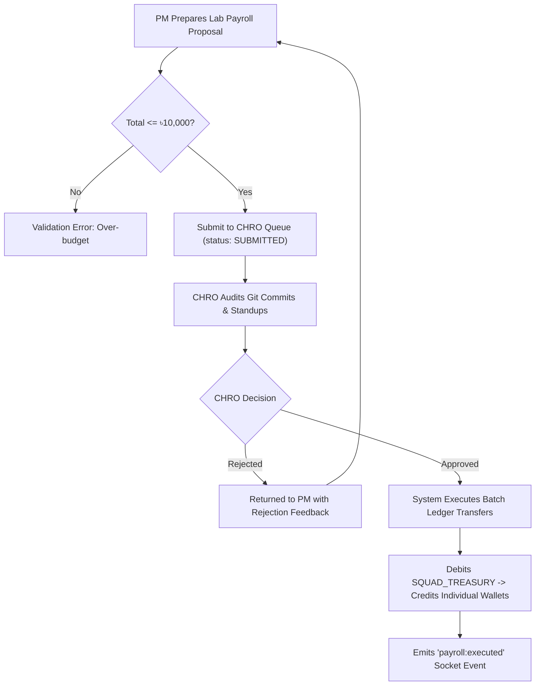

# Pointfex ERP — CHRO & People Operations Specification

> **Module:** CHRO (CPO) Module — Talent Operations, Payroll Engine & E2EE Notices  
> **Status:** Production Specification  
> **Target Audience:** CHRO/CPO, Backend Engineers, Team Leads  
> **Revision:** 2.0.0

---

## 1. Role Overview & People Operations Architecture

The Chief People & Product Officer (CHRO/CPO) oversees organizational design, talent allocation, weekly lab payroll compliance, performance disciplinary enforcement, and secure executive directives.

### 1.1 CHRO Personal Revenue Streams
The CHRO's personal wallet (`PERSONAL_WALLET`) accumulates protocol incentives from administrative enforcement:
1. **Slacker Fine Bounties (৳500 / citation):** Collected whenever the CHRO cites an employee for zero git commits or unexcused standup absence (out of a ৳2,000 fine).
2. **Squad Swap & Firing Processing Cut (20% = ৳1,000):** Paid directly to the CHRO wallet from the ৳5,000 administrative fee charged to squads for processing member transfers or terminations.

---

## 2. Business Rules & Operational Workflows

### 2.1 Talent Registry & Dynamic Squad Topology
* **BR-CHRO-01:** Squad headcounts are elastic (supporting 2 to 10+ members; not rigidly fixed at 5).
* **BR-CHRO-02:** Members can hold **fractional allocations** across multiple squads (e.g., 60% on Squad 1, 40% on Squad 3) via `SquadMembership.allocation` ($\sum \text{allocation} \le 1.0$).
* **BR-CHRO-03:** Each squad must have exactly **one primary Project Manager (`PM`)** (`allocation = 1.0`).
* **BR-CHRO-04:** Developers hold skill tiers (`TIER_A`, `TIER_B`, `TIER_C`, `TIER_D`). The initial studio draft guarantees at least one member from each tier per squad, but squads may subsequently rebalance dynamically.

### 2.2 Weekly Lab Payroll Engine
* **BR-CHRO-05:** Each squad operates on a fixed burn rate ceiling of **৳10,000 per lab** (`WEEKLY_LAB_BUDGET`).
* **BR-CHRO-06:** The squad PM submits a `PayrollProposal` with individual line items allocating funds according to performance tiers:
  * **Star Performer:** ৳3,500
  * **Regular Performer:** ৳2,000
  * **Underperformer:** ৳1,000
  * **Slacker / Absentee:** ৳0
* **BR-CHRO-07:** The sum of all line items must **not exceed ৳10,000**. Any unallocated remainder stays in the squad treasury.
* **BR-CHRO-08:** The CHRO audits each proposal against git commit activity, issue board progress, and standup logs before executing approval.
* **BR-CHRO-09:** Upon CHRO approval, the system executes an automated batch payout: funds debit the `SQUAD_TREASURY` and credit each employee's `PERSONAL_WALLET` in atomic double-entry ledger transactions.
* **BR-CHRO-10:** Only one approved payroll proposal is permitted per squad per lab.



### 2.3 End-to-End Encrypted Secure Notice System (E2EE)
* **BR-CHRO-11:** Only the CHRO and CEO can issue official executive directives and disciplinary notices.
* **BR-CHRO-12:** Notice payloads are encrypted client-side using the recipient's ECDH public key and signed using the sender's Ed25519 private key.
* **BR-CHRO-13:** The backend server and database store **only ciphertext and signatures** (`zero-knowledge`). The server cannot inspect notice bodies.
* **BR-CHRO-14:** Notice Categories:
  * `DISCIPLINARY`: Red banner, mandatory signed acknowledgment required within 48 hours.
  * `APPOINTMENT`: Role changes, promotion confirmations, and appointment letters.
  * `ORGANIZATIONAL`: Squad restructuring, transfers, and announcements.
  * `STUDIO_DIRECTIVE`: Studio-wide rules and CEO decrees.
* **BR-CHRO-15:** Recipients must acknowledge receipt by signing an ACK hash. Unacknowledged disciplinary notices trigger an automated escalation alert to the CEO after 48 hours.

### 2.4 Slacker Detection & Fine Enforcement
* **BR-CHRO-16:** The CHRO reviews commit frequency and standup attendance each lab session.
* **BR-CHRO-17:** A developer with zero commits or an unexcused absence is cited with a `SLACKER_FINE` (**৳2,000**).
* **BR-CHRO-18:** **৳500** routes to the CHRO's `PERSONAL_WALLET` as an enforcement bounty; **৳1,500** routes to the `SYSTEM_RESERVE`.
* **BR-CHRO-19:** Fines are deducted from the employee's personal wallet. If the wallet has insufficient funds, the balance is deducted from the squad treasury, and the developer's wallet balance is locked.

### 2.5 Squad Swaps & Terminations
* **BR-CHRO-20:** A PM can petition to fire an unproductive member or swap members between squads.
* **BR-CHRO-21:** Requires a ৳5,000 administrative fee charged to the requesting squad's treasury.
* **BR-CHRO-22:** 20% (৳1,000) is deposited into the CHRO's personal wallet; 80% (৳4,000) credits `SYSTEM_RESERVE`.
* **BR-CHRO-23:** Swaps require a **2-of-3 Board Decision** and final CEO approval before roster records are updated.

---

## 3. CHRO Dashboard & Operations Suite

1. **Studio-Wide Talent Roster:** Interactive table showing all 33 students, their skill tiers, allocations, and active squad assignments.
2. **Weekly Payroll Approval Queue:** Side-by-side view comparing PM proposed payouts with real git activity metrics and DPI scores.
3. **Encrypted Notice Dispatcher:** Web-crypto interface enabling client-side encryption and Ed25519 signing.
4. **Disciplinary & Slacker Registry:** Log of all citations, attached commit diff screenshots, and acknowledgment statuses.
5. **People & Product Score Input:** Form to submit sprint teamwork and agile maturity scores (0–100) per squad.

---

## 4. API Endpoints Specification

### API-CHRO-01: Submit Payroll Proposal
* **Method & Path:** `POST /api/v1/payroll`
* **Access Role:** `PM`
* **Request Body:**
```json
{
  "squadId": "uuid-squad-1",
  "labNumber": 3,
  "sprintNumber": 2,
  "lineItems": [
    { "userId": "uuid-dev-1", "tier": "STAR_PERFORMER", "amount": 3500.00, "justification": "Completed auth module" },
    { "userId": "uuid-dev-2", "tier": "REGULAR", "amount": 2000.00, "justification": "Delivered CRUD views" },
    { "userId": "uuid-dev-3", "tier": "REGULAR", "amount": 2000.00, "justification": "Fixed UI responsive bugs" },
    { "userId": "uuid-dev-4", "tier": "UNDERPERFORMER", "amount": 1000.00, "justification": "Slow velocity on tickets" },
    { "userId": "uuid-pm-1", "tier": "REGULAR", "amount": 1500.00, "justification": "Sprint planning & scrum" }
  ]
}
```
* **Success Response (201 Created):**
```json
{
  "success": true,
  "data": {
    "proposalId": "uuid-payroll-12",
    "totalProposed": 10000.00,
    "status": "SUBMITTED"
  }
}
```

### API-CHRO-02: Approve Payroll & Disburse
* **Method & Path:** `POST /api/v1/payroll/:id/approve`
* **Access Role:** `CPO`
* **Headers:** `X-Idempotency-Key: <UUID>`
* **Success Response (200 OK):**
```json
{
  "success": true,
  "data": {
    "proposalId": "uuid-payroll-12",
    "status": "APPROVED",
    "disbursedAmount": 10000.00,
    "recipientsCount": 5,
    "executedAt": "2026-10-29T12:30:00.000Z"
  }
}
```

### API-CHRO-03: Dispatch Encrypted Notice
* **Method & Path:** `POST /api/v1/notices`
* **Access Role:** `CPO`, `CEO`
* **Request Body:**
```json
{
  "recipientId": "uuid-dev-4",
  "title": "Disciplinary Citation: Lab 3 Non-Attendance",
  "encryptedContent": "base64-aes-256-gcm-ciphertext",
  "category": "DISCIPLINARY",
  "signature": "base64-ed25519-signature"
}
```
* **Success Response (201 Created):**
```json
{
  "success": true,
  "data": {
    "noticeId": "uuid-notice-99",
    "status": "DISPATCHED",
    "dispatchedAt": "2026-10-29T12:35:00.000Z"
  }
}
```

### API-CHRO-04: Issue Slacker Fine
* **Method & Path:** `POST /api/v1/fines/slacker`
* **Access Role:** `CPO`
* **Headers:** `X-Idempotency-Key: <UUID>`
* **Request Body:**
```json
{
  "targetUserId": "uuid-dev-4",
  "targetSquadId": "uuid-squad-1",
  "reason": "Zero commits and missed standup during Lab 3",
  "evidenceUrl": "https://pointfex.storage/evidence/commit-audit-lab3.png"
}
```
* **Success Response (201 Created):**
```json
{
  "success": true,
  "data": {
    "fineAmount": 2000.00,
    "cpoBounty": 500.00,
    "reserveDeposit": 1500.00,
    "issuedAt": "2026-10-29T12:40:00.000Z"
  }
}
```

---

## 5. NestJS Implementation Blueprint

```typescript
// src/modules/payroll/payroll.service.ts
import { Injectable, BadRequestException, ConflictException, ForbiddenException } from '@nestjs/common';
import { PrismaService } from '../../prisma/prisma.service';
import { LedgerService } from '../ledger/ledger.service';
import { TransactionType } from '@prisma/client';

@Injectable()
export class PayrollService {
  constructor(
    private readonly prisma: PrismaService,
    private readonly ledger: LedgerService,
  ) {}

  async approveAndDisburse(proposalId: string, cpoUserId: string, idempotencyKey: string) {
    const proposal = await this.prisma.payrollProposal.findUnique({
      where: { id: proposalId },
      include: {
        squad: { include: { account: true } },
        lineItems: { include: { user: { include: { account: true } } } },
      },
    });

    if (!proposal || proposal.status !== 'SUBMITTED') {
      throw new ConflictException('Proposal not found or is not in SUBMITTED state.');
    }

    if (!proposal.squad.account) {
      throw new BadRequestException('Squad treasury account missing.');
    }

    // Execute atomic sequential disbursements to member personal wallets
    for (const [index, item] of proposal.lineItems.entries()) {
      if (Number(item.amount) > 0) {
        if (!item.user.account) {
          throw new BadRequestException(`User ${item.user.id} has no personal wallet.`);
        }

        await this.ledger.executeDoubleEntryTransfer({
          senderAccountId: proposal.squad.account.id,
          recipientAccountId: item.user.account.id,
          amount: Number(item.amount),
          referenceType: TransactionType.PAYROLL,
          referenceId: proposal.id,
          description: `Lab ${proposal.labNumber} salary for ${item.user.fullName} (${item.tier})`,
          idempotencyKey: `${idempotencyKey}_item_${index}`,
          authorizedById: cpoUserId,
        });
      }
    }

    return await this.prisma.payrollProposal.update({
      where: { id: proposalId },
      data: {
        status: 'APPROVED',
        approvedById: cpoUserId,
      },
    });
  }
}
```

---

## 6. Edge Cases & Resilience Rules
1. **Unacknowledged Notices:** If a disciplinary notice remains in `DISPATCHED` state after 48 hours without a signed ACK receipt, BullMQ queues an automated escalation event alerting the CEO dashboard.
2. **Squad Balance Deficit during Payroll:** If the squad treasury has less than the proposed amount (e.g. ৳8,000 balance for a ৳10,000 payroll), the transaction aborts with `LEDGER_INSUFFICIENT_FUNDS`, and the squad is directed to apply for an emergency loan.
3. **Concurrent Proposals:** The composite unique constraint `@@unique([squadId, labNumber])` on `PayrollProposal` prevents race conditions from creating duplicate proposals for the same lab.
