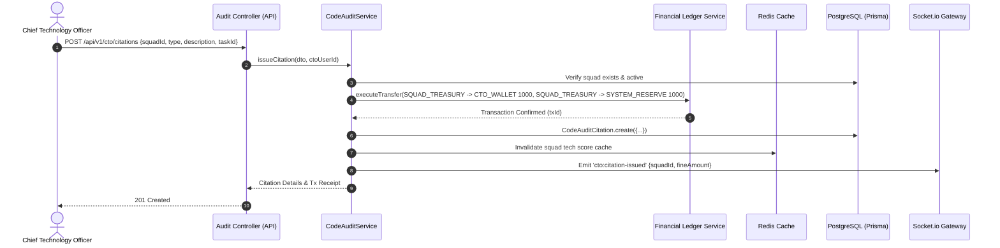
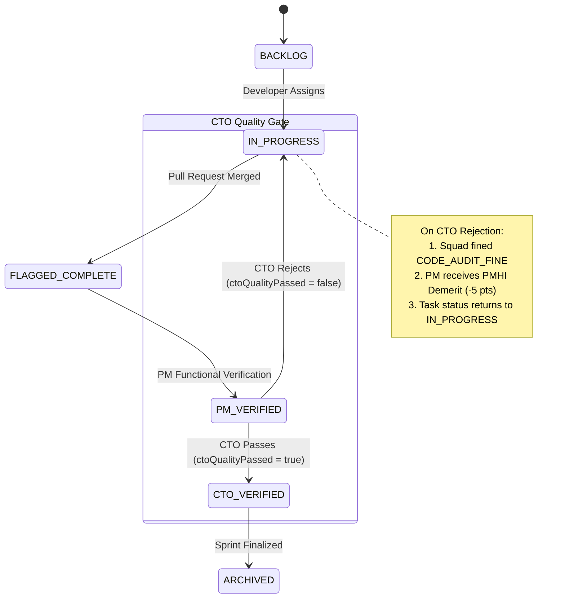
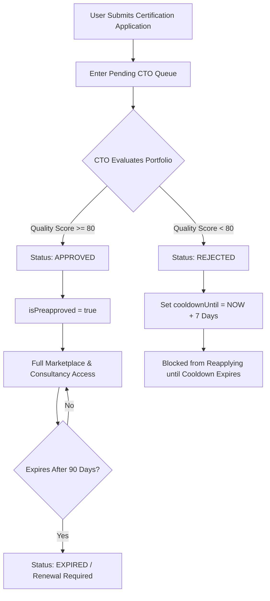
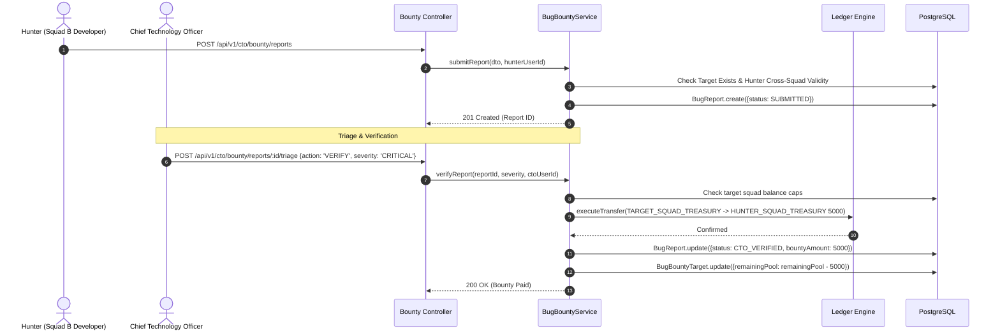
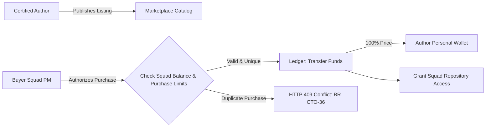
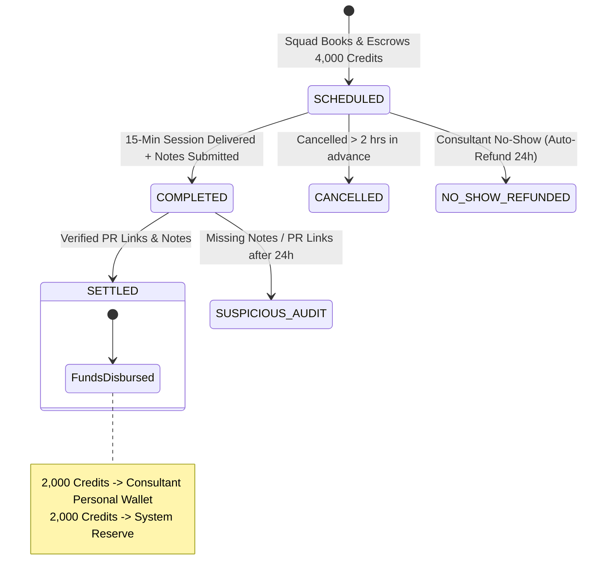
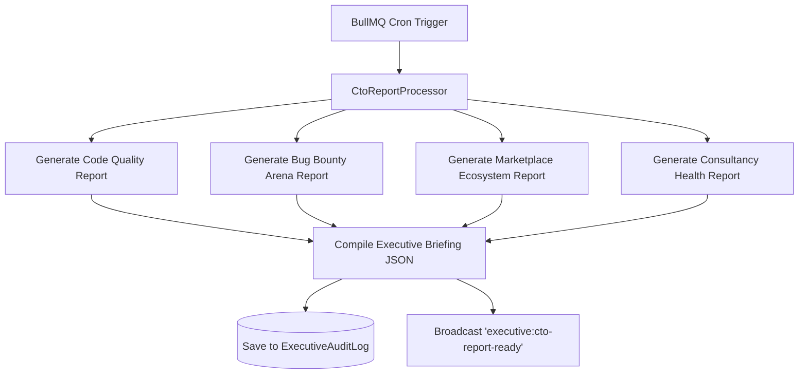

# CTO Module Specification

## 1. Executive Overview & Architectural Mandate

### 1.1 Role Overview
The Chief Technology Officer (CTO) & Chief Architect serves as the supreme technical quality gatekeeper, market ecosystem operator, and adversarial security administrator within the Pointfex ERP Venture Studio platform. 

Unlike executive peers whose authority primarily governs financial capital ([cfo.md §2.1](file:///c:/Users/USERAS/Desktop/ai%20project%20mbh/docs/cfo.md)) or strategic product-market alignment ([cpo.md §1.2](file:///c:/Users/USERAS/Desktop/ai%20project%20mbh/docs/cpo.md)), the CTO holds absolute domain over code integrity, architectural adherence, technical debt penalization, developer tooling distribution, and cross-squad adversarial vulnerability discovery.

The CTO module governs four interconnected operational pillars:
1. **Code Audit & Citation Engine**: Mandatory weekly and on-demand repository reviews, levying automated financial fines for anti-patterns, security risks, and architectural drift.
2. **Task CTO Secondary Verification Gate**: Final technical quality verification following Project Manager (PM) operational acceptance, enforcing test coverage, static analysis standards, and penalizing PM rubber-stamping.
3. **Quality Gate & Provider Certification**: The centralized credentialing bottleneck that controls whether any user across the studio is authorized to sell boilerplate assets or offer paid technical consultancy.
4. **Adversarial Bug Bounty Arena**: A competitive cross-squad vulnerability marketplace where security researchers audit competitor squad software, draining target squad treasuries while funding hunter treasuries.

```
+--------------------------------------------------------------------------------------------------+
|                                    CTO EXECUTIVE CONTROL PLANE                                   |
+--------------------------------------------------------------------------------------------------+
         |                                |                               |
         v                                v                               v
+------------------+            +-------------------+           +-------------------+
|  Quality Gate &  |            |    Code Audit     |           | Bug Bounty Arena  |
|  Certifications  |            |   & Citations     |           |  (Cross-Squad)    |
| (Score >= 80)    |            | (2,000 Fine/Cut)  |           | (Adversarial Pool)|
+------------------+            +-------------------+           +-------------------+
         |                                |                               |
         | Enables                        | Levies                        | Deducts
         v                                v                               v
+------------------+            +-------------------+           +-------------------+
| Marketplace &    |            | Squad Treasury &  |           | Target Squad      |
| Paid Consultancy |            | CTO Wallet Cut    |           | vs Hunter Squad   |
+------------------+            +-------------------+           +-------------------+
```

### 1.2 Two-Tier Economy Integration & CTO Personal Wallet Inflows
Pointfex operates a strict two-tier economic model consisting of **Squad Treasuries** (corporate capital allocated to squads) and **Personal Wallets** (individual user earnings). All ledger movements are mediated by the double-entry accounting engine ([ledger.md §3.1](file:///c:/Users/USERAS/Desktop/ai%20project%20mbh/docs/ledger.md)).

The CTO holds unique financial privileges that align personal wealth accumulation with uncompromising studio code quality:
* **Code Audit Fine Cut**: For every valid citation issued to a squad, the squad treasury is penalized `CODE_AUDIT_FINE` (2,000 credits). The CTO receives `CTO_AUDIT_FINE_CUT` (1,000 credits) directly into their personal wallet; the remaining 1,000 credits are swept into the `SYSTEM_RESERVE`.
* **Personal Consultancy Engagements**: When the CTO conducts 15-minute architecture office hours, the hiring squad pays `CONSULTANCY_FEE` (4,000 credits). The CTO personal wallet receives `CTO_CONSULTANCY_CUT_RATE` (50% = 2,000 credits), with 2,000 credits allocated to `SYSTEM_RESERVE`.
* **Proprietary Marketplace Boilerplates**: The CTO can publish official framework starters, DevOps scripts, and base libraries. Purchases by squads credit 100% of the sale price to the author's personal wallet.
* **Reverse Penalty Exposure**: To prevent fraudulent fine farming, if the CEO or an external security audit identifies an exploited vulnerability or critical design defect in code that the CTO audited and passed, the CTO is subjected to an executive reverse penalty: 4,000 credits are deducted directly from the CTO personal wallet and surrendered to the `SYSTEM_RESERVE`.

### 1.3 Squad Tech Score Concept
The CTO assigns every squad a **Tech Score** ($S_{tech} \in [0, 100]$) at the conclusion of each sprint cycle. The Tech Score is a composite, objective metric that reflects code quality, test reliability, architectural stability, and security posture.

The Tech Score formula is evaluated deterministically as follows:

$$S_{tech} = \max\left(0, \min\left(100, 100 - D_{citations} - D_{bounties} + B_{coverage} - D_{rejections}\right)\right)$$

Where:
* $D_{citations} = \sum (\text{Citations} \times 5)$ : Points lost from issued Code Audit Citations.
* $D_{bounties} = \sum (\text{Verified Critical Bugs} \times 10) + \sum (\text{Verified Major Bugs} \times 5)$: Points lost from vulnerabilities breached by rival squads in the Bug Bounty Arena.
* $B_{coverage} = \begin{cases} +5 & \text{if squad test coverage } \ge 85\% \\ 0 & \text{if } 70\% \le \text{coverage} < 85\% \\ -10 & \text{if coverage } < 70\% \end{cases}$
* $D_{rejections} = \text{CTO Task Rejections} \times 4$: Deductions incurred when the CTO rejects PM-verified tasks for substandard technical craftsmanship.

#### Tech Score Tiers and Squad Operational Impact
| Tech Score Tier | Score Range | Operational Consequence | Squad Valuation Multiplier |
| :--- | :--- | :--- | :--- |
| **Tier S (Elite)** | $90 - 100$ | Priority marketplace listing display; +15% squad seed funding bonus | $1.25\times$ |
| **Tier A (Sound)** | $75 - 89$ | Standard operational clearance; full consultancy access | $1.00\times$ |
| **Tier B (At Risk)** | $60 - 74$ | Mandatory CTO architectural audit on all PRs; -10% equity grant cut | $0.85\times$ |
| **Tier C (Degraded)**| $40 - 59$ | Squad treasury blocked from dividend payouts; weekly audit fines doubled | $0.60\times$ |
| **Tier F (Critical)**| $0 - 39$ | Squad feature freeze; PM and Tech Lead summoned to executive review | $0.25\times$ |

### 1.4 System Settings & Financial Constants
All economic parameters are dynamically configurable via the `SystemSettings` table managed by executive consensus ([governance.md §4.1](file:///c:/Users/USERAS/Desktop/ai%20project%20mbh/docs/governance.md)).

| Constant Key | Data Type | Default Value | Description |
| :--- | :--- | :--- | :--- |
| `CODE_AUDIT_FINE` | `INTEGER` | `2000` | Squad treasury penalty per issued citation (Configurable via SystemSettings, default: 2000) |
| `CTO_AUDIT_FINE_CUT` | `INTEGER` | `1000` | Share of citation fine paid into CTO personal wallet (Configurable via SystemSettings, default: 1000) |
| `CONSULTANCY_FEE` | `INTEGER` | `4000` | Fee charged to squad treasury for a 15-minute consultancy session (Configurable via SystemSettings, default: 4000) |
| `CTO_CONSULTANCY_CUT_RATE` | `FLOAT` | `0.50` | Share of consultancy fee paid to consultant wallet (Configurable via SystemSettings, default: 0.50) |
| `CRITICAL_BUG_BOUNTY` | `INTEGER` | `5000` | Payout for verified critical vulnerability (Configurable via SystemSettings, default: 5000) |
| `MAJOR_BUG_BOUNTY` | `INTEGER` | `3000` | Payout for verified major functional/security defect (Configurable via SystemSettings, default: 3000) |
| `MINOR_BUG_BOUNTY` | `INTEGER` | `1000` | Payout for verified minor UI/logic defect (Configurable via SystemSettings, default: 1000) |
| `LOW_BUG_BOUNTY` | `INTEGER` | `500` | Payout for cosmetic/documentation defect (Configurable via SystemSettings, default: 500) |
| `BLIND_QA_PENALTY` | `INTEGER` | `15000` | Squad fine for zero-defect milestone submissions or blind approval (Configurable via SystemSettings, default: 15000) |
| `REVERSE_AUDIT_FINE` | `INTEGER` | `4000` | CTO personal wallet fine for missed critical defects (Configurable via SystemSettings, default: 4000) |
| `MAX_CONSULTANCY_SESSIONS_PER_USER_PER_WEEK` | `INTEGER` | `2` | Max sessions a certified consultant may conduct weekly (Configurable via SystemSettings, default: 2) |
| `MAX_MARKETPLACE_PURCHASES_PER_SQUAD_PER_ASSET`| `INTEGER` | `1` | Max times a squad may purchase the same asset (Configurable via SystemSettings, default: 1) |
| `MAX_BUG_BOUNTY_CLAIMS_PER_USER_PER_SPRINT` | `INTEGER` | `5` | Maximum bounties a hunter can claim in a sprint (Configurable via SystemSettings, default: 5) |
| `BUG_BOUNTY_CAP_PERCENT_OF_TARGET_BALANCE` | `FLOAT` | `0.25` | Max percentage of squad treasury extractable via bounties/sprint (Configurable via SystemSettings, default: 0.25) |
| `CROSS_SQUAD_BOUNTY_COOLDOWN_SPRINTS` | `INTEGER` | `2` | Sprints a developer must wait after leaving a squad before hunting it (Configurable via SystemSettings, default: 2) |
| `CERTIFICATION_PASS_THRESHOLD` | `INTEGER` | `80` | Minimum score required for provider preapproval (Configurable via SystemSettings, default: 80) |
| `CERTIFICATION_COOLDOWN_DAYS` | `INTEGER` | `7` | Mandatory waiting period following certification rejection (Configurable via SystemSettings, default: 7) |
| `CERTIFICATION_VALIDITY_DAYS` | `INTEGER` | `90` | Lifetime of granted provider certification (Configurable via SystemSettings, default: 90) |

### 1.5 CTO Module Permission Matrix
The following matrix defines the access control rights across platform personas for all CTO operations:

| Operation / Capability | CEO | CFO | CTO | CPO | PM | DEVELOPER | Guard / Prerequisite |
| :--- | :---: | :---: | :---: | :---: | :---: | :---: | :--- |
| **Issue Code Audit Citation** | View | View | **Execute** | View | View | View | `@Roles('CTO')` |
| **Reverse Penalty on CTO** | **Execute** | View | Audit | - | - | - | `@Roles('CEO')` |
| **Verify / Pass Task (Secondary)** | Override | - | **Execute** | - | - | - | `@Roles('CTO')` (Task in `PM_VERIFIED`) |
| **Reject Task (Secondary)** | Override | - | **Execute** | - | - | - | `@Roles('CTO')` (Task in `PM_VERIFIED`) |
| **Apply for Certification** | Yes | Yes | Auto | Yes | Yes | Yes | Authenticated, Cooldown expired |
| **Review / Score Certification** | Audit | - | **Execute** | - | - | - | `@Roles('CTO')` |
| **Create Bug Bounty Target** | Yes | - | **Execute** | - | Yes | - | Funded from Target Squad or Milestone |
| **Submit Bug Report** | - | - | Yes | - | - | **Execute** | Cross-Squad check (`hunterSquad != targetSquad`) |
| **Triage & Pay Bug Bounty** | Audit | Audit | **Execute** | - | - | - | `@Roles('CTO')` |
| **Create Marketplace Listing** | - | - | **Auto** | - | Cert | Cert | `@RequireCertification('MARKETPLACE_AUTHOR')` |
| **Purchase Marketplace Asset** | Audit | Audit | Yes | - | **Execute** | - | Squad Treasury balance verification |
| **Delist Marketplace Asset** | Yes | - | **Execute** | - | - | - | `@Roles('CTO')` |
| **Offer Consultancy Slot** | - | - | **Auto** | - | Cert | Cert | `@RequireCertification('CONSULTANT')` |
| **Book Consultancy Session** | - | - | Yes | - | **Execute** | - | Escrow from Squad Treasury |
| **Complete Consultancy Session** | - | - | Yes | - | - | - | Assigned Consultant (min 50 words + PR) |
| **View Dashboard / Tech Scores** | Yes | Yes | **Full** | Yes | Yes | Yes | Authenticated JWT |
| **Trigger Automated Reports** | Yes | - | **Execute** | - | - | - | `@Roles('CTO', 'CEO')` |

### 1.6 Fee, Fine, & Bounty Schedule
All monetary values are denominated in Studio Credits and dynamically controlled by SystemSettings.

| Fee / Penalty Type | Amount (Credits) | Source Account | Destination Account | SystemSettings Key |
| :--- | :--- | :--- | :--- | :--- |
| **Code Audit Citation Fine** | 2,000 | `SQUAD_TREASURY` | `PERSONAL_WALLET` (1,000) + `SYSTEM_RESERVE` (1,000) | `CODE_AUDIT_FINE`, `CTO_AUDIT_FINE_CUT` |
| **CEO Reverse Audit Penalty** | 4,000 | `PERSONAL_WALLET` (CTO) | `SYSTEM_RESERVE` | `REVERSE_AUDIT_FINE` |
| **Task Rejection Fine** | 2,000 | `SQUAD_TREASURY` | `PERSONAL_WALLET` (1,000) + `SYSTEM_RESERVE` (1,000) | `CODE_AUDIT_FINE` |
| **Consultancy Fee (15 min)** | 4,000 | `SQUAD_TREASURY` | `PERSONAL_WALLET` (2,000) + `SYSTEM_RESERVE` (2,000) | `CONSULTANCY_FEE`, `CTO_CONSULTANCY_CUT_RATE` |
| **Critical Bug Bounty** | 5,000 | `SQUAD_TREASURY` (Target) | `SQUAD_TREASURY` (Hunter) | `CRITICAL_BUG_BOUNTY` |
| **Major Bug Bounty** | 3,000 | `SQUAD_TREASURY` (Target) | `SQUAD_TREASURY` (Hunter) | `MAJOR_BUG_BOUNTY` |
| **Minor Bug Bounty** | 1,000 | `SQUAD_TREASURY` (Target) | `SQUAD_TREASURY` (Hunter) | `MINOR_BUG_BOUNTY` |
| **Low Bug Bounty** | 500 | `SQUAD_TREASURY` (Target) | `SQUAD_TREASURY` (Hunter) | `LOW_BUG_BOUNTY` |
| **Blind QA Penalty** | 15,000 | `SQUAD_TREASURY` | `SYSTEM_RESERVE` | `BLIND_QA_PENALTY` |

### 1.7 Status Transition Matrices

#### Task Quality Gate Transitions
| Initial Status | Event / Trigger | Actor | Target Status | Side Effects |
| :--- | :--- | :--- | :--- | :--- |
| `FLAGGED_COMPLETE` | PM Verification | PM | `PM_VERIFIED` | Functional sign-off recorded |
| `PM_VERIFIED` | CTO Audit Pass | CTO | `CTO_VERIFIED` | `ctoQualityPassed=true`, unlocks task archiving |
| `PM_VERIFIED` | CTO Audit Reject | CTO | `IN_PROGRESS` | `ctoQualityPassed=false`, 2000 fine levied, PM PMHI -5 |
| `CTO_VERIFIED` | Sprint Finalization | System | `ARCHIVED` | Task points credited to squad velocity |

#### Provider Certification Lifecycle Transitions
| Initial Status | Trigger | Actor | Target Status | System Constraints |
| :--- | :--- | :--- | :--- | :--- |
| `NONE` | Submit Application | User | `PENDING` | User must not have active 7-day cooldown |
| `PENDING` | CTO Score $\ge 80$ | CTO | `APPROVED` | `isPreapproved=true`, `expiresAt = NOW + 90d` |
| `PENDING` | CTO Score $< 80$ | CTO | `REJECTED` | `isPreapproved=false`, `cooldownUntil = NOW + 7d` |
| `APPROVED` | Expiry Date Elapsed | System | `EXPIRED` | `isPreapproved=false`, listing creation blocked |
| `APPROVED` | Code Negligence / Malice | CTO | `REVOKED` | Asset delisting, 30-day cooldown |

#### Bug Report Lifecycle Transitions
| Initial Status | Trigger | Actor | Target Status | Financial Settlement |
| :--- | :--- | :--- | :--- | :--- |
| `NONE` | Submit Report | Hunter | `SUBMITTED` | Anti-exploit velocity check (max 5/sprint) |
| `SUBMITTED` | CTO Triage Verify | CTO | `CTO_VERIFIED` | Payout transferred (Target Squad -> Hunter Squad) |
| `SUBMITTED` | CTO Triage Reject | CTO | `REJECTED` | Zero transfer; feedback recorded |
| `CTO_VERIFIED` | Target Squad Patches | Target PM | `RESOLVED` | Bug closed, regression test verified |

#### Consultancy Booking Lifecycle Transitions
| Initial Status | Trigger | Actor | Target Status | Financial Settlement |
| :--- | :--- | :--- | :--- | :--- |
| `NONE` | Book Slot | Client PM | `SCHEDULED` | 4,000 credits escrowed from client squad |
| `SCHEDULED` | Notes & PR Submitted | Consultant | `COMPLETED` | 2,000 -> Consultant Wallet, 2,000 -> System Reserve |
| `SCHEDULED` | Cancelled (> 2h prior)| Client PM | `CANCELLED` | 4,000 credits refunded to client squad |
| `SCHEDULED` | 24h Elapsed, No Notes | System Cron | `NO_SHOW_REFUNDED`| 4,000 credits refunded, consultant demerit |
| `COMPLETED` | Missing Deliverables | CEO / System | `SUSPICIOUS_AUDIT`| Escalated to CEO financial audit |

---

## 2. Prisma Database Schema

The CTO module relies on dedicated relational entities, task status lifecycle hooks, and ledger references defined within the PostgreSQL 16 schema via Prisma ORM.

```prisma
// ========================================================
// ENUMS
// ========================================================

enum CitationType {
  CODE_SMELL
  BAD_MERGE_REQUEST
  SECURITY_VULNERABILITY
  ARCHITECTURE_VIOLATION
  UNTESTED_CODE
}

enum CertificationType {
  CONSULTANT
  MARKETPLACE_AUTHOR
  SECURITY_RESEARCHER
}

enum CertificationStatus {
  PENDING
  APPROVED
  REJECTED
  EXPIRED
  REVOKED
}

enum ConsultancyBookingStatus {
  SCHEDULED
  COMPLETED
  CANCELLED
  NO_SHOW_REFUNDED
  SUSPICIOUS_AUDIT
}

enum BugSeverity {
  CRITICAL
  MAJOR
  MINOR
  LOW
}

enum BugReportStatus {
  SUBMITTED
  TRIAGED
  CTO_VERIFIED
  REJECTED
  RESOLVED
}

enum TaskStatus {
  BACKLOG
  TODO
  IN_PROGRESS
  FLAGGED_COMPLETE
  PM_VERIFIED
  CTO_VERIFIED
  ARCHIVED
}

// ========================================================
// MODELS
// ========================================================

model CodeAuditCitation {
  id             String        @id @default(uuid()) @db.Uuid
  squadId        String        @db.Uuid
  citedById      String        @db.Uuid
  type           CitationType
  description    String        @db.Text
  fineAmount     Int           @default(2000)
  ctoCut         Int           @default(1000)
  taskId         String?       @db.Uuid
  repositoryUrl  String?       @db.VarChar(512)
  commitHash     String?       @db.VarChar(64)
  transactionId  String?       @unique @db.Uuid
  createdAt      DateTime      @default(now()) @db.Timestamptz(6)

  // Relations
  squad          Squad         @relation(fields: [squadId], references: [id], onDelete: Restrict)
  citedBy        User          @relation("CtoCitationsIssued", fields: [citedById], references: [id], onDelete: Restrict)
  task           Task?         @relation(fields: [taskId], references: [id], onDelete: SetNull)

  @@index([squadId, createdAt])
  @@index([citedById])
  @@map("code_audit_citations")
}

model CtoProviderCertification {
  id                String              @id @default(uuid()) @db.Uuid
  userId            String              @db.Uuid
  certificationType CertificationType
  status            CertificationStatus @default(PENDING)
  qualityScore      Int?                // 0 to 100
  isPreapproved     Boolean             @default(false)
  portfolioUrl      String?             @db.VarChar(512)
  applicationNotes  String?             @db.Text
  ctoReviewNotes    String?             @db.Text
  reviewedById      String?             @db.Uuid
  certifiedAt       DateTime?           @db.Timestamptz(6)
  expiresAt         DateTime?           @db.Timestamptz(6)
  cooldownUntil     DateTime?           @db.Timestamptz(6)
  createdAt         DateTime            @default(now()) @db.Timestamptz(6)
  updatedAt         DateTime            @updatedAt @db.Timestamptz(6)

  // Relations
  user              User                @relation(fields: [userId], references: [id], onDelete: Cascade)
  reviewedBy        User?               @relation("CtoCertReviews", fields: [reviewedById], references: [id], onDelete: SetNull)

  @@unique([userId, certificationType])
  @@index([status, isPreapproved])
  @@map("cto_provider_certifications")
}

model BugBountyTarget {
  id                String            @id @default(uuid()) @db.Uuid
  title             String            @db.VarChar(255)
  description       String?           @db.Text
  targetSquadId     String            @db.Uuid
  clientMilestoneId String?           @db.Uuid
  totalBountyPool   Int               // Escrowed from target squad
  remainingPool     Int
  createdById       String            @db.Uuid
  isActive          Boolean           @default(true)
  createdAt         DateTime          @default(now()) @db.Timestamptz(6)
  updatedAt         DateTime          @updatedAt @db.Timestamptz(6)

  // Relations
  targetSquad       Squad             @relation("BountyTargetSquad", fields: [targetSquadId], references: [id], onDelete: Restrict)
  createdBy         User              @relation("BountyTargetCreator", fields: [createdById], references: [id], onDelete: Restrict)
  reports           BugReport[]

  @@index([targetSquadId, isActive])
  @@map("bug_bounty_targets")
}

model BugReport {
  id                 String          @id @default(uuid()) @db.Uuid
  bountyTargetId     String?         @db.Uuid
  reportingUserId    String          @db.Uuid
  reportingSquadId   String          @db.Uuid
  targetSquadId      String          @db.Uuid
  title              String          @db.VarChar(255)
  description        String          @db.Text
  reproductionSteps  String          @db.Text
  proofOfConceptUrl  String?         @db.VarChar(512)
  severity           BugSeverity
  bountyAmount       Int?
  status             BugReportStatus @default(SUBMITTED)
  verifiedByCtoId    String?         @db.Uuid
  verifiedAt         DateTime?       @db.Timestamptz(6)
  rejectionReason    String?         @db.Text
  transactionId      String?         @unique @db.Uuid
  createdAt          DateTime        @default(now()) @db.Timestamptz(6)
  updatedAt          DateTime        @updatedAt @db.Timestamptz(6)

  // Relations
  bountyTarget       BugBountyTarget? @relation(fields: [bountyTargetId], references: [id], onDelete: SetNull)
  reportingUser      User             @relation("BugReporter", fields: [reportingUserId], references: [id], onDelete: Restrict)
  reportingSquad     Squad            @relation("HunterSquadReports", fields: [reportingSquadId], references: [id], onDelete: Restrict)
  targetSquad        Squad            @relation("TargetSquadBugs", fields: [targetSquadId], references: [id], onDelete: Restrict)
  verifiedByCto      User?            @relation("CtoBugVerifications", fields: [verifiedByCtoId], references: [id], onDelete: SetNull)

  @@index([targetSquadId, status])
  @@index([reportingUserId, createdAt])
  @@map("bug_reports")
}

model MarketplaceListing {
  id                        String                @id @default(uuid()) @db.Uuid
  authorId                  String                @db.Uuid
  title                     String                @db.VarChar(255)
  description               String?               @db.Text
  price                     Int
  repositoryUrl             String?               @db.VarChar(512)
  documentationUrl          String?               @db.VarChar(512)
  isCtoVerified             Boolean               @default(false)
  isDelisted                Boolean               @default(false)
  verifiedById              String?               @db.Uuid
  verifiedAt                DateTime?             @db.Timestamptz(6)
  weeklySquadPurchaseLimit  Int                   @default(1)
  createdAt                 DateTime              @default(now()) @db.Timestamptz(6)
  updatedAt                 DateTime              @updatedAt @db.Timestamptz(6)

  // Relations
  author                    User                  @relation("AuthorListings", fields: [authorId], references: [id], onDelete: Restrict)
  verifiedBy                User?                 @relation("CtoMarketplaceReviews", fields: [verifiedById], references: [id], onDelete: SetNull)
  purchases                 MarketplacePurchase[]

  @@index([isCtoVerified, isDelisted])
  @@index([authorId])
  @@map("marketplace_listings")
}

model MarketplacePurchase {
  id            String             @id @default(uuid()) @db.Uuid
  listingId     String             @db.Uuid
  buyerSquadId  String             @db.Uuid
  buyerUserId   String             @db.Uuid
  amount        Int
  transactionId String             @unique @db.Uuid
  createdAt     DateTime           @default(now()) @db.Timestamptz(6)

  // Relations
  listing       MarketplaceListing @relation(fields: [listingId], references: [id], onDelete: Restrict)
  buyerSquad    Squad              @relation(fields: [buyerSquadId], references: [id], onDelete: Restrict)
  buyerUser     User               @relation(fields: [buyerUserId], references: [id], onDelete: Restrict)

  @@unique([listingId, buyerSquadId])
  @@index([buyerSquadId])
  @@map("marketplace_purchases")
}

model ConsultancyBooking {
  id             String                   @id @default(uuid()) @db.Uuid
  consultantId   String                   @db.Uuid
  clientSquadId  String                   @db.Uuid
  bookedById     String                   @db.Uuid
  fee            Int                      @default(4000)
  consultantCut  Int                      @default(2000)
  meetingNotes   String?                  @db.Text
  prLinks        String[]                 @default([])
  status         ConsultancyBookingStatus @default(SCHEDULED)
  scheduledAt    DateTime                 @db.Timestamptz(6)
  completedAt    DateTime?                @db.Timestamptz(6)
  transactionId  String?                  @unique @db.Uuid
  createdAt      DateTime                 @default(now()) @db.Timestamptz(6)
  updatedAt      DateTime                 @updatedAt @db.Timestamptz(6)

  // Relations
  consultant     User                     @relation("ConsultantBookings", fields: [consultantId], references: [id], onDelete: Restrict)
  clientSquad    Squad                    @relation(fields: [clientSquadId], references: [id], onDelete: Restrict)
  bookedBy       User                     @relation("ClientBooker", fields: [bookedById], references: [id], onDelete: Restrict)

  @@index([consultantId, status])
  @@index([clientSquadId, scheduledAt])
  @@map("consultancy_bookings")
}

// Partial mapping of Task entity showing CTO extensions
model Task {
  id                 String              @id @default(uuid()) @db.Uuid
  title              String              @db.VarChar(255)
  status             TaskStatus          @default(BACKLOG)
  squadId            String              @db.Uuid
  pmVerifiedById     String?             @db.Uuid
  pmVerifiedAt       DateTime?           @db.Timestamptz(6)
  ctoVerifiedById    String?             @db.Uuid
  ctoVerifiedAt      DateTime?           @db.Timestamptz(6)
  ctoQualityPassed   Boolean?
  ctoFineLevied      Boolean             @default(false)
  ctoCritique        String?             @db.Text
  citations          CodeAuditCitation[]

  @@index([status, squadId])
  @@map("tasks")
}

model ExecutiveAuditLog {
  id         String   @id @default(uuid()) @db.Uuid
  actorId    String   @db.Uuid
  action     String   @db.VarChar(128)
  module     String   @default("CTO") @db.VarChar(32)
  payload    Json
  createdAt  DateTime @default(now()) @db.Timestamptz(6)

  @@index([module, action, createdAt])
  @@map("executive_audit_logs")
}
```

---

## 3. Code Audit & Citation System

### 3.1 Audit Workflow & Operational Protocol
The CTO reviews every squad's repositories on a recurring weekly schedule ("The Lab Audit") and responds asynchronously to static analysis alarms emitted by continuous integration pipelines.

When code smell, security vulnerabilities, or anti-patterns are validated, the CTO issues an immutable `CodeAuditCitation`.



### 3.2 Business Rules
* **BR-CTO-01 (Mandatory Audit Cadence)**: The CTO MUST review all squad repositories during every scheduled laboratory cycle and whenever automated code scanners alert for high-severity vulnerabilities.
* **BR-CTO-02 (Citation Fine Levying)**: Each valid infraction identified MUST levy a penalty of `CODE_AUDIT_FINE` (Configurable via SystemSettings, default: 2000 credits) debited from the offending squad's `SQUAD_TREASURY`.
* **BR-CTO-03 (Executive Personal Cut)**: The system MUST credit `CTO_AUDIT_FINE_CUT` (Configurable via SystemSettings, default: 1000 credits) directly into the CTO's `PERSONAL_WALLET`.
* **BR-CTO-04 (System Reserve Sweep)**: The remaining balance of the citation fine (`CODE_AUDIT_FINE` minus `CTO_AUDIT_FINE_CUT` = 1000 credits) MUST be credited to the studio `SYSTEM_RESERVE`.
* **BR-CTO-05 (Reverse Audit Penalty)**: If the CEO or an accredited external auditor discovers a critical vulnerability or gross architectural failure that was reviewed and passed by the CTO within the prior 14 days, the system MUST execute a reverse penalty: deducting `REVERSE_AUDIT_FINE` (Configurable via SystemSettings, default: 4000 credits) from the CTO's `PERSONAL_WALLET` to `SYSTEM_RESERVE`.
* **BR-CTO-06 (Classification Taxonomy)**: Citations MUST be classified under one of the canonical categories: `CODE_SMELL`, `BAD_MERGE_REQUEST`, `SECURITY_VULNERABILITY`, `ARCHITECTURE_VIOLATION`, or `UNTESTED_CODE`.
* **BR-CTO-07 (Task Association)**: Citations MAY link directly to a specific `taskId`. When linked, the citation automatically flags the task audit history and displays in the squad PM backlog.

### 3.3 Double-Entry Financial Ledger Flow

#### Standard Citation Settlement
```
DEBIT:  SQUAD_TREASURY:<squadId>       2,000 Credits
CREDIT: PERSONAL_WALLET:<ctoUserId>     1,000 Credits (CTO Executive Cut)
CREDIT: SYSTEM_RESERVE                  1,000 Credits (Studio Treasury Buffer)
```

#### CEO Reverse Audit Penalty Settlement
```
DEBIT:  PERSONAL_WALLET:<ctoUserId>     4,000 Credits
CREDIT: SYSTEM_RESERVE                  4,000 Credits
```

---

## 4. Task CTO Secondary Verification Gate

### 4.1 Verification Lifecycle & PM Quality Control
The CTO serves as the secondary gatekeeper for task completions. While the Project Manager (PM) verifies functional feature delivery ([pm.md §3.2](file:///c:/Users/USERAS/Desktop/ai%20project%20mbh/docs/pm.md)), the CTO enforces architectural rigor, security compliance, and testing hygiene.



### 4.2 Business Rules
* **BR-CTO-08 (Secondary Gate Precondition)**: The CTO MAY audit any task in status `PM_VERIFIED`. Tasks cannot advance to `CTO_VERIFIED` without an explicit cryptographic signature or audit execution by the CTO.
* **BR-CTO-09 (Verification Checklist)**: The CTO verification MUST evaluate four pillars: (1) Architecture adherence, (2) Test coverage ($\ge 80\%$), (3) Static security analysis (zero high/critical CVEs), and (4) Documentation/Style.
* **BR-CTO-10 (Passing Transition)**: When all quality criteria pass, the CTO marks the task as `CTO_VERIFIED`. The system records `ctoQualityPassed = true`, sets `ctoVerifiedAt = NOW()`, and assigns `ctoVerifiedById = <ctoUserId>`.
* **BR-CTO-11 (Rejection Reset)**: If the task fails inspection, the system transitions the task status immediately from `PM_VERIFIED` back to `IN_PROGRESS`.
* **BR-CTO-12 (Automated Squad Fine on Rejection)**: Task rejection by the CTO triggers an automatic `CODE_AUDIT_FINE` (Configurable via SystemSettings, default: 2000 credits) against the squad treasury, with 1000 credits credited to the CTO's personal wallet and 1000 to `SYSTEM_RESERVE`.
* **BR-CTO-13 (PM Health Index Demerit)**: Rejection of a `PM_VERIFIED` task indicates negligence by the approving PM. The system automatically increments `pmhiRubberStampViolations` by 1 and penalizes the PM's Health Index score by 5 points (See [pm.md §4.2](file:///c:/Users/USERAS/Desktop/ai%20project%20mbh/docs/pm.md) and [governance.md §5.1](file:///c:/Users/USERAS/Desktop/ai%20project%20mbh/docs/governance.md)).
* **BR-CTO-14 (Mandatory Written Critique)**: Every task rejection MUST be accompanied by a `ctoCritique` of at least 20 characters explaining the architectural failure and specific remediation instructions.

---

## 5. CTO Quality Gate & Provider Certification

### 5.1 Provider Certification Framework
To ensure software assets and architectural consulting maintain elite standards across the venture studio, all developers, PMs, and executive staff MUST be certified by the CTO before offering services or selling software.



### 5.2 Business Rules
* **BR-CTO-15 (Application Eligibility)**: Any registered studio user MAY apply for one or more `CertificationType` credentials: `CONSULTANT`, `MARKETPLACE_AUTHOR`, or `SECURITY_RESEARCHER`.
* **BR-CTO-16 (Score Range)**: The CTO MUST score applications using a standardized integer scale from 0 to 100 based on the official rubric.
* **BR-CTO-17 (Passing Threshold)**: Applications achieving a `qualityScore >= 80` (`CERTIFICATION_PASS_THRESHOLD`, Configurable via SystemSettings, default: 80) MUST be transitioned to `APPROVED`, setting `isPreapproved = true`, `certifiedAt = NOW()`, and `expiresAt = NOW() + 90 DAYS`.
* **BR-CTO-18 (Rejection Cooldown)**: Applications scoring below 80 MUST be marked `REJECTED`, setting `cooldownUntil = NOW() + 7 DAYS` (`CERTIFICATION_COOLDOWN_DAYS`, Configurable via SystemSettings, default: 7). The system MUST reject any re-application before this timestamp.
* **BR-CTO-19 (Preapproved Marketplace Publishing)**: Users certified as `MARKETPLACE_AUTHOR` with `isPreapproved = true` are authorized to publish boilerplates, modules, and scripts without requiring individual item pre-screening.
* **BR-CTO-20 (Preapproved Consultancy Listing)**: Users certified as `CONSULTANT` with `isPreapproved = true` are authorized to open calendar slots and accept squad bookings.
* **BR-CTO-21 (Guard Enforcement)**: Any non-certified user attempting to create a marketplace listing or offer consultancy slots MUST be blocked by NestJS execution guards with HTTP 403 Forbidden.
* **BR-CTO-22 (Certification Expiration)**: Certifications expire automatically after `CERTIFICATION_VALIDITY_DAYS` (Configurable via SystemSettings, default: 90 days). When expired, `isPreapproved` reverts to `false` until recertified.

### 5.3 Certification Evaluation Rubric
| Evaluation Pillar | Weight | Passing Requirement ($\ge 80\%$) |
| :--- | :--- | :--- |
| **Clean Architecture & Design Patterns** | 30% | Strong modular separation, SOLID principles, strict typing, zero cyclic dependencies. |
| **Automated Test Coverage & Rigor** | 25% | Comprehensive unit/integration tests with mocking, edge case handling, and $>80\%$ coverage. |
| **Security Posture & Defensive Coding** | 25% | Input sanitization, parameterized queries, authorization checks, zero hardcoded secrets. |
| **Documentation & Developer Experience**| 20% | Clear setup README, API contracts, schema documentation, and reproducible instructions. |

---

## 6. Bug Bounty Arena

### 6.1 Adversarial Security Architecture
The Bug Bounty Arena transforms quality assurance into a competitive cross-squad adversarial game. Squads that release buggy software suffer financial depletion to competitor squads that discover and report defects.



### 6.2 Business Rules
* **BR-CTO-23 (Target Initialization)**: The CTO, PMs, or studio Clients MAY establish a `BugBountyTarget` for any active squad software module or milestone release.
* **BR-CTO-24 (Pool Escrow)**: When a BugBountyTarget is instantiated, `totalBountyPool` MUST be reserved from the target squad treasury or client milestone budget. The target remains `isActive = true` until its pool reaches zero or the CTO archives it.
* **BR-CTO-25 (Cross-Squad Submission)**: A developer submitting a `BugReport` MUST document reproduction steps, target squad ID, vulnerability severity, and proof-of-concept repository or commit references.
* **BR-CTO-26 (Anti-Collusion Cross-Squad Rule)**: A hunter CANNOT claim bounties against a squad of which they are currently an active member, nor against any squad they were a member of within the preceding `CROSS_SQUAD_BOUNTY_COOLDOWN_SPRINTS` (Configurable via SystemSettings, default: 2 sprints). Violations are blocked with HTTP 403 Forbidden.
* **BR-CTO-27 (Sole Triaging Authority)**: The CTO acts as the sole triaging authority. Only the CTO can transition a report from `SUBMITTED` to `CTO_VERIFIED` or `REJECTED`.
* **BR-CTO-28 (Critical Bounty Settlement)**: A verified `CRITICAL` vulnerability MUST deduct `CRITICAL_BUG_BOUNTY` (Configurable via SystemSettings, default: 5000 credits) from the target squad treasury pool and credit the hunter's `SQUAD_TREASURY`.
* **BR-CTO-29 (Major Bounty Settlement)**: A verified `MAJOR` defect MUST deduct `MAJOR_BUG_BOUNTY` (Configurable via SystemSettings, default: 3000 credits) from the target squad treasury pool and credit the hunter's `SQUAD_TREASURY`. (Minor: 1000 credits, Low: 500 credits).
* **BR-CTO-30 (Hunter Velocity Cap)**: A user CANNOT claim more than `MAX_BUG_BOUNTY_CLAIMS_PER_USER_PER_SPRINT` (Configurable via SystemSettings, default: 5) verified bounties within a single sprint. Subsequent submissions within that sprint are held in queue.
* **BR-CTO-31 (Target Balance Drain Cap)**: Total bounty payouts extracted from a single target squad treasury within a single sprint CANNOT exceed `BUG_BOUNTY_CAP_PERCENT_OF_TARGET_BALANCE` (Configurable via SystemSettings, default: 0.25 = 25%) of their opening balance. Excess claims are queued for settlement in the subsequent sprint.
* **BR-CTO-32 (Blind QA Penalty)**: If a squad delivers a software build claiming zero defects, and subsequent CTO audit reveals severe defects, OR if a squad's internal QA signs off on code without detecting obvious bugs caught by rival squads, the squad is assessed a `BLIND_QA_PENALTY` (Configurable via SystemSettings, default: 15000 credits) charged from `SQUAD_TREASURY` to `SYSTEM_RESERVE`.

### 6.3 Financial Ledger Flows
#### Critical Bug Bounty Payout
```
DEBIT:  SQUAD_TREASURY:<targetSquadId>    5,000 Credits
CREDIT: SQUAD_TREASURY:<hunterSquadId>    5,000 Credits
```

#### Blind QA Negligence Penalty
```
DEBIT:  SQUAD_TREASURY:<targetSquadId>   15,000 Credits
CREDIT: SYSTEM_RESERVE                   15,000 Credits
```

---

## 7. Marketplace (Boilerplate Store)

### 7.1 Marketplace Economics & Intellectual Property
The Marketplace enables squads to purchase reusable templates, software starter kits, CI/CD automation pipelines, and core microservice blueprints to accelerate sprint velocity.



### 7.2 Business Rules
* **BR-CTO-33 (Author Certification Mandatory)**: Only users possessing an active `CtoProviderCertification` of type `MARKETPLACE_AUTHOR` with `isPreapproved = true` are authorized to list assets.
* **BR-CTO-34 (CTO Auto-Certification)**: The CTO user account is auto-certified as a `MARKETPLACE_AUTHOR` with lifetime preapproval upon platform initialization.
* **BR-CTO-35 (Squad Treasury Funding)**: Marketplace purchases MUST be debited from the buying squad's `SQUAD_TREASURY`. Purchases require PM or Squad Lead authentication.
* **BR-CTO-36 (Single Purchase Limit)**: A squad CANNOT purchase the same marketplace listing more than `MAX_MARKETPLACE_PURCHASES_PER_SQUAD_PER_ASSET` times (Configurable via SystemSettings, default: 1). Duplicate purchase attempts fail with HTTP 409 Conflict.
* **BR-CTO-37 (Direct Author Revenue)**: 100% of the purchase amount is credited directly to the author's `PERSONAL_WALLET`.
* **BR-CTO-38 (Administrative Delisting)**: The CTO holds unconditional administrative authority to flag, delist (`isDelisted = true`), and remove any asset found to have malicious code, stolen intellectual property, or critical vulnerabilities.

### 7.3 Financial Ledger Flow
```
DEBIT:  SQUAD_TREASURY:<buyerSquadId>        <price> Credits
CREDIT: PERSONAL_WALLET:<authorUserId>       <price> Credits
```

---

## 8. Paid Consultancy System

### 8.1 Architecture Office Hours
High-velocity squads encounter complex architectural blockers requiring expert intervention. The Paid Consultancy System allows squads to retain certified technical experts for structured 15-minute consultations.



### 8.2 Business Rules
* **BR-CTO-39 (Consultant Credentialing)**: Only users with an active `CtoProviderCertification` of type `CONSULTANT` with `isPreapproved = true` may schedule office hours.
* **BR-CTO-40 (CTO Preapproval)**: The CTO user account is auto-certified as a `CONSULTANT` with lifetime preapproval upon platform bootstrap.
* **BR-CTO-41 (Standard Booking Fee)**: All consultancy sessions are priced at a fixed rate of `CONSULTANCY_FEE` (Configurable via SystemSettings, default: 4000 credits) per 15-minute block, debited from the client `SQUAD_TREASURY` and placed in escrow.
* **BR-CTO-42 (Revenue Split)**: Upon verified completion, the booking fee is divided: `CTO_CONSULTANCY_CUT_RATE` (Configurable via SystemSettings, default: 0.50 = 50%, i.e., 2000 credits) is paid to the consultant's `PERSONAL_WALLET`, and 50% (2000 credits) is credited to `SYSTEM_RESERVE`.
* **BR-CTO-43 (Mandatory Verification Deliverables)**: To finalize a session, the consultant and client MUST submit comprehensive `meetingNotes` (min 50 words) and at least one actionable Pull Request or repository link (`prLinks`).
* **BR-CTO-44 (Weekly Consultant Velocity Limit)**: A consultant CANNOT conduct more than `MAX_CONSULTANCY_SESSIONS_PER_USER_PER_WEEK` (Configurable via SystemSettings, default: 2) sessions across all squads to prevent neglecting primary development duties.
* **BR-CTO-45 (Suspicious Session Escalation)**: If meeting notes or PR links are not submitted within 24 hours post-session, the session status transitions to `SUSPICIOUS_AUDIT`. The transaction is flagged in `ExecutiveAuditLog` and escalated to the CEO for financial investigation (See [ceo.md §3.4](file:///c:/Users/USERAS/Desktop/ai%20project%20mbh/docs/ceo.md)).

### 8.3 Financial Ledger Flows
#### Session Completion Settlement
```
DEBIT:  ESCROW_CONSULTANCY:<bookingId>      4,000 Credits
CREDIT: PERSONAL_WALLET:<consultantId>      2,000 Credits (Consultant Share)
CREDIT: SYSTEM_RESERVE                      2,000 Credits (Platform Overhead)
```

#### Consultant No-Show Refund
```
DEBIT:  ESCROW_CONSULTANCY:<bookingId>      4,000 Credits
CREDIT: SQUAD_TREASURY:<clientSquadId>      4,000 Credits (100% Refund)
```

---

## 9. Anti-Exploit Enforcement Engine

### 9.1 Threat Modeling & Exploitation Vectors
In an enterprise simulation with real economic incentives, collusion and balance-draining schemes are critical threat vectors. The CTO module enforces automated detection and blocking against four primary exploit archetypes:

```
+---------------------------------------------------------------------------------------------------+
|                                  THREAT MODEL & MITIGATION MATRIX                                 |
+---------------------------------------------------------------------------------------------------+
| 1. Reciprocal Consultancy     | Squad A books Squad B, Squad B books Squad A to wash corporate    |
|    Kickbacks                  | treasury into personal wallets. Mitigated via sliding-window keys |
+-------------------------------+-------------------------------------------------------------------+
| 2. Bug Bounty Farming         | Friendly developer submits trivial/manufactured PR bugs to drain  |
|                               | competitor treasury. Blocked via cross-squad cooldowns & CTO gate |
+-------------------------------+-------------------------------------------------------------------+
| 3. Shell Asset Wash Trading   | Author creates trivial template; friendly PM buys it to extract   |
|                               | corporate funds. Blocked by single-purchase limit & CTO audits    |
+-------------------------------+-------------------------------------------------------------------+
| 4. Self-Audit Conflict        | CTO or PM auditing their own tasks or squads. Blocked by identity |
|                               | mismatch guards at controller level                               |
+-------------------------------+-------------------------------------------------------------------+
```

### 9.2 Rate Limits & Velocity Caps
| Velocity Limit Key | Scope | Threshold | Storage Backend | Rejection Response |
| :--- | :--- | :--- | :--- | :--- |
| `consultancy:user:week:<userId>` | Per Consultant | 2 sessions / 7 days | Redis Sorted Set | `HTTP 429: Weekly consultancy quota reached` |
| `marketplace:squad:asset:<squadId>:<listingId>` | Per Squad & Asset | 1 purchase / lifetime | PostgreSQL Unique Index | `HTTP 409: Asset already licensed by squad` |
| `bounty:user:sprint:<userId>:<sprintId>` | Per Hunter | 5 verified claims / sprint | Redis Counter | `HTTP 429: Hunter sprint claim capacity reached` |
| `bounty:target:drain:<squadId>:<sprintId>` | Per Target Squad | 25% opening balance | Redis Floating Sum | `HTTP 422: Target squad bounty pool depleted` |
| `cert:cooldown:<userId>:<type>` | Per Applicant | 7 days post-rejection | Redis TTL Key | `HTTP 403: Application locked in cooldown` |

### 9.3 Collusion Detection Heuristics
The platform runs background Redis monitoring jobs:
1. **Reciprocal Booking Detector**: Checks if Squad $A$ booked User $B$ from Squad $B$, and within 14 days Squad $B$ booked User $A$ from Squad $A$. Upon detection, both bookings are placed on hold and flagged with `SUSPICIOUS_COLLUSION_RECIPROCAL`.
2. **Circular Bug Bounty Detector**: Tracks hunter-target pairs. If Hunter $X$ reports bugs against Squad $Y$, and Hunter $Y$ simultaneously reports bugs against Squad $X$, a severity audit is triggered automatically.

---

## 10. CTO Dashboard Components

The CTO frontend dashboard aggregates real-time metrics across all four modules using Socket.io and REST endpoints.

```
+----------------------------------------------------------------------------------------------------+
|                                    CTO EXECUTIVE DASHBOARD                                         |
+----------------------------------------------------------------------------------------------------+
| [1. Squad Tech Score Leaderboard]        | [2. Provider Certification Queue]                       |
| Squad Alpha: 94 [Tier S]                 | John Doe (Dev) - CONSULTANT - Score: 85 [Approve]       |
| Squad Beta:  81 [Tier A]                 | Jane Roe (Dev) - MARKETPLACE - Pending Review           |
| Squad Gamma: 52 [Tier C] [AUDIT REQUIRED]|                                                         |
+------------------------------------------+---------------------------------------------------------+
| [3. Bug Bounty Arena Real-Time Feed]     | [4. Task Secondary Verification Queue]                  |
| [CRITICAL] SQLi in Squad Gamma Auth      | Task #402: Payment Gateway Adapter (PM Verified)       |
| Reported by: Alice (Squad Alpha)         | Task #409: Redis Token Session Store (PM Verified)      |
| Pool: 25,000 / 30,000 Remaining          | [Audit & Pass] [Reject & Levy 2,000 Fine]               |
+------------------------------------------+---------------------------------------------------------+
| [5. Code Audit Citations Ledger]         | [6. CTO Personal Wallet Accumulator]                    |
| Total Fines Levied: 64,000 Credits       | Audit Fines Cut: 32,000 Credits                         |
| Active Infractions: 32 Citations         | Consultancy Share: 16,000 Credits                       |
| Repeat Offender: Squad Gamma (12 Fines)  | Marketplace Earnings: 12,000 Credits                    |
|                                          | Net Balance: 60,000 Credits                             |
+----------------------------------------------------------------------------------------------------+
```

### The Seven Dashboard Components
1. **Squad Tech Score Leaderboard**: Real-time ranking of all 6 studio squads showing composite scores, trend indicators, citation tallies, and bug exposure.
2. **Code Audit Citation History**: Filterable ledger of all citations issued across squads, categorized by violation type and linked to git commits and PRs.
3. **Bug Bounty Arena Overview**: Active targets, bounty pool utilization gauges, pending triage queue, and squad vulnerability heatmaps.
4. **Marketplace Activity Feed**: Catalog management, approval statuses, purchase activity logs, and delisting controls.
5. **Consultancy Management Console**: Office hour calendars, active sessions, note compliance checklists, and flagged suspicious bookings.
6. **Provider Certification Queue**: Pending applicant portfolio submissions, evaluation rubrics, scoring sliders, and cooldown timers.
7. **CTO Executive Wallet Tracker**: Real-time breakdown of all personal revenue inflows categorized by audit fines, consultancy, and marketplace sales.

---

## 11. Automated Executive Reports

The CTO module executes scheduled BullMQ background jobs to generate standardized technical reports stored in `ExecutiveAuditLog` and broadcast via WebSocket to executive staff.



### The Four Automated Reports
1. **Code Quality & Architectural Integrity Report (Weekly)**: Measures defect density per squad KLOC, merge request review latency, static analysis health trends, and repeat citation infractions.
2. **Bug Bounty Security Arena Report (Per Sprint)**: Analyzes vulnerability distributions (OWASP Top 10 breakdown), critical-to-major severity ratios, squad treasury drain totals, and top security hunters.
3. **Marketplace Ecosystem Report (Bi-Weekly)**: Details total transaction volume, high-velocity boilerplate assets, author earnings distributions, and license compliance audits.
4. **Technical Consultancy & Mentorship Report (Monthly)**: Evaluates total hours conducted, squad utilization percentages, post-consultation PR merge rates, and note submission compliance.

---

## 12. Complete API Specification

All endpoints are prefixed with `/api/v1/cto` and enforce JWT authentication and RBAC guards.

### Summary Table of CTO API Endpoints
| Endpoint ID | Method | Path | Required Role | Summary |
| :--- | :--- | :--- | :--- | :--- |
| `API-CTO-01` | `POST` | `/api/v1/cto/citations` | `CTO` | Issue code audit citation & levy fine |
| `API-CTO-02` | `GET` | `/api/v1/cto/citations` | `ANY_AUTHENTICATED` | List all citations with filters |
| `API-CTO-03` | `GET` | `/api/v1/cto/citations/:id` | `ANY_AUTHENTICATED` | Retrieve citation details |
| `API-CTO-04` | `POST` | `/api/v1/cto/tasks/:id/verify` | `CTO` | Verify & pass PM-verified task |
| `API-CTO-05` | `POST` | `/api/v1/cto/tasks/:id/reject` | `CTO` | Reject task, fine squad, penalize PM |
| `API-CTO-06` | `GET` | `/api/v1/cto/tasks/pending-verification` | `CTO`, `CEO` | List tasks awaiting CTO secondary audit |
| `API-CTO-07` | `POST` | `/api/v1/cto/certifications/apply` | `ANY_AUTHENTICATED` | Submit application for provider certification |
| `API-CTO-08` | `GET` | `/api/v1/cto/certifications/queue` | `CTO` | List pending certification applications |
| `API-CTO-09` | `POST` | `/api/v1/cto/certifications/:id/review` | `CTO` | Review & score certification application |
| `API-CTO-10` | `GET` | `/api/v1/cto/certifications/user/:userId` | `ANY_AUTHENTICATED` | Retrieve user certification history |
| `API-CTO-11` | `POST` | `/api/v1/cto/bounty/targets` | `CTO`, `PM`, `CEO` | Create bug bounty target & fund pool |
| `API-CTO-12` | `GET` | `/api/v1/cto/bounty/targets` | `ANY_AUTHENTICATED` | List active bug bounty targets |
| `API-CTO-13` | `POST` | `/api/v1/cto/bounty/reports` | `DEVELOPER`, `CTO` | Submit bug report against target squad |
| `API-CTO-14` | `GET` | `/api/v1/cto/bounty/reports` | `ANY_AUTHENTICATED` | List bug reports with status filter |
| `API-CTO-15` | `POST` | `/api/v1/cto/bounty/reports/:id/triage` | `CTO` | Triage & verify bug report payout |
| `API-CTO-16` | `POST` | `/api/v1/cto/marketplace/listings` | `MARKETPLACE_AUTHOR` | Publish reusable boilerplate listing |
| `API-CTO-17` | `GET` | `/api/v1/cto/marketplace/listings` | `ANY_AUTHENTICATED` | Search active marketplace listings |
| `API-CTO-18` | `POST` | `/api/v1/cto/marketplace/listings/:id/purchase` | `PM`, `CTO` | Purchase marketplace listing for squad |
| `API-CTO-19` | `POST` | `/api/v1/cto/marketplace/listings/:id/delist` | `CTO` | Administratively delist flawed asset |
| `API-CTO-20` | `POST` | `/api/v1/cto/consultancy/slots` | `CONSULTANT` | Open consultancy office hour slot |
| `API-CTO-21` | `GET` | `/api/v1/cto/consultancy/slots` | `ANY_AUTHENTICATED` | View open consultancy slots |
| `API-CTO-22` | `POST` | `/api/v1/cto/consultancy/bookings` | `PM`, `CTO` | Book consultancy session for squad |
| `API-CTO-23` | `POST` | `/api/v1/cto/consultancy/bookings/:id/complete` | `CONSULTANT` | Submit notes & settle consultancy session |
| `API-CTO-24` | `GET` | `/api/v1/cto/dashboard` | `CTO`, `CEO` | Get aggregate CTO executive metrics |
| `API-CTO-25` | `GET` | `/api/v1/cto/tech-scores` | `ANY_AUTHENTICATED` | View squad Tech Score leaderboard |
| `API-CTO-26` | `POST` | `/api/v1/cto/reports/generate` | `CTO`, `CEO` | Trigger automated report compilation |
| `API-CTO-27` | `POST` | `/api/v1/cto/citations/:id/reverse-penalty` | `CEO` | Execute reverse fine against CTO |

---

### Detailed Endpoint Specifications

#### API-CTO-01: Issue Code Audit Citation
* **HTTP Method**: `POST`
* **Path**: `/api/v1/cto/citations`
* **Required Role**: `CTO`
* **Request Headers**: `Authorization: Bearer <jwt_token>`
* **Request Body Schema**:
```json
{
  "squadId": "3fa85f64-5717-4562-b3fc-2c963f66afa6",
  "type": "SECURITY_VULNERABILITY",
  "description": "SQL injection vector identified in raw database query inside UserRepository.ts line 42",
  "taskId": "7ba85f64-5717-4562-b3fc-2c963f66af11",
  "repositoryUrl": "https://github.com/pointfex/squad-gamma-api",
  "commitHash": "a1b2c3d4e5f67890123456789abcdef012345678"
}
```
* **Response Schema (201 Created)**:
```json
{
  "success": true,
  "citation": {
    "id": "e4c5b6a7-8901-2345-6789-abcdef012345",
    "squadId": "3fa85f64-5717-4562-b3fc-2c963f66afa6",
    "type": "SECURITY_VULNERABILITY",
    "fineAmount": 2000,
    "ctoCut": 1000,
    "systemReserveCut": 1000,
    "transactionId": "9fa85f64-5717-4562-b3fc-2c963f66af99",
    "createdAt": "2026-10-29T12:00:00.000Z"
  }
}
```
* **Error Cases**:
  * `400 Bad Request`: Validation failure on UUID, description length < 15, or invalid `CitationType`.
  * `401 Unauthorized`: Missing or malformed JWT token.
  * `403 Forbidden`: Authenticated user does not possess the `CTO` role.
  * `404 Not Found`: Target `squadId` or `taskId` does not exist.
  * `422 Unprocessable Entity`: Squad treasury balance is insufficient to absorb fine.

---

#### API-CTO-02: List Code Audit Citations
* **HTTP Method**: `GET`
* **Path**: `/api/v1/cto/citations`
* **Required Role**: `ANY_AUTHENTICATED`
* **Query Parameters**:
  * `squadId` (UUID, optional): Filter citations for a specific squad.
  * `type` (`CitationType`, optional): Filter by violation classification.
  * `page` (integer, default: 1): Page number.
  * `limit` (integer, default: 20): Results per page.
* **Request Body**: None
* **Response Schema (200 OK)**:
```json
{
  "data": [
    {
      "id": "e4c5b6a7-8901-2345-6789-abcdef012345",
      "squadId": "3fa85f64-5717-4562-b3fc-2c963f66afa6",
      "squadName": "Squad Gamma",
      "citedById": "1aa85f64-5717-4562-b3fc-2c963f66af77",
      "type": "SECURITY_VULNERABILITY",
      "description": "SQL injection vector identified in raw database query inside UserRepository.ts line 42",
      "fineAmount": 2000,
      "ctoCut": 1000,
      "taskId": "7ba85f64-5717-4562-b3fc-2c963f66af11",
      "repositoryUrl": "https://github.com/pointfex/squad-gamma-api",
      "commitHash": "a1b2c3d4e5f67890123456789abcdef012345678",
      "createdAt": "2026-10-29T12:00:00.000Z"
    }
  ],
  "meta": {
    "total": 34,
    "page": 1,
    "limit": 20,
    "totalPages": 2
  }
}
```
* **Error Cases**:
  * `401 Unauthorized`: Invalid or missing credentials.

---

#### API-CTO-03: Retrieve Citation Details
* **HTTP Method**: `GET`
* **Path**: `/api/v1/cto/citations/:id`
* **Required Role**: `ANY_AUTHENTICATED`
* **Request Body**: None
* **Response Schema (200 OK)**:
```json
{
  "id": "e4c5b6a7-8901-2345-6789-abcdef012345",
  "squadId": "3fa85f64-5717-4562-b3fc-2c963f66afa6",
  "squad": {
    "id": "3fa85f64-5717-4562-b3fc-2c963f66afa6",
    "name": "Squad Gamma",
    "currentTechScore": 52
  },
  "citedBy": {
    "id": "1aa85f64-5717-4562-b3fc-2c963f66af77",
    "username": "executive_cto",
    "role": "CTO"
  },
  "type": "SECURITY_VULNERABILITY",
  "description": "SQL injection vector identified in raw database query inside UserRepository.ts line 42",
  "fineAmount": 2000,
  "ctoCut": 1000,
  "taskId": "7ba85f64-5717-4562-b3fc-2c963f66af11",
  "taskTitle": "User Authentication & Persistence",
  "transactionId": "9fa85f64-5717-4562-b3fc-2c963f66af99",
  "createdAt": "2026-10-29T12:00:00.000Z"
}
```
* **Error Cases**:
  * `404 Not Found`: Citation ID does not exist.

---

#### API-CTO-04: Verify Task (CTO Pass)
* **HTTP Method**: `POST`
* **Path**: `/api/v1/cto/tasks/:id/verify`
* **Required Role**: `CTO`
* **Request Body Schema**:
```json
{
  "testCoveragePercent": 88.5,
  "critique": "Clean architectural decoupling between domain services and Prisma repository layer. Full test coverage verified."
}
```
* **Response Schema (200 OK)**:
```json
{
  "success": true,
  "taskId": "7ba85f64-5717-4562-b3fc-2c963f66af11",
  "status": "CTO_VERIFIED",
  "ctoQualityPassed": true,
  "ctoVerifiedById": "1aa85f64-5717-4562-b3fc-2c963f66af77",
  "ctoVerifiedAt": "2026-10-29T12:15:00.000Z"
}
```
* **Error Cases**:
  * `400 Bad Request`: Task is not in `PM_VERIFIED` status.
  * `403 Forbidden`: Caller is not CTO, or CTO is an active member of the target squad (Conflict of Interest).
  * `404 Not Found`: Task ID not found.

---

#### API-CTO-05: Reject Task (CTO Fail & Fine)
* **HTTP Method**: `POST`
* **Path**: `/api/v1/cto/tasks/:id/reject`
* **Required Role**: `CTO`
* **Request Body Schema**:
```json
{
  "critique": "Rejection: Unit tests are mocked trivially with zero edge-case validation; business logic leaks into NestJS controller directly.",
  "citationType": "ARCHITECTURE_VIOLATION"
}
```
* **Response Schema (200 OK)**:
```json
{
  "success": true,
  "taskId": "7ba85f64-5717-4562-b3fc-2c963f66af11",
  "status": "IN_PROGRESS",
  "ctoQualityPassed": false,
  "fineLevied": 2000,
  "pmhiDemeritApplied": 5,
  "pmUserId": "4ca85f64-5717-4562-b3fc-2c963f66af33",
  "citationId": "c3d4e5f6-7890-1234-5678-abcdef123456"
}
```
* **Error Cases**:
  * `400 Bad Request`: Critique length under 20 characters or invalid `citationType`.
  * `403 Forbidden`: Caller is not CTO.
  * `409 Conflict`: Task is not in `PM_VERIFIED` status.

---

#### API-CTO-06: List Tasks Pending CTO Verification
* **HTTP Method**: `GET`
* **Path**: `/api/v1/cto/tasks/pending-verification`
* **Required Role**: `CTO`, `CEO`
* **Query Parameters**:
  * `squadId` (UUID, optional): Filter by squad.
* **Request Body**: None
* **Response Schema (200 OK)**:
```json
{
  "count": 3,
  "tasks": [
    {
      "id": "7ba85f64-5717-4562-b3fc-2c963f66af11",
      "title": "Payment Gateway Adapter Integration",
      "squadId": "3fa85f64-5717-4562-b3fc-2c963f66afa6",
      "squadName": "Squad Gamma",
      "pmVerifiedById": "4ca85f64-5717-4562-b3fc-2c963f66af33",
      "pmVerifiedAt": "2026-10-29T11:45:00.000Z",
      "pullRequestUrl": "https://github.com/pointfex/squad-gamma-api/pull/89"
    }
  ]
}
```
* **Error Cases**:
  * `403 Forbidden`: Caller lacks executive permissions.

---

#### API-CTO-07: Apply for Provider Certification
* **HTTP Method**: `POST`
* **Path**: `/api/v1/cto/certifications/apply`
* **Required Role**: `ANY_AUTHENTICATED`
* **Request Body Schema**:
```json
{
  "certificationType": "CONSULTANT",
  "portfolioUrl": "https://github.com/developer-lead/pointfex-portfolio",
  "applicationNotes": "Principal architect with 8 years enterprise microservice experience; authored studio CQRS libraries."
}
```
* **Response Schema (201 Created)**:
```json
{
  "success": true,
  "certification": {
    "id": "1ba85f64-5717-4562-b3fc-2c963f66af88",
    "userId": "2aa85f64-5717-4562-b3fc-2c963f66af55",
    "certificationType": "CONSULTANT",
    "status": "PENDING",
    "isPreapproved": false,
    "cooldownUntil": null,
    "createdAt": "2026-10-29T12:30:00.000Z"
  }
}
```
* **Error Cases**:
  * `400 Bad Request`: Missing portfolio URL or invalid `CertificationType`.
  * `403 Forbidden`: User currently subject to 7-day cooldown (`cooldownUntil > NOW()`).
  * `409 Conflict`: Active or approved certification of this type already exists for user.

---

#### API-CTO-08: List Pending Certification Queue
* **HTTP Method**: `GET`
* **Path**: `/api/v1/cto/certifications/queue`
* **Required Role**: `CTO`
* **Request Body**: None
* **Response Schema (200 OK)**:
```json
{
  "pendingCount": 2,
  "queue": [
    {
      "id": "1ba85f64-5717-4562-b3fc-2c963f66af88",
      "userId": "2aa85f64-5717-4562-b3fc-2c963f66af55",
      "applicantName": "Dev Alice",
      "applicantSquad": "Squad Alpha",
      "certificationType": "CONSULTANT",
      "portfolioUrl": "https://github.com/developer-lead/pointfex-portfolio",
      "applicationNotes": "Principal architect with 8 years enterprise microservice experience...",
      "createdAt": "2026-10-29T12:30:00.000Z"
    }
  ]
}
```
* **Error Cases**:
  * `403 Forbidden`: Caller is not CTO.

---

#### API-CTO-09: Review & Score Certification Application
* **HTTP Method**: `POST`
* **Path**: `/api/v1/cto/certifications/:id/review`
* **Required Role**: `CTO`
* **Request Body Schema**:
```json
{
  "qualityScore": 86,
  "ctoReviewNotes": "Candidate demonstrated exceptional grasp of distributed locking patterns and defensive database indexing.",
  "action": "APPROVE"
}
```
* **Response Schema (200 OK)**:
```json
{
  "success": true,
  "certificationId": "1ba85f64-5717-4562-b3fc-2c963f66af88",
  "status": "APPROVED",
  "isPreapproved": true,
  "qualityScore": 86,
  "certifiedAt": "2026-10-29T12:45:00.000Z",
  "expiresAt": "2027-01-27T12:45:00.000Z"
}
```
* **Error Cases**:
  * `400 Bad Request`: `qualityScore` not in range 0-100 or action mismatch (`APPROVE` requires score >= 80; `REJECT` requires score < 80).
  * `403 Forbidden`: Caller is not CTO.
  * `404 Not Found`: Certification application ID not found.

---

#### API-CTO-10: Get User Certification History
* **HTTP Method**: `GET`
* **Path**: `/api/v1/cto/certifications/user/:userId`
* **Required Role**: `ANY_AUTHENTICATED`
* **Request Body**: None
* **Response Schema (200 OK)**:
```json
{
  "userId": "2aa85f64-5717-4562-b3fc-2c963f66af55",
  "certifications": [
    {
      "id": "1ba85f64-5717-4562-b3fc-2c963f66af88",
      "certificationType": "CONSULTANT",
      "status": "APPROVED",
      "qualityScore": 86,
      "isPreapproved": true,
      "certifiedAt": "2026-10-29T12:45:00.000Z",
      "expiresAt": "2027-01-27T12:45:00.000Z",
      "cooldownUntil": null
    }
  ]
}
```
* **Error Cases**:
  * `404 Not Found`: User does not exist.

---

#### API-CTO-11: Create Bug Bounty Target
* **HTTP Method**: `POST`
* **Path**: `/api/v1/cto/bounty/targets`
* **Required Role**: `CTO`, `PM`, `CEO`
* **Request Body Schema**:
```json
{
  "title": "Squad Gamma Auth & Payment Security Target",
  "description": "Continuous vulnerability discovery targeting Squad Gamma's distributed payment orchestration services.",
  "targetSquadId": "3fa85f64-5717-4562-b3fc-2c963f66afa6",
  "totalBountyPool": 30000,
  "clientMilestoneId": "4ba85f64-5717-4562-b3fc-2c963f66af77"
}
```
* **Response Schema (201 Created)**:
```json
{
  "success": true,
  "target": {
    "id": "8fa85f64-5717-4562-b3fc-2c963f66af22",
    "title": "Squad Gamma Auth & Payment Security Target",
    "targetSquadId": "3fa85f64-5717-4562-b3fc-2c963f66afa6",
    "totalBountyPool": 30000,
    "remainingPool": 30000,
    "isActive": true,
    "createdAt": "2026-10-29T13:00:00.000Z"
  }
}
```
* **Error Cases**:
  * `400 Bad Request`: `totalBountyPool` < 5,000 credits.
  * `403 Forbidden`: Caller lacks permission to escrow from target squad.
  * `422 Unprocessable Entity`: Target squad treasury balance insufficient to fund pool.

---

#### API-CTO-12: List Active Bug Bounty Targets
* **HTTP Method**: `GET`
* **Path**: `/api/v1/cto/bounty/targets`
* **Required Role**: `ANY_AUTHENTICATED`
* **Query Parameters**:
  * `isActive` (boolean, default: true): Filter active pools.
* **Request Body**: None
* **Response Schema (200 OK)**:
```json
{
  "targets": [
    {
      "id": "8fa85f64-5717-4562-b3fc-2c963f66af22",
      "title": "Squad Gamma Auth & Payment Security Target",
      "targetSquadId": "3fa85f64-5717-4562-b3fc-2c963f66afa6",
      "targetSquadName": "Squad Gamma",
      "totalBountyPool": 30000,
      "remainingPool": 25000,
      "openBugCount": 2,
      "isActive": true
    }
  ]
}
```
* **Error Cases**: None

---

#### API-CTO-13: Submit Bug Report
* **HTTP Method**: `POST`
* **Path**: `/api/v1/cto/bounty/reports`
* **Required Role**: `DEVELOPER`, `CTO`
* **Request Body Schema**:
```json
{
  "bountyTargetId": "8fa85f64-5717-4562-b3fc-2c963f66af22",
  "targetSquadId": "3fa85f64-5717-4562-b3fc-2c963f66afa6",
  "title": "Remote Code Execution via Insecure Deserialization in Session Cookie",
  "description": "The JWT session decoder parses untrusted payload objects directly using vm.runInContext",
  "reproductionSteps": "1. Send curl with crafted cookie header...\n2. Observe arbitrary process execution on host.",
  "proofOfConceptUrl": "https://gist.github.com/hunter/poc-rce-squad-gamma",
  "severity": "CRITICAL"
}
```
* **Response Schema (201 Created)**:
```json
{
  "success": true,
  "reportId": "5da85f64-5717-4562-b3fc-2c963f66af44",
  "status": "SUBMITTED",
  "severity": "CRITICAL",
  "reportingSquadId": "2fa85f64-5717-4562-b3fc-2c963f66afb2",
  "targetSquadId": "3fa85f64-5717-4562-b3fc-2c963f66afa6",
  "createdAt": "2026-10-29T13:15:00.000Z"
}
```
* **Error Cases**:
  * `400 Bad Request`: Inadequate reproduction steps (< 30 characters).
  * `403 Forbidden`: Cross-Squad violation (Hunter belongs to target squad or cooldown active, BR-CTO-26).
  * `429 Too Many Requests`: User exceeded 5 claims in the current sprint (BR-CTO-30).

---

#### API-CTO-14: List Bug Reports
* **HTTP Method**: `GET`
* **Path**: `/api/v1/cto/bounty/reports`
* **Required Role**: `ANY_AUTHENTICATED`
* **Query Parameters**:
  * `targetSquadId` (UUID, optional): Filter by target squad.
  * `status` (`BugReportStatus`, optional): Filter by report status.
  * `severity` (`BugSeverity`, optional): Filter by severity level.
* **Request Body**: None
* **Response Schema (200 OK)**:
```json
{
  "reports": [
    {
      "id": "5da85f64-5717-4562-b3fc-2c963f66af44",
      "title": "Remote Code Execution via Insecure Deserialization in Session Cookie",
      "severity": "CRITICAL",
      "status": "SUBMITTED",
      "reportingUserId": "2aa85f64-5717-4562-b3fc-2c963f66af55",
      "reportingSquadId": "2fa85f64-5717-4562-b3fc-2c963f66afb2",
      "targetSquadId": "3fa85f64-5717-4562-b3fc-2c963f66afa6",
      "createdAt": "2026-10-29T13:15:00.000Z"
    }
  ]
}
```
* **Error Cases**:
  * `401 Unauthorized`: Token missing or invalid.

---

#### API-CTO-15: Triage Bug Report
* **HTTP Method**: `POST`
* **Path**: `/api/v1/cto/bounty/reports/:id/triage`
* **Required Role**: `CTO`
* **Request Body Schema**:
```json
{
  "action": "VERIFY",
  "severity": "CRITICAL",
  "bountyAmount": 5000,
  "notes": "Verified in staging replica. Critical severity confirmed."
}
```
* **Response Schema (200 OK)**:
```json
{
  "success": true,
  "reportId": "5da85f64-5717-4562-b3fc-2c963f66af44",
  "status": "CTO_VERIFIED",
  "bountyPaid": 5000,
  "hunterSquadId": "2fa85f64-5717-4562-b3fc-2c963f66afb2",
  "targetSquadId": "3fa85f64-5717-4562-b3fc-2c963f66afa6",
  "transactionId": "8fa85f64-5717-4562-b3fc-2c963f66af77"
}
```
* **Error Cases**:
  * `400 Bad Request`: Invalid action enum (`VERIFY` or `REJECT`).
  * `403 Forbidden`: Caller is not CTO.
  * `409 Conflict`: Report has already been triaged.
  * `422 Unprocessable Entity`: Target squad balance cap exceeded (BR-CTO-31).

---

#### API-CTO-16: Publish Marketplace Listing
* **HTTP Method**: `POST`
* **Path**: `/api/v1/cto/marketplace/listings`
* **Required Role**: `MARKETPLACE_AUTHOR`
* **Request Body Schema**:
```json
{
  "title": "Enterprise BullMQ Event Bus Starter",
  "description": "Production-grade BullMQ scaffolding with Redis cluster failover, dead-letter reprocessing, and Prometheus metrics.",
  "price": 8000,
  "repositoryUrl": "https://github.com/pointfex/starter-bullmq-eventbus",
  "documentationUrl": "https://docs.pointfex.io/starters/bullmq"
}
```
* **Response Schema (201 Created)**:
```json
{
  "success": true,
  "listing": {
    "id": "4ba85f64-5717-4562-b3fc-2c963f66af00",
    "authorId": "1aa85f64-5717-4562-b3fc-2c963f66af77",
    "title": "Enterprise BullMQ Event Bus Starter",
    "price": 8000,
    "isCtoVerified": true,
    "weeklySquadPurchaseLimit": 1,
    "createdAt": "2026-10-29T13:30:00.000Z"
  }
}
```
* **Error Cases**:
  * `400 Bad Request`: Price <= 0 or missing repository URL.
  * `403 Forbidden`: Author lacks active, preapproved `MARKETPLACE_AUTHOR` certification (BR-CTO-21, BR-CTO-33).

---

#### API-CTO-17: Search Marketplace Listings
* **HTTP Method**: `GET`
* **Path**: `/api/v1/cto/marketplace/listings`
* **Required Role**: `ANY_AUTHENTICATED`
* **Query Parameters**:
  * `query` (string, optional): Search keyword in title/description.
  * `maxPrice` (integer, optional): Maximum asset price filter.
* **Request Body**: None
* **Response Schema (200 OK)**:
```json
{
  "listings": [
    {
      "id": "4ba85f64-5717-4562-b3fc-2c963f66af00",
      "authorId": "1aa85f64-5717-4562-b3fc-2c963f66af77",
      "authorName": "CTO Executive",
      "title": "Enterprise BullMQ Event Bus Starter",
      "price": 8000,
      "documentationUrl": "https://docs.pointfex.io/starters/bullmq",
      "purchaseCount": 3,
      "isCtoVerified": true
    }
  ]
}
```
* **Error Cases**: None

---

#### API-CTO-18: Purchase Marketplace Listing
* **HTTP Method**: `POST`
* **Path**: `/api/v1/cto/marketplace/listings/:id/purchase`
* **Required Role**: `PM`, `CTO`
* **Request Body Schema**:
```json
{
  "buyerSquadId": "2fa85f64-5717-4562-b3fc-2c963f66afb2"
}
```
* **Response Schema (200 OK)**:
```json
{
  "success": true,
  "purchaseId": "6da85f64-5717-4562-b3fc-2c963f66af55",
  "listingId": "4ba85f64-5717-4562-b3fc-2c963f66af00",
  "amount": 8000,
  "authorUserId": "1aa85f64-5717-4562-b3fc-2c963f66af77",
  "repositoryAccessGranted": true,
  "transactionId": "5fa85f64-5717-4562-b3fc-2c963f66af44"
}
```
* **Error Cases**:
  * `404 Not Found`: Listing ID not found or marked delisted.
  * `409 Conflict`: Squad has already purchased this asset (BR-CTO-36).
  * `422 Unprocessable Entity`: Squad treasury balance insufficient to cover price.

---

#### API-CTO-19: Delist Marketplace Listing
* **HTTP Method**: `POST`
* **Path**: `/api/v1/cto/marketplace/listings/:id/delist`
* **Required Role**: `CTO`
* **Request Body Schema**:
```json
{
  "reason": "Administrative delisting: Critical hardcoded AWS credentials discovered in starter configuration files."
}
```
* **Response Schema (200 OK)**:
```json
{
  "success": true,
  "listingId": "4ba85f64-5717-4562-b3fc-2c963f66af00",
  "isDelisted": true,
  "delistedAt": "2026-10-29T13:45:00.000Z"
}
```
* **Error Cases**:
  * `403 Forbidden`: Caller is not CTO.
  * `404 Not Found`: Listing ID not found.

---

#### API-CTO-20: Create Consultancy Office Hour Slot
* **HTTP Method**: `POST`
* **Path**: `/api/v1/cto/consultancy/slots`
* **Required Role**: `CONSULTANT`
* **Request Body Schema**:
```json
{
  "scheduledAt": "2026-10-30T10:00:00.000Z",
  "meetingLink": "https://meet.pointfex.io/cto-office-hours"
}
```
* **Response Schema (201 Created)**:
```json
{
  "success": true,
  "slotId": "8ba85f64-5717-4562-b3fc-2c963f66af11",
  "consultantId": "1aa85f64-5717-4562-b3fc-2c963f66af77",
  "scheduledAt": "2026-10-30T10:00:00.000Z",
  "status": "OPEN"
}
```
* **Error Cases**:
  * `400 Bad Request`: `scheduledAt` timestamp is in the past.
  * `403 Forbidden`: User lacks active `CONSULTANT` certification (BR-CTO-21, BR-CTO-39).

---

#### API-CTO-21: List Available Consultancy Slots
* **HTTP Method**: `GET`
* **Path**: `/api/v1/cto/consultancy/slots`
* **Required Role**: `ANY_AUTHENTICATED`
* **Query Parameters**:
  * `from` (ISO8601, optional): Range start.
  * `to` (ISO8601, optional): Range end.
* **Request Body**: None
* **Response Schema (200 OK)**:
```json
{
  "slots": [
    {
      "slotId": "8ba85f64-5717-4562-b3fc-2c963f66af11",
      "consultantId": "1aa85f64-5717-4562-b3fc-2c963f66af77",
      "consultantName": "CTO Executive",
      "scheduledAt": "2026-10-30T10:00:00.000Z",
      "fee": 4000
    }
  ]
}
```
* **Error Cases**: None

---

#### API-CTO-22: Book Consultancy Session
* **HTTP Method**: `POST`
* **Path**: `/api/v1/cto/consultancy/bookings`
* **Required Role**: `PM`, `CTO`
* **Request Body Schema**:
```json
{
  "slotId": "8ba85f64-5717-4562-b3fc-2c963f66af11",
  "clientSquadId": "3fa85f64-5717-4562-b3fc-2c963f66afa6"
}
```
* **Response Schema (201 Created)**:
```json
{
  "success": true,
  "booking": {
    "id": "9ea85f64-5717-4562-b3fc-2c963f66af66",
    "consultantId": "1aa85f64-5717-4562-b3fc-2c963f66af77",
    "clientSquadId": "3fa85f64-5717-4562-b3fc-2c963f66afa6",
    "fee": 4000,
    "status": "SCHEDULED",
    "scheduledAt": "2026-10-30T10:00:00.000Z",
    "escrowTransactionId": "2fa85f64-5717-4562-b3fc-2c963f66af11"
  }
}
```
* **Error Cases**:
  * `403 Forbidden`: Consultant reached weekly limit of 2 sessions (BR-CTO-44).
  * `409 Conflict`: Slot already booked by another squad.
  * `422 Unprocessable Entity`: Squad treasury balance insufficient for escrow.

---

#### API-CTO-23: Complete Consultancy Booking
* **HTTP Method**: `POST`
* **Path**: `/api/v1/cto/consultancy/bookings/:id/complete`
* **Required Role**: `CONSULTANT`
* **Request Body Schema**:
```json
{
  "meetingNotes": "Comprehensive 15-minute architecture session with Squad Gamma. Reviewed Postgres connection pooling strategies and advised migration to PgBouncer. Refactored high-latency Prisma raw queries to indexed views.",
  "prLinks": [
    "https://github.com/pointfex/squad-gamma-api/pull/104",
    "https://github.com/pointfex/squad-gamma-api/pull/105"
  ]
}
```
* **Response Schema (200 OK)**:
```json
{
  "success": true,
  "bookingId": "9ea85f64-5717-4562-b3fc-2c963f66af66",
  "status": "COMPLETED",
  "consultantEarnings": 2000,
  "systemReserveShare": 2000,
  "completedAt": "2026-10-29T14:15:00.000Z"
}
```
* **Error Cases**:
  * `400 Bad Request`: Notes under 50 words or zero PR links provided (BR-CTO-43).
  * `403 Forbidden`: Caller is not the assigned consultant.
  * `409 Conflict`: Booking is not in `SCHEDULED` status.

---

#### API-CTO-24: Retrieve CTO Executive Dashboard
* **HTTP Method**: `GET`
* **Path**: `/api/v1/cto/dashboard`
* **Required Role**: `CTO`, `CEO`
* **Request Body**: None
* **Response Schema (200 OK)**:
```json
{
  "squadTechScores": [
    { "squadId": "uuid-1", "squadName": "Squad Alpha", "score": 94, "tier": "S" },
    { "squadId": "uuid-2", "squadName": "Squad Beta", "score": 81, "tier": "A" }
  ],
  "pendingTaskVerifications": 3,
  "pendingCertificationReviews": 2,
  "activeBountyPoolTotal": 45000,
  "totalAuditFinesLevied": 64000,
  "ctoWalletEarnings": {
    "auditCut": 32000,
    "consultancyCut": 16000,
    "marketplaceSales": 12000,
    "totalEarnings": 60000
  }
}
```
* **Error Cases**:
  * `403 Forbidden`: Caller is not executive staff.

---

#### API-CTO-25: Get Squad Tech Scores Leaderboard
* **HTTP Method**: `GET`
* **Path**: `/api/v1/cto/tech-scores`
* **Required Role**: `ANY_AUTHENTICATED`
* **Request Body**: None
* **Response Schema (200 OK)**:
```json
{
  "leaderboard": [
    {
      "rank": 1,
      "squadId": "uuid-1",
      "squadName": "Squad Alpha",
      "score": 94,
      "tier": "S",
      "citationsCount": 1,
      "bountiesConceded": 0,
      "testCoverage": 89.2
    },
    {
      "rank": 6,
      "squadId": "uuid-6",
      "squadName": "Squad Zeta",
      "score": 38,
      "tier": "F",
      "citationsCount": 11,
      "bountiesConceded": 4,
      "testCoverage": 61.4
    }
  ]
}
```
* **Error Cases**: None

---

#### API-CTO-26: Trigger Automated Report Compilation
* **HTTP Method**: `POST`
* **Path**: `/api/v1/cto/reports/generate`
* **Required Role**: `CTO`, `CEO`
* **Request Body Schema**:
```json
{
  "reportType": "CODE_QUALITY_INTEGRITY",
  "sprintId": "sprint-4-q4-2026"
}
```
* **Response Schema (202 Accepted)**:
```json
{
  "success": true,
  "jobId": "bullmq-job-9014",
  "status": "QUEUED",
  "message": "CTO report generation queued in BullMQ"
}
```
* **Error Cases**:
  * `400 Bad Request`: Unknown `reportType`.
  * `403 Forbidden`: Caller lacks executive permissions.

---

#### API-CTO-27: Execute Reverse Penalty on CTO
* **HTTP Method**: `POST`
* **Path**: `/api/v1/cto/citations/:id/reverse-penalty`
* **Required Role**: `CEO`
* **Request Body Schema**:
```json
{
  "reason": "Gross oversight: CTO audited and passed task #402 which contained unauthenticated admin endpoint leading to data breach."
}
```
* **Response Schema (200 OK)**:
```json
{
  "success": true,
  "citationId": "e4c5b6a7-8901-2345-6789-abcdef012345",
  "penaltyAmount": 4000,
  "debitedAccount": "PERSONAL_WALLET:cto_user_id",
  "creditedAccount": "SYSTEM_RESERVE",
  "transactionId": "tx-rev-fine-1234"
}
```
* **Error Cases**:
  * `400 Bad Request`: Reason under 20 characters.
  * `403 Forbidden`: Caller is not the platform `CEO` (BR-CTO-05).
  * `404 Not Found`: Citation not found.

---

## 13. NestJS Implementation

### 13.1 Module Definition
```typescript
// src/modules/cto/cto.module.ts
import { Module } from '@nestjs/common';
import { BullModule } from '@nestjs/bullmq';
import { PrismaModule } from '../../prisma/prisma.module';
import { RedisModule } from '../../redis/redis.module';
import { LedgerModule } from '../ledger/ledger.module';

import { CtoCitationController } from './controllers/citation.controller';
import { CtoTaskVerificationController } from './controllers/task-verification.controller';
import { CtoCertificationController } from './controllers/certification.controller';
import { CtoBountyController } from './controllers/bounty.controller';
import { CtoMarketplaceController } from './controllers/marketplace.controller';
import { CtoConsultancyController } from './controllers/consultancy.controller';
import { CtoDashboardController } from './controllers/dashboard.controller';

import { CodeAuditService } from './services/code-audit.service';
import { TaskVerificationService } from './services/task-verification.service';
import { ProviderCertificationService } from './services/provider-certification.service';
import { BugBountyService } from './services/bug-bounty.service';
import { MarketplaceService } from './services/marketplace.service';
import { ConsultancyService } from './services/consultancy.service';
import { CtoDashboardService } from './services/cto-dashboard.service';

import { CtoReportProcessor } from './processors/cto-report.processor';
import { RequireCertificationGuard } from './guards/require-certification.guard';

@Module({
  imports: [
    PrismaModule,
    RedisModule,
    LedgerModule,
    BullModule.registerQueue({
      name: 'cto-reports',
    }),
  ],
  controllers: [
    CtoCitationController,
    CtoTaskVerificationController,
    CtoCertificationController,
    CtoBountyController,
    CtoMarketplaceController,
    CtoConsultancyController,
    CtoDashboardController,
  ],
  providers: [
    CodeAuditService,
    TaskVerificationService,
    ProviderCertificationService,
    BugBountyService,
    MarketplaceService,
    ConsultancyService,
    CtoDashboardService,
    CtoReportProcessor,
    RequireCertificationGuard,
  ],
  exports: [
    CodeAuditService,
    TaskVerificationService,
    ProviderCertificationService,
    BugBountyService,
  ],
})
export class CtoModule {}
```

---

### 13.2 Data Transfer Objects (DTOs) with Zod & Class-Validator
```typescript
// src/modules/cto/dto/create-citation.dto.ts
import { IsUUID, IsEnum, IsString, MinLength, IsOptional, IsUrl } from 'class-validator';
import { CitationType } from '@prisma/client';

export class CreateCitationDto {
  @IsUUID('4', { message: 'squadId must be a valid UUIDv4' })
  squadId: string;

  @IsEnum(CitationType, { message: 'type must be a valid CitationType enum' })
  type: CitationType;

  @IsString()
  @MinLength(15, { message: 'description must be at least 15 characters long' })
  description: string;

  @IsOptional()
  @IsUUID('4')
  taskId?: string;

  @IsOptional()
  @IsUrl()
  repositoryUrl?: string;

  @IsOptional()
  @IsString()
  commitHash?: string;
}

// src/modules/cto/dto/reject-task.dto.ts
export class RejectTaskDto {
  @IsString()
  @MinLength(20, { message: 'CTO rejection critique must provide at least 20 characters of actionable feedback' })
  critique: string;

  @IsEnum(CitationType)
  citationType: CitationType;
}

// src/modules/cto/dto/submit-bug-report.dto.ts
import { BugSeverity } from '@prisma/client';

export class SubmitBugReportDto {
  @IsOptional()
  @IsUUID('4')
  bountyTargetId?: string;

  @IsUUID('4')
  targetSquadId: string;

  @IsString()
  @MinLength(5)
  title: string;

  @IsString()
  @MinLength(20)
  description: string;

  @IsString()
  @MinLength(30)
  reproductionSteps: string;

  @IsOptional()
  @IsUrl()
  proofOfConceptUrl?: string;

  @IsEnum(BugSeverity)
  severity: BugSeverity;
}
```

---

### 13.3 Custom Execution Guard: RequireCertification
```typescript
// src/modules/cto/guards/require-certification.guard.ts
import {
  Injectable,
  CanActivate,
  ExecutionContext,
  ForbiddenException,
  SetMetadata,
} from '@nestjs/common';
import { Reflector } from '@nestjs/core';
import { PrismaService } from '../../prisma/prisma.service';
import { CertificationType } from '@prisma/client';

export const REQUIRE_CERT_KEY = 'require_certification';
export const RequireCertification = (type: CertificationType) =>
  SetMetadata(REQUIRE_CERT_KEY, type);

@Injectable()
export class RequireCertificationGuard implements CanActivate {
  constructor(
    private reflector: Reflector,
    private prisma: PrismaService,
  ) {}

  async canActivate(context: ExecutionContext): Promise<boolean> {
    const requiredType = this.reflector.get<CertificationType>(
      REQUIRE_CERT_KEY,
      context.getHandler(),
    );

    if (!requiredType) {
      return true;
    }

    const request = context.switchToHttp().getRequest();
    const user = request.user;

    if (!user) {
      throw new ForbiddenException('User context missing');
    }

    // CTO is automatically certified for all types
    if (user.role === 'CTO') {
      return true;
    }

    const cert = await this.prisma.ctoProviderCertification.findUnique({
      where: {
        userId_certificationType: {
          userId: user.id,
          certificationType: requiredType,
        },
      },
    });

    if (!cert || !cert.isPreapproved || cert.status !== 'APPROVED') {
      throw new ForbiddenException(
        `Active and preapproved certification of type '${requiredType}' is required to access this resource.`,
      );
    }

    if (cert.expiresAt && cert.expiresAt < new Date()) {
      throw new ForbiddenException(
        `Your certification of type '${requiredType}' expired on ${cert.expiresAt.toISOString()}. Recertification required.`,
      );
    }

    return true;
  }
}
```

---

### 13.4 Critical Service: CodeAuditService
```typescript
// src/modules/cto/services/code-audit.service.ts
import { Injectable, BadRequestException, UnprocessableEntityException } from '@nestjs/common';
import { PrismaService } from '../../../prisma/prisma.service';
import { LedgerService } from '../../ledger/services/ledger.service';
import { CreateCitationDto } from '../dto/create-citation.dto';

@Injectable()
export class CodeAuditService {
  constructor(
    private prisma: PrismaService,
    private ledgerService: LedgerService,
  ) {}

  async issueCitation(dto: CreateCitationDto, ctoUserId: string) {
    const fineAmount = 2000;
    const ctoCut = 1000;
    const reserveCut = 1000;

    const squad = await this.prisma.squad.findUnique({
      where: { id: dto.squadId },
    });

    if (!squad) {
      throw new BadRequestException(`Squad ${dto.squadId} not found`);
    }

    // Double-entry ledger settlement: Atomic execution
    const tx = await this.ledgerService.executeCompositeTransaction({
      description: `Code Audit Citation: ${dto.type} - Squad ${dto.squadId}`,
      entries: [
        {
          account: `SQUAD_TREASURY:${dto.squadId}`,
          type: 'DEBIT',
          amount: fineAmount,
        },
        {
          account: `PERSONAL_WALLET:${ctoUserId}`,
          type: 'CREDIT',
          amount: ctoCut,
        },
        {
          account: 'SYSTEM_RESERVE',
          type: 'CREDIT',
          amount: reserveCut,
        },
      ],
    });

    const citation = await this.prisma.codeAuditCitation.create({
      data: {
        squadId: dto.squadId,
        citedById: ctoUserId,
        type: dto.type,
        description: dto.description,
        fineAmount,
        ctoCut,
        taskId: dto.taskId,
        repositoryUrl: dto.repositoryUrl,
        commitHash: dto.commitHash,
        transactionId: tx.id,
      },
    });

    // Record executive audit log
    await this.prisma.executiveAuditLog.create({
      data: {
        actorId: ctoUserId,
        action: 'ISSUE_CODE_AUDIT_CITATION',
        module: 'CTO',
        payload: { citationId: citation.id, squadId: dto.squadId, fineAmount },
      },
    });

    return citation;
  }

  async executeReversePenalty(citationId: string, ceoUserId: string) {
    const citation = await this.prisma.codeAuditCitation.findUnique({
      where: { id: citationId },
      include: { citedBy: true },
    });

    if (!citation) {
      throw new BadRequestException('Citation not found');
    }

    const reversePenaltyAmount = 4000;

    // Deduct from CTO personal wallet directly to System Reserve
    const tx = await this.ledgerService.executeTransfer({
      fromAccount: `PERSONAL_WALLET:${citation.citedById}`,
      toAccount: 'SYSTEM_RESERVE',
      amount: reversePenaltyAmount,
      referenceType: 'REVERSE_AUDIT_FINE',
      description: `CEO Reverse Fine on CTO for Citation ${citation.id}`,
    });

    await this.prisma.executiveAuditLog.create({
      data: {
        actorId: ceoUserId,
        action: 'EXECUTE_CTO_REVERSE_PENALTY',
        module: 'CTO',
        payload: { citationId: citation.id, ctoId: citation.citedById, amount: reversePenaltyAmount, txId: tx.id },
      },
    });

    return { success: true, penaltyAmount: reversePenaltyAmount, txId: tx.id };
  }
}
```

---

### 13.5 Critical Service: TaskVerificationService
```typescript
// src/modules/cto/services/task-verification.service.ts
import { Injectable, BadRequestException, ForbiddenException } from '@nestjs/common';
import { PrismaService } from '../../../prisma/prisma.service';
import { CodeAuditService } from './code-audit.service';
import { RejectTaskDto } from '../dto/reject-task.dto';

@Injectable()
export class TaskVerificationService {
  constructor(
    private prisma: PrismaService,
    private codeAuditService: CodeAuditService,
  ) {}

  async verifyTaskPass(taskId: string, ctoUserId: string, critique?: string) {
    const task = await this.prisma.task.findUnique({
      where: { id: taskId },
    });

    if (!task) {
      throw new BadRequestException(`Task ${taskId} not found`);
    }

    if (task.status !== 'PM_VERIFIED') {
      throw new BadRequestException(
        `Task must be in 'PM_VERIFIED' status for CTO audit. Current status: ${task.status}`,
      );
    }

    return this.prisma.task.update({
      where: { id: taskId },
      data: {
        status: 'CTO_VERIFIED',
        ctoVerifiedById: ctoUserId,
        ctoVerifiedAt: new Date(),
        ctoQualityPassed: true,
        ctoCritique: critique,
      },
    });
  }

  async rejectTaskFail(taskId: string, ctoUserId: string, dto: RejectTaskDto) {
    const task = await this.prisma.task.findUnique({
      where: { id: taskId },
    });

    if (!task) {
      throw new BadRequestException(`Task ${taskId} not found`);
    }

    if (task.status !== 'PM_VERIFIED') {
      throw new BadRequestException(
        `Task must be in 'PM_VERIFIED' status to reject. Current status: ${task.status}`,
      );
    }

    // 1. Issue automatic fine against squad
    await this.codeAuditService.issueCitation(
      {
        squadId: task.squadId,
        type: dto.citationType,
        description: `CTO Rejection on Task '${task.title}': ${dto.critique}`,
        taskId: task.id,
      },
      ctoUserId,
    );

    // 2. Penalize approving PM's PMHI score if present
    if (task.pmVerifiedById) {
      await this.prisma.user.update({
        where: { id: task.pmVerifiedById },
        data: {
          // Decrement PM Health Index by 5 points for rubber-stamping defective code
          pmhiScore: { decrement: 5 },
          pmhiRubberStampViolations: { increment: 1 },
        },
      });
    }

    // 3. Reset task back to IN_PROGRESS
    return this.prisma.task.update({
      where: { id: taskId },
      data: {
        status: 'IN_PROGRESS',
        ctoVerifiedById: ctoUserId,
        ctoVerifiedAt: new Date(),
        ctoQualityPassed: false,
        ctoFineLevied: true,
        ctoCritique: dto.critique,
      },
    });
  }
}
```

---

### 13.6 Critical Service: BugBountyService
```typescript
// src/modules/cto/services/bug-bounty.service.ts
import { Injectable, BadRequestException, ForbiddenException, UnprocessableEntityException } from '@nestjs/common';
import { PrismaService } from '../../../prisma/prisma.service';
import { LedgerService } from '../../ledger/services/ledger.service';
import { RedisService } from '../../../redis/redis.service';
import { SubmitBugReportDto } from '../dto/submit-bug-report.dto';
import { BugSeverity } from '@prisma/client';

@Injectable()
export class BugBountyService {
  constructor(
    private prisma: PrismaService,
    private ledgerService: LedgerService,
    private redisService: RedisService,
  ) {}

  async submitReport(dto: SubmitBugReportDto, hunterUserId: string) {
    const hunter = await this.prisma.user.findUnique({
      where: { id: hunterUserId },
      include: { squadMemberships: { where: { isActive: true } } },
    });

    if (!hunter || hunter.squadMemberships.length === 0) {
      throw new ForbiddenException('Hunter must belong to an active squad');
    }

    const hunterSquadId = hunter.squadMemberships[0].squadId;

    // BR-CTO-26: Cross-Squad Rule Verification
    if (hunterSquadId === dto.targetSquadId) {
      throw new ForbiddenException('Hunters cannot claim bug bounties on their own squad.');
    }

    // Check membership cooldown
    const priorMembership = await this.prisma.squadMembershipHistory.findFirst({
      where: {
        userId: hunterUserId,
        squadId: dto.targetSquadId,
        leftAt: { gte: new Date(Date.now() - 14 * 24 * 60 * 60 * 1000) }, // 2 Sprints / 14 days
      },
    });

    if (priorMembership) {
      throw new ForbiddenException(
        'Cooldown active: You were a member of this target squad within the last 2 sprints.',
      );
    }

    // BR-CTO-30: Per-Hunter Sprint Velocity Cap
    const sprintKey = `bounty:claims:${hunterUserId}:current_sprint`;
    const claims = await this.redisService.incr(sprintKey);
    if (claims === 1) {
      await this.redisService.expire(sprintKey, 7 * 24 * 60 * 60);
    }
    if (claims > 5) {
      throw new ForbiddenException('Hunter sprint submission cap reached (Max: 5 per sprint).');
    }

    return this.prisma.bugReport.create({
      data: {
        bountyTargetId: dto.bountyTargetId,
        reportingUserId: hunterUserId,
        reportingSquadId: hunterSquadId,
        targetSquadId: dto.targetSquadId,
        title: dto.title,
        description: dto.description,
        reproductionSteps: dto.reproductionSteps,
        proofOfConceptUrl: dto.proofOfConceptUrl,
        severity: dto.severity,
        status: 'SUBMITTED',
      },
    });
  }

  async triageReport(reportId: string, severity: BugSeverity, ctoUserId: string) {
    const report = await this.prisma.bugReport.findUnique({
      where: { id: reportId },
      include: { targetSquad: true },
    });

    if (!report || report.status !== 'SUBMITTED') {
      throw new BadRequestException('Bug report not found or already triaged');
    }

    const payoutMap = {
      CRITICAL: 5000,
      MAJOR: 3000,
      MINOR: 1000,
      LOW: 500,
    };

    const payout = payoutMap[severity];

    // Transfer bounty directly between squad treasuries
    const tx = await this.ledgerService.executeTransfer({
      fromAccount: `SQUAD_TREASURY:${report.targetSquadId}`,
      toAccount: `SQUAD_TREASURY:${report.reportingSquadId}`,
      amount: payout,
      referenceType: 'BUG_BOUNTY_PAYOUT',
      description: `Bounty Payout: ${severity} bug report #${report.id}`,
    });

    return this.prisma.bugReport.update({
      where: { id: reportId },
      data: {
        status: 'CTO_VERIFIED',
        severity,
        bountyAmount: payout,
        verifiedByCtoId: ctoUserId,
        verifiedAt: new Date(),
        transactionId: tx.id,
      },
    });
  }
}
```

---

### 13.7 BullMQ Automated Report Processor
```typescript
// src/modules/cto/processors/cto-report.processor.ts
import { Processor, WorkerHost } from '@nestjs/bullmq';
import { Job } from 'bullmq';
import { Injectable, Logger } from '@nestjs/common';
import { PrismaService } from '../../prisma/prisma.service';

@Processor('cto-reports')
@Injectable()
export class CtoReportProcessor extends WorkerHost {
  private readonly logger = new Logger(CtoReportProcessor.name);

  constructor(private prisma: PrismaService) {
    super();
  }

  async process(job: Job<any, any, string>): Promise<any> {
    this.logger.log(`Processing CTO scheduled report: ${job.name}`);

    switch (job.name) {
      case 'weekly-code-quality-report':
        return this.generateCodeQualityReport();
      case 'sprint-bug-bounty-report':
        return this.generateBugBountyReport();
      default:
        this.logger.warn(`Unrecognized report job name: ${job.name}`);
    }
  }

  private async generateCodeQualityReport() {
    const citations = await this.prisma.codeAuditCitation.groupBy({
      by: ['squadId', 'type'],
      _count: { id: true },
      _sum: { fineAmount: true },
    });

    const reportPayload = {
      timestamp: new Date(),
      totalFinesLevied: citations.reduce((acc, c) => acc + (c._sum.fineAmount || 0), 0),
      breakdown: citations,
    };

    await this.prisma.executiveAuditLog.create({
      data: {
        actorId: '00000000-0000-0000-0000-000000000000', // System Cron
        action: 'GENERATE_WEEKLY_CODE_QUALITY_REPORT',
        module: 'CTO',
        payload: reportPayload,
      },
    });

    return reportPayload;
  }

  private async generateBugBountyReport() {
    const bugs = await this.prisma.bugReport.groupBy({
      by: ['targetSquadId', 'severity'],
      where: { status: 'CTO_VERIFIED' },
      _count: { id: true },
      _sum: { bountyAmount: true },
    });

    const reportPayload = {
      timestamp: new Date(),
      totalBountiesPaid: bugs.reduce((acc, b) => acc + (b._sum.bountyAmount || 0), 0),
      squadSummaries: bugs,
    };

    await this.prisma.executiveAuditLog.create({
      data: {
        actorId: '00000000-0000-0000-0000-000000000000',
        action: 'GENERATE_SPRINT_BUG_BOUNTY_REPORT',
        module: 'CTO',
        payload: reportPayload,
      },
    });

    return reportPayload;
  }
}
```

---

## 14. Edge Cases & Failure Modes

### 14.1 CTO Self-Verification Conflict of Interest
* **Scenario**: If the CTO is temporarily acting as a developer or squad lead in a squad during bootstrap, they might attempt to approve their own pull requests or verify their own squad's tasks (`PM_VERIFIED` $\to$ `CTO_VERIFIED`).
* **Mitigation**: The `TaskVerificationService` performs an identity mismatch check:
  ```typescript
  const squadMembership = await prisma.squadMember.findFirst({
    where: { userId: ctoUserId, squadId: task.squadId, isActive: true },
  });
  if (squadMembership) {
    throw new ForbiddenException("Conflict of Interest: CTO cannot perform secondary verification on a squad in which they hold active membership.");
  }
  ```
  In such events, secondary verification escalates to the CEO or requires an external peer sign-off.

### 14.2 Bug Bounty Target Squad Balance Depletion
* **Scenario**: A flurry of critical zero-days is verified against Squad Gamma, but Squad Gamma's treasury balance is less than the required `CRITICAL_BUG_BOUNTY` (5,000 credits).
* **Mitigation**: 
  1. The system executes a partial debit down to zero credits.
  2. The remaining unpaid bounty balance is converted into an active `DebtObligation` entity against Squad Gamma.
  3. Squad Gamma's Tech Score drops to `Tier F`, freezing all marketplace purchases, consultancy bookings, and dividend distributions until debt obligations are resolved.
  4. The platform notifies the CFO and CEO via `audit:treasury-insolvent`.

### 14.3 Race Conditions in Concurrent Marketplace Purchases
* **Scenario**: Two squad representatives attempt to buy the same boilerplate listing simultaneously, or a squad attempts double-purchases in parallel requests to extract money to an author friend.
* **Mitigation**: 
  1. Relational uniqueness constraint `@@unique([listingId, buyerSquadId])` on `MarketplacePurchase` provides database-level serializability.
  2. Redis distributed redlock on key `redlock:marketplace:${buyerSquadId}:${listingId}` with a 5000ms TTL guarantees exactly-once execution semantics.

### 14.4 Consultant No-Show or Abandoned Sessions
* **Scenario**: A squad books a 15-minute consultancy session, reserving 4,000 credits in escrow. The consultant fails to attend or never submits meeting notes and PR links.
* **Mitigation**:
  1. A BullMQ sweep job (`consultancy-no-show-scanner`) runs hourly.
  2. If `status == 'SCHEDULED'` and `scheduledAt + 24 HOURS < NOW()` and `meetingNotes == null`, the session automatically transitions to `NO_SHOW_REFUNDED`.
  3. 100% of the 4,000 credits escrow is refunded to the client `SQUAD_TREASURY`.
  4. The consultant's provider certification score is penalized by 15 points.

### 14.5 Reverse Fine Execution Against an Insolvent CTO Wallet
* **Scenario**: The CEO executes a `REVERSE_AUDIT_FINE` (4,000 credits) against the CTO for gross negligence, but the CTO's personal wallet holds only 1,200 credits.
* **Mitigation**:
  1. The wallet balance is debited 1,200 credits to `SYSTEM_RESERVE`.
  2. A negative balance of $-2,800$ credits is logged on the CTO's personal wallet account.
  3. All future CTO audit fine cuts and consultancy earnings are automatically garnished by the Ledger Service at a 100% rate until the negative balance is cleared.

### 14.6 Rapid Re-Application During Certification Cooldown
* **Scenario**: An applicant rejected with a score of 65 attempts to bypass the 7-day cooldown by spamming the registration endpoint or tweaking submission parameters.
* **Mitigation**:
  * An atomic check verifies `cooldownUntil`:
    ```typescript
    if (existingCert?.cooldownUntil && existingCert.cooldownUntil > new Date()) {
      const remainingHours = Math.ceil((existingCert.cooldownUntil.getTime() - Date.now()) / (1000 * 3600));
      throw new ForbiddenException(`Application rejected. Cooldown active for another ${remainingHours} hours.`);
    }
    ```

---

## 15. Cross-Reference Index

| Spec File Reference | Section | Description of Interaction |
| :--- | :--- | :--- |
| [ledger.md](file:///c:/Users/USERAS/Desktop/ai%20project%20mbh/docs/ledger.md) | §3.1, §5.2 | Double-entry journal accounts (`SQUAD_TREASURY`, `PERSONAL_WALLET`, `SYSTEM_RESERVE`) and atomic transfers |
| [cfo.md](file:///c:/Users/USERAS/Desktop/ai%20project%20mbh/docs/cfo.md) | §2.1, §4.3 | Squad balance validation, dividend distribution freeze during Tier F tech scores |
| [ceo.md](file:///c:/Users/USERAS/Desktop/ai%20project%20mbh/docs/ceo.md) | §3.4, §6.1 | Executive audit oversight, CTO reverse penalties, and dispute arbitration |
| [pm.md](file:///c:/Users/USERAS/Desktop/ai%20project%20mbh/docs/pm.md) | §3.2, §4.2 | Task status transition from `PM_VERIFIED` to `CTO_VERIFIED`, PMHI rubber-stamp penalties |
| [cpo.md](file:///c:/Users/USERAS/Desktop/ai%20project%20mbh/docs/cpo.md) | §1.2, §5.3 | Client milestone releases, bug bounty targets, and feature acceptance criteria |
| [governance.md](file:///c:/Users/USERAS/Desktop/ai%20project%20mbh/docs/governance.md) | §2.3, §4.1 | Dynamic `SystemSettings` configuration updates and executive quorum approvals |
| [security.md](file:///c:/Users/USERAS/Desktop/ai%20project%20mbh/docs/security.md) | §3.2, §7.1 | Static analysis integration, OWASP vulnerability grading, and bug bounty verification |
