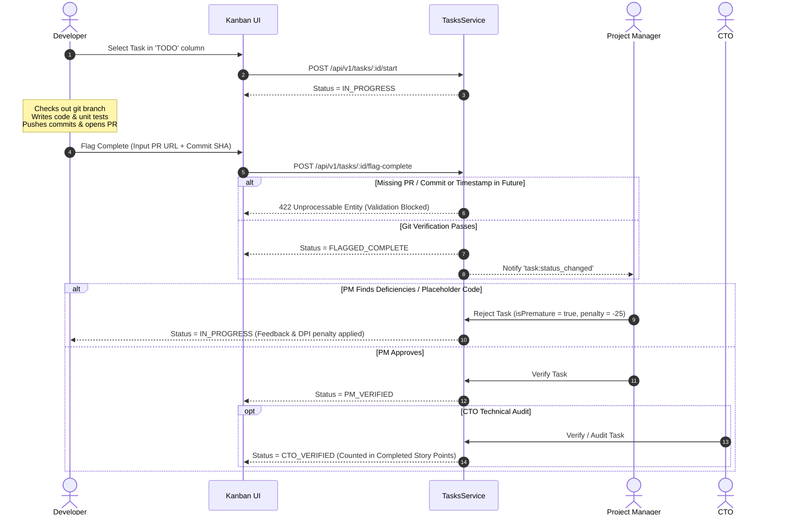

# Pointfex ERP — Developer & Engineering Contributor Specification

> **Module:** Developer Module (Task Execution, Git Linkage, Bug Hunting & DPI)  
> **Status:** Production Specification  
> **Target Audience:** Developers, QA Engineers, System Architects  
> **Revision:** 2.0.0

---

## 1. Role Overview & Engineering Responsibilities

Developers represent the core building force of Pointfex. Spread across the 6 dynamic product squads, developers are classified into skill tiers (`TIER_A`, `TIER_B`, `TIER_C`, `TIER_D`) to balance team capabilities. Developers write code, submit merge requests, execute tasks assigned by their Project Manager, hunt vulnerabilities in competitor products during the testing lab, and maintain their individual **Developer Performance Index (DPI)**.

### 1.1 Developer Access Permissions & Horizontal Isolation
Developers are strictly isolated from cross-squad and cross-user data:
* **Task Boards:** Can view tasks within their assigned squad(s). Can only mutate tasks assigned to them directly.
* **Personal Wallet:** Can **only view their own wallet balance**. Cannot inspect peer balances, squad bank logs, or executive wallets.
* **Notices:** Can only view and decrypt notices addressed to their specific public key.
* **Bug Bounty Arena:** Can browse active targets and submit adversarial bug reports against **other squads' products**.

---

## 2. Developer Task Lifecycle & Git Linkage Workflow

The developer's primary daily cycle moves through four operational states:



### 2.1 Flagging Completion Preconditions
* **BR-DEV-01:** Moving a task from `IN_PROGRESS` to `FLAGGED_COMPLETE` requires submitting a valid `gitPrUrl` or `gitCommitHash`.
* **BR-DEV-02:** The system anchors `flaggedCompleteAt = NOW()`.
* **BR-DEV-03:** The task's `lastCommitTimestamp` must precede `flaggedCompleteAt`. Flagging completion before committing code triggers an immediate validation failure (`TASK_TIMESTAMP_MISMATCH`).
* **BR-DEV-04:** Once flagged, the developer cannot alter the task's state. It remains in the PM's review queue.

---

## 3. Premature Flag Penalties & Anti-Gaming

To eliminate "ghost claiming" (marking a ticket done to manipulate velocity metrics before doing the work), the platform enforces strict penalties:
* **BR-DEV-05:** If the PM inspects a deliverable and finds incomplete code or stubbed functions:
  1. The PM sets `pmIsFlagPremature = true`.
  2. The PM applies a demerit of $-15$ to $-50$ points via `pmPenaltyPoints`.
  3. The task is reset to `IN_PROGRESS`.
  4. The developer's cumulative `prematureFlagsCount` increments on their performance snapshot.
* **BR-DEV-06:** Each premature flag demerit directly subtracts **15 points** from the developer's DPI score for the sprint.
* **BR-DEV-07:** Accumulating 3 premature flags in a single sprint flags the developer for automatic administrative review by the CHRO for potential salary reduction.

---

## 4. Adversarial Bug Bounty Participation (Hunter Role)

During dedicated testing labs and ongoing sprint execution, developers earn prestige and treasury funding by discovering verified defects in rival squads' products.

* **BR-DEV-08:** Developers can view all active `BugBountyTarget` records for other squads.
* **BR-DEV-09 (Cross-Squad Rule):** Developers **cannot** submit bug reports against:
  1. Their own squad.
  2. Any squad they belonged to within the last **2 sprints** (`CROSS_SQUAD_BOUNTY_COOLDOWN_SPRINTS`).
* **BR-DEV-10:** A bug report must include complete markdown reproduction steps, environment details, and expected vs. actual behavior.
* **BR-DEV-11 (Bounty Payout):** Upon CTO verification:
  * **Critical Bug:** **৳5,000** transferred from target squad treasury $\rightarrow$ hunter's squad treasury.
  * **Major Bug:** **৳3,000** transferred from target squad treasury $\rightarrow$ hunter's squad treasury.
* **BR-DEV-12 (Velocity Cap):** A developer is capped at a maximum of **5 verified bounty claims per sprint** (`MAX_BUG_BOUNTY_CLAIMS_PER_USER_PER_SPRINT`) to prevent farming.
* **BR-DEV-13:** Verified bounties increment the developer's `bugBountyContributions` counter, elevating their DPI.

---

## 5. Personal Wallet & Compensation Mechanics

* **BR-DEV-14:** Each developer is provisioned a personal wallet (`PERSONAL_WALLET`) upon enrollment.
* **BR-DEV-15:** Weekly salary is deposited directly into this wallet following CHRO approval of the PM's lab payroll proposal:
  * **Star Performer:** ৳3,500
  * **Regular:** ৳2,000
  * **Underperformer:** ৳1,000
  * **Slacker / Absent:** ৳0
* **BR-DEV-16:** Personal wallet funds contribute **50%** to the student's final **Simulation Score**:
  $$\text{Simulation Score} = 50\% \times \text{Normalized Squad Valuation} + 50\% \times \text{Individual Wallet Balance}$$
* **BR-DEV-17:** Fines (such as a ৳2,000 Slacker Fine) are deducted directly from the developer's personal wallet. If the wallet has insufficient funds, the balance is frozen at zero, and the remaining debt is charged to the squad treasury.

---

## 6. Developer Performance Index (DPI) Formulation

The DPI is a quantitative metric (0 – 100) calculated at the end of each sprint:

$$\text{DPI} = \left(\frac{S_c}{S_a} \times 40\right) + (\text{OnTimeRate} \times 20) + (\text{CTOPassRate} \times 25) - (\text{PrematureFlags} \times 15)$$

Where:
* $S_c$: Completed Story Points (tasks that reached `CTO_VERIFIED` or `CLOSED`).
* $S_a$: Assigned Story Points across the sprint.
* $\text{OnTimeRate}$: Percentage of assigned tasks completed on or before `dueDate`.
* $\text{CTOPassRate}$: Percentage of tasks that passed CTO review on the first attempt without rejection.
* $\text{PrematureFlags}$: Count of tickets rejected by the PM for premature or fraudulent completion.

### 6.1 Performance Tier Classifications
| DPI Score Range | Performance Tier | Weekly Lab Salary Ceiling |
| :--- | :--- | :--- |
| **85 – 100** | `STAR_PERFORMER` | ৳3,500 |
| **60 – 84** | `REGULAR` | ৳2,000 |
| **40 – 59** | `UNDERPERFORMER` | ৳1,000 |
| **0 – 39** | `SLACKER` | ৳0 (Eligible for disciplinary citation) |

---

## 7. Developer Workspace Dashboard Layout

The developer portal presents an uncluttered, focus-driven interface:
1. **My Assigned Tasks:** Personalized Kanban filter displaying tasks in `TODO`, `IN_PROGRESS`, and `FLAGGED_COMPLETE`.
2. **Commit Linker Modal:** Quick modal to paste PR URL, branch name, and commit hash when moving to complete.
3. **Personal Wallet Card:** Current balance in BDT, historical payroll receipts, and fine deductions.
4. **DPI Breakdown Widget:** Visual gauge of current sprint DPI score, with itemized completion ratios and pass rates.
5. **Bug Hunter Arena:** Feed of target systems, bounty pool sizes, and submission form.
6. **Encrypted Notice Inbox:** Displays incoming CHRO notices with 1-click cryptographic acknowledgment.

---

## 8. API Endpoints Specification

### API-DEV-01: Fetch My Assigned Tasks
* **Method & Path:** `GET /api/v1/tasks?assignedToId=me`
* **Access Role:** `DEVELOPER`, `PM`
* **Success Response (200 OK):**
```json
{
  "success": true,
  "data": [
    {
      "id": "uuid-task-1",
      "title": "Build PostgreSQL connection pooler",
      "storyPoints": 3,
      "priority": "HIGH",
      "status": "IN_PROGRESS",
      "dueDate": "2026-11-01T18:00:00.000Z",
      "gitPrUrl": "https://github.com/pointfex/squad-1/pull/14"
    }
  ]
}
```

### API-DEV-02: Flag Task Complete
* **Method & Path:** `POST /api/v1/tasks/:id/flag-complete`
* **Access Role:** `DEVELOPER`
* **Request Body:**
```json
{
  "gitPrUrl": "https://github.com/pointfex/squad-1/pull/14",
  "gitCommitHash": "8f1b9a23c4d5e6f7a8b9c0d1e2f3a4b5c6d7e8f9"
}
```
* **Success Response (200 OK):**
```json
{
  "success": true,
  "data": {
    "taskId": "uuid-task-1",
    "status": "FLAGGED_COMPLETE",
    "flaggedCompleteAt": "2026-10-29T12:00:00.000Z"
  }
}
```

### API-DEV-03: Submit Bug Bounty Report
* **Method & Path:** `POST /api/v1/bounty/reports`
* **Access Role:** `DEVELOPER`
* **Request Body:**
```json
{
  "bountyTargetId": "uuid-target-squad-3",
  "targetSquadId": "uuid-squad-3",
  "title": "SQL Injection in Search API endpoint",
  "severity": "CRITICAL",
  "description": "Unsanitized user input passed directly into raw database query.",
  "reproductionSteps": "1. Send GET to /api/search?q=' OR 1=1--\n2. Observe database dump in response."
}
```
* **Success Response (201 Created):**
```json
{
  "success": true,
  "data": {
    "reportId": "uuid-report-9",
    "status": "SUBMITTED",
    "submittedAt": "2026-10-29T12:15:00.000Z"
  }
}
```

---

## 9. NestJS Controller Blueprint

```typescript
// src/modules/tasks/dev-tasks.controller.ts
import { Controller, Post, Get, Param, Body, UseGuards, Req } from '@nestjs/common';
import { JwtAuthGuard } from '../../common/guards/jwt-auth.guard';
import { RolesGuard } from '../../common/guards/roles.guard';
import { Roles } from '../../common/decorators/roles.decorator';
import { TasksService } from './tasks.service';
import { UserRole } from '@prisma/client';

@Controller('tasks')
@UseGuards(JwtAuthGuard, RolesGuard)
export class DevTasksController {
  constructor(private readonly tasksService: TasksService) {}

  @Post(':id/start')
  @Roles(UserRole.DEVELOPER, UserRole.PM)
  async startTask(@Param('id') id: string, @Req() req: any) {
    return await this.tasksService.moveTaskStatus(id, req.user.id, 'IN_PROGRESS');
  }

  @Post(':id/flag-complete')
  @Roles(UserRole.DEVELOPER)
  async flagComplete(
    @Param('id') id: string,
    @Body() body: { gitPrUrl: string; gitCommitHash: string },
    @Req() req: any,
  ) {
    return await this.tasksService.flagComplete(
      id,
      req.user.id,
      body.gitPrUrl,
      body.gitCommitHash,
    );
  }
}
```

---

## 10. Edge Cases & Resilience Rules
1. **Fractional Squad Allocation DPI Scoring:** If a developer holds a split assignment (e.g. 50% on Squad 1, 50% on Squad 2), their completed story points and assignments are aggregated across both squads into a single unified sprint DPI snapshot.
2. **Disputed Premature Flag Penalties:** If a developer believes their task was penalized unfairly by the PM, they can appeal to the CTO by booking a 15-minute code audit review.
3. **Late-Sprint Task Assignment:** Tasks assigned less than 24 hours before sprint completion that remain incomplete are excluded from the `OnTimeDeliveryRate` metric to avoid unfairly penalizing the developer for sprint rollover items.
