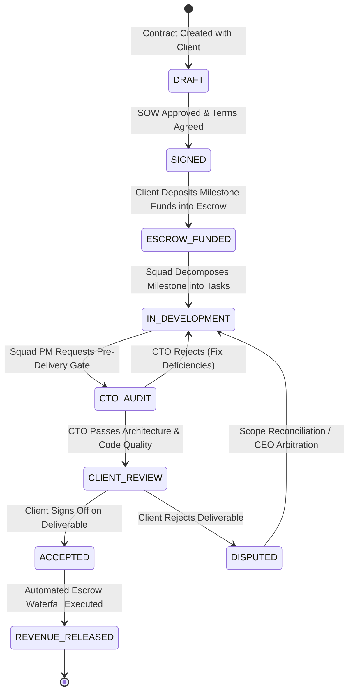

# Pointfex ERP — Supplementary Systems, Real Clients & Telemetry Specification

> **Module:** Other Systems (Client Pipeline, Product Telemetry, Valuation Engine & Reference Catalog)  
> **Status:** Production Specification  
> **Target Audience:** Fullstack Engineers, Data/DevOps Engineers, Executive Board  
> **Revision:** 2.0.0

---

## 1. System Scope & Architecture

This specification defines the cross-cutting systems that bridge educational simulation mechanics with real-world venture operations:
1. **Real-Client Engagement Pipeline:** Client CRM, milestone escrow funding, client acceptance gates, and dynamic revenue splits.
2. **Product Telemetry & Usage Analytics:** Live traffic, active user (DAU/MAU) tracking, and uptime monitoring from deployed squad products.
3. **Automated Health Monitors:** Background calculation of the Developer Performance Index (DPI), PM Health Index (PMHI), and squad financial runway.
4. **Venture Valuation & Simulation Stock Exchange:** Dynamic market capitalization algorithms and final student grading calculations.
5. **WebSocket & Error Code Catalog:** Global reference tables for real-time events and standard API error codes.

---

## 2. Real-Client Service Pipeline

In addition to internal educational software ventures, Pointfex squads deliver production software for paying external clients.



### 2.1 Contract Structuring & Dynamic Milestone Escrow
* **BR-OTH-01:** Contracts are categorized into `FIXED_BID`, `TIME_AND_MATERIALS`, or `RETAINER`.
* **BR-OTH-02:** Funds are deposited into an isolated `ESCROW` account prior to sprint kickoff. Squads do not begin work on un-escrowed milestones.
* **BR-OTH-03:** Each contract specifies custom revenue split percentages (defaulting to):
  * **Studio Reserve Pool:** $25\%$ (`studioReservePercent`)
  * **Executing Squad Treasury:** $65\%$ (`squadSharePercent`)
  * **Executive Management Overhead:** $10\%$ (`execOverheadPercent`)
  *(Constraint: $\text{studioReservePercent} + \text{squadSharePercent} + \text{execOverheadPercent} = 1.00$)*.

### 2.2 Pre-Delivery Quality Gate & Client Sign-Off
* **BR-OTH-04:** A squad cannot submit deliverables directly to a real client without **CTO Technical Approval** (`ctoApproved = true`).
* **BR-OTH-05:** Upon client acceptance (`clientAccepted = true`), the milestone status transitions to `PAID`, triggering the automated revenue recognition waterfall via the `LedgerService`.
* **BR-OTH-06:** Disputed milestones freeze the relevant escrow funds. The CEO conducts binding faculty arbitration to either release partial payments or order squad remediation.

---

## 3. Product Telemetry & Usage Analytics Engine

Squad ventures and client deliverables integrate the Pointfex Telemetry Collector (`pointfex-analytics.js` or REST API) to feed live usage data into squad valuations.

```mermaid
flowchart LR
    subgraph DeployedApps ["Deployed Products (Web/API)"]
        APP1["Squad 1 Venture (Next.js)"]
        APP2["Squad 2 Client App (Mobile API)"]
    end

    subgraph IngestPipeline ["Pointfex Ingestion Layer"]
        INGEST["POST /api/v1/telemetry/ingest"]
        AUTH_KEY{"Validate apiKey"}
        REDIS_BUFFER[("Redis Stream Buffer")]
    end

    subgraph RollupEngine ["Hourly Rollup Worker (BullMQ)"]
        WORKER["Hourly Aggregator Worker"]
        TIMESIZE[("ProductTelemetryHourly Table")]
        VALUATION["Valuation Calculator"]
    end

    APP1 & APP2 -->|Batched Events (JSON)| INGEST
    INGEST --> AUTH_KEY
    AUTH_KEY -- "Valid" --> REDIS_BUFFER
    REDIS_BUFFER --> WORKER
    WORKER --> TIMESIZE
    TIMESIZE --> VALUATION
```

### 3.1 Tracked Telemetry Dimensions
* **Traffic:** Total pageviews, unique visitors, total HTTP requests.
* **Engagement:** Daily Active Users (DAU), Monthly Active Users (MAU), session stickiness ($\text{DAU} / \text{MAU}$).
* **Reliability:** HTTP 5xx error rate, average latency in milliseconds (p50, p95, p99).
* **Automated Incident Alarms:** If a product's 5xx error rate exceeds **2.0%** over a 1-hour window, the system automatically dispatches high-priority alert notifications to the CTO and squad PM via WebSockets.

---

## 4. Squad Valuation & Stock Exchange Engine

The Pointfex Stock Exchange calculates real-time market capitalization for each squad to fuel the simulation leaderboard and venture equity trading.

### 4.1 Dynamic Valuation Formula
$$\text{Valuation} = \text{Treasury Cash} + (\text{Recognized Client Revenue} \times 1.5) + (\text{MAU} \times \beta) + (\text{API Invocations} \times \alpha) - \text{Active Debt}$$

* **Treasury Cash:** Current available balance in `AccountType.SQUAD_TREASURY`.
* **Recognized Client Revenue Multiplier (1.5x):** Rewards squads that win and deliver real paying client contracts.
* **Product Usage Lift:** Configurable multipliers stored in `SystemSettings` ($\beta = ৳100/\text{MAU}$, $\alpha = ৳0.05/\text{request}$).
* **Active Debt Deduction:** Outstanding principal and accrued interest on emergency loans are deducted directly from squad valuation.

### 4.2 Final Simulation Score Formulation
For student course grading, the platform combines collective squad performance with individual student merit:
$$\text{Simulation Score} = 50\% \times \left(\frac{\text{Squad Valuation}}{\max(\text{All Squad Valuations})} \times 100\right) + 50\% \times \left(\frac{\text{Individual Wallet Balance}}{\max(\text{All Student Wallets})} \times 100\right)$$

---

## 5. Automated Health Monitors (BullMQ Background Workers)

Three scheduled BullMQ worker jobs continuously calculate system health without impacting HTTP request threads:

| Monitor | Execution Frequency | Calculation Logic & Source Data | Target Entity |
| :--- | :--- | :--- | :--- |
| **DPI Calculator** | Every 6 hours + Sprint End | Story points completed vs assigned, on-time rate, CTO pass rate, premature flags demerits | `DeveloperPerformanceSnapshot` |
| **PMHI Calculator**| Every 6 hours + Sprint End | Velocity accuracy, CTO agreement percentage, on-time milestones, CTO overrides | `PmPerformanceSnapshot` |
| **Runway Monitor** | Daily at 00:00 UTC | $\text{Runway} = \frac{\text{Treasury Balance} + \text{Pending Escrow}}{\text{Trailing 4-Lab Average Burn Rate}}$ | `SquadHealthSnapshot` |

### Squad Health Status Thresholds:
* 🟢 **`BULLISH`:** Runway $> 6$ labs, positive operating margin, zero active loan defaults.
* 🟡 **`STABLE`:** Runway between 3 and 6 labs.
* 🔴 **`BANKRUPT_RISK`:** Runway $< 2$ labs. Automatically locks non-essential marketplace purchases and sends an alert to the CFO and CEO.

---

## 6. Real-Time WebSocket Events Catalog

All live updates stream over Socket.io namespaces authenticated with JWT:

| Event Name | Direction | Payload Schema | Recipient Scope | Description |
| :--- | :--- | :--- | :--- | :--- |
| `task:created` | Server $\rightarrow$ Client | `{ id, squadId, title, storyPoints, priority }` | Squad Room | New task added to Kanban backlog |
| `task:status_changed` | Server $\rightarrow$ Client | `{ taskId, fromStatus, toStatus, changedBy }` | Squad Room | Task moved across Kanban columns |
| `notice:incoming` | Server $\rightarrow$ Client | `{ id, title, category, encryptedContent, signature }`| Specific User Room | New E2EE encrypted notice received |
| `payroll:executed` | Server $\rightarrow$ Client | `{ proposalId, labNumber, totalDisbursed }` | Squad Room | Lab salary deposited into member wallets |
| `chaos:triggered` | Server $\rightarrow$ Client | `{ id, type, title, description, targetSquadId }` | Studio-Wide Broadcast| CEO injected real-time lab crisis |
| `chaos:resolved` | Server $\rightarrow$ Client | `{ id, resolutionText, resolvedAt }` | Studio-Wide Broadcast| Squad resolved active crisis |
| `bounty:verified` | Server $\rightarrow$ Client | `{ reportId, severity, bountyAmount, hunterSquadId }`| Target & Hunter Rooms| CTO approved peer bug bounty |
| `balance:updated` | Server $\rightarrow$ Client | `{ accountId, newBalance, currency }` | Account Owner Room | Real-time wallet or treasury balance update |
| `health:alert` | Server $\rightarrow$ Client | `{ squadId, metric, status, currentRunway }` | Squad PM & CEO Rooms | Squad entered `BANKRUPT_RISK` |
| `telemetry:alarm` | Server $\rightarrow$ Client | `{ productId, errorRate5xx, threshold }` | CTO & Squad Rooms | Product 5xx error rate exceeded 2% |
| `governance:vote_cast`| Server $\rightarrow$ Client | `{ decisionId, voterId, vote }` | Executive Board Room | Executive cast 2-of-3 board ballot |

---

## 7. Global API Error Codes Reference

All error responses return standard HTTP envelopes with deterministic application error codes:

| Error Code | HTTP Status | Description / Trigger Scenario | Module Origin |
| :--- | :---: | :--- | :--- |
| `AUTH_INVALID_CREDENTIALS` | 401 | Email or password incorrect. | `AuthModule` |
| `AUTH_TOKEN_EXPIRED` | 401 | Access token expired (refresh required). | `AuthModule` |
| `AUTH_TOKEN_REVOKED` | 401 | Token blacklisted or session terminated. | `AuthModule` |
| `AUTHZ_FORBIDDEN` | 403 | User role lacks permission for action. | `CaslModule` |
| `AUTHZ_NOT_OWNER` | 403 | Attempting to access another user's wallet or notices. | `CaslModule` |
| `AUTHZ_CROSS_SQUAD` | 403 | Attempting to access or alter another squad's tasks. | `CaslModule` |
| `LEDGER_INSUFFICIENT_FUNDS` | 409 | Account balance is lower than requested transfer amount.| `LedgerModule` |
| `LEDGER_ACCOUNT_FROZEN` | 403 | Account has been frozen by CEO administrative order. | `LedgerModule` |
| `LEDGER_IDEMPOTENCY_CONFLICT`| 409 | Identical idempotency key reused with different payload. | `LedgerModule` |
| `LEDGER_CHAIN_BROKEN` | 500 | HMAC hash verification failed (database tampering alert). | `LedgerModule` |
| `TASK_INVALID_TRANSITION` | 422 | Moving task between non-adjacent or unauthorized states.| `TasksModule` |
| `TASK_MISSING_GIT_LINK` | 422 | Flagging complete without PR URL or commit hash. | `TasksModule` |
| `TASK_TIMESTAMP_MISMATCH` | 422 | Flagged timestamp precedes commit timestamp. | `TasksModule` |
| `PAYROLL_EXCEEDS_BUDGET` | 422 | Proposal allocation exceeds ৳10,000 lab limit. | `PayrollModule` |
| `PAYROLL_ALREADY_APPROVED` | 409 | Proposal already approved and disbursed for this lab. | `PayrollModule` |
| `LOAN_ALREADY_ACTIVE` | 409 | Squad has an existing unpaid emergency loan. | `LoansModule` |
| `LOAN_GOVERNANCE_REQUIRED` | 422 | Loan lacking 2-of-3 board votes or CEO approval. | `LoansModule` |
| `BOUNTY_SELF_SQUAD` | 403 | Attempting to claim bounty on own squad's product. | `BountyModule` |
| `BOUNTY_COOLDOWN` | 403 | Claiming bounty on former squad within 2-sprint cooldown.| `BountyModule` |
| `BOUNTY_CAP_EXCEEDED` | 422 | Developer exceeded 5 bounty claims for current sprint. | `BountyModule` |
| `CERT_COOLDOWN_ACTIVE` | 422 | Re-applying for certification within 7-day cooldown. | `MarketplaceModule` |
| `CONSULT_CAP_EXCEEDED` | 422 | Consultant exceeded 2 sessions in active week. | `ConsultancyModule` |
| `GOVERNANCE_SELF_VOTE` | 403 | Executive attempted to vote on their own proposal. | `GovernanceModule` |
| `GOVERNANCE_ALREADY_VOTED` | 409 | Executive already cast a ballot on this decision. | `GovernanceModule` |
| `TELEMETRY_INVALID_KEY` | 401 | Telemetry heartbeat submitted with invalid apiKey. | `TelemetryModule` |

---

## 8. Database Seeding Implementation (`prisma/seed.ts`)

```typescript
// prisma/seed.ts
import { PrismaClient, UserRole, AccountType } from '@prisma/client';
import * as bcrypt from 'bcrypt';

const prisma = new PrismaClient();

async function main() {
  console.log('--- Initializing Pointfex Genesis Seeding ---');

  // 1. Seed Faculty CEO Account
  const passwordHash = await bcrypt.hash(process.env.INITIAL_CEO_PASSWORD || 'PointfexCeo2026!', 12);
  const ceoUser = await prisma.user.upsert({
    where: { email: 'noor@seu.edu.bd' },
    update: {},
    create: {
      email: 'noor@seu.edu.bd',
      passwordHash,
      fullName: 'Asaduzzaman Noor (Course Faculty)',
      role: UserRole.CEO,
      isActive: true,
    },
  });

  // 2. Initialize System Reserve Account
  await prisma.account.upsert({
    where: { type: AccountType.SYSTEM_RESERVE },
    update: {},
    create: {
      type: AccountType.SYSTEM_RESERVE,
      balance: 5000000.00, // ৳5M Initial System Reserve Pool
      currency: 'BDT',
    },
  });

  // 3. Seed Core System Settings
  const defaultSettings = [
    { key: 'SQUAD_INITIAL_BALANCE', value: '100000', type: 'NUMBER' },
    { key: 'WEEKLY_LAB_BUDGET', value: '10000', type: 'NUMBER' },
    { key: 'SPRINT_POOL_TOTAL', value: '150000', type: 'NUMBER' },
    { key: 'CFO_TAX_RATE', value: '0.05', type: 'NUMBER' },
    { key: 'LOAN_INTEREST_RATE', value: '0.15', type: 'NUMBER' },
    { key: 'EQUITY_STAKE_PERCENT', value: '0.10', type: 'NUMBER' },
    { key: 'EQUITY_DIVIDEND_RATE', value: '0.10', type: 'NUMBER' },
    { key: 'CFO_PENALTY_INCENTIVE', value: '0.20', type: 'NUMBER' },
    { key: 'CODE_AUDIT_FINE', value: '2000', type: 'NUMBER' },
    { key: 'CTO_AUDIT_FINE_CUT', value: '1000', type: 'NUMBER' },
    { key: 'CONSULTANCY_FEE', value: '4000', type: 'NUMBER' },
    { key: 'CTO_CONSULTANCY_CUT_RATE', value: '0.50', type: 'NUMBER' },
    { key: 'SLACKER_FINE', value: '2000', type: 'NUMBER' },
    { key: 'CPO_SLACKER_CUT', value: '500', type: 'NUMBER' },
    { key: 'SWAP_FEE', value: '5000', type: 'NUMBER' },
    { key: 'CPO_SWAP_CUT_RATE', value: '0.20', type: 'NUMBER' },
    { key: 'CRITICAL_BUG_BOUNTY', value: '5000', type: 'NUMBER' },
    { key: 'MAJOR_BUG_BOUNTY', value: '3000', type: 'NUMBER' },
    { key: 'BLIND_QA_PENALTY', value: '15000', type: 'NUMBER' },
    { key: 'PM_LEADERSHIP_BONUS_RATE', value: '0.10', type: 'NUMBER' },
  ];

  for (const s of defaultSettings) {
    await prisma.systemSetting.upsert({
      where: { key: s.key },
      update: { value: s.value },
      create: s,
    });
  }

  // 4. Seed Product Squads (Squad 1 to 6)
  for (let i = 1; i <= 6; i++) {
    const squad = await prisma.squad.upsert({
      where: { name: `Squad ${i}` },
      update: {},
      create: {
        name: `Squad ${i}`,
        description: `Product Engineering Squad ${i}`,
        valuation: 100000.00,
      },
    });

    // Create Squad Treasury Account
    await prisma.account.upsert({
      where: { squadId: squad.id },
      update: {},
      create: {
        squadId: squad.id,
        type: AccountType.SQUAD_TREASURY,
        balance: 100000.00,
        currency: 'BDT',
      },
    });
  }

  console.log('--- Pointfex Genesis Seeding Completed Successfully ---');
}

main()
  .catch((e) => {
    console.error(e);
    process.exit(1);
  })
  .finally(async () => {
    await prisma.$disconnect();
  });
```

---

## 9. Cross-Cutting API Endpoints Specification

### API-OTH-01: Ingest Product Telemetry
* **Method & Path:** `POST /api/v1/telemetry/ingest`
* **Authentication:** Header `X-API-Key: <product_api_key>` (Stateless, no JWT required)
* **Request Body:**
```json
{
  "events": [
    { "type": "page_view", "url": "/dashboard", "timestamp": "2026-10-29T12:00:00Z" },
    { "type": "api_call", "endpoint": "/api/v1/checkout", "latencyMs": 45.2, "statusCode": 200 }
  ]
}
```
* **Success Response (202 Accepted):**
```json
{
  "success": true,
  "data": { "bufferedCount": 2 }
}
```

### API-OTH-02: Fetch Studio Simulation Leaderboard
* **Method & Path:** `GET /api/v1/simulation-scores`
* **Access Role:** Public / All Authenticated Users
* **Success Response (200 OK):**
```json
{
  "success": true,
  "data": [
    {
      "rank": 1,
      "squadId": "uuid-squad-1",
      "squadName": "Squad 1",
      "valuation": 280000.00,
      "healthStatus": "BULLISH",
      "simulationScore": 94.5
    }
  ]
}
```

---

## 10. Edge Cases & Resilience Safeguards
1. **Telemetry Flooding / DDoS Protection:** Ingestion endpoints enforce IP and API-Key based token bucket rate limits in Redis (`max 500 requests/minute/product`).
2. **Escrow Dispute Timeout:** If a client dispute remains unresolved for $> 14$ days, funds are locked in Escrow, and an emergency arbitration case is auto-created in the CEO queue.
3. **Valuation Normalization Floor:** If all squads undergo negative sprint performance, the normalization algorithm sets a minimum floor ($0.0$) preventing division-by-zero or negative simulation scores.
