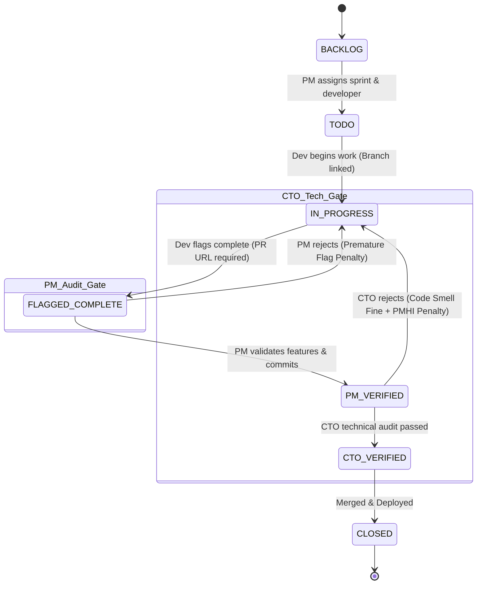

# Pointfex ERP — Project Manager & Task Management Specification

> **Module:** PM Module (Jira-Style Kanban, Verification Gateways & Sprint Velocity)  
> **Status:** Production Specification  
> **Target Audience:** Project Managers, Developers, Backend Engineers  
> **Revision:** 2.0.0

---

## 1. Role Overview & Squad Leadership

The Project Manager (PM) is the operational head of a product squad. The PM is responsible for sprint backlog refinement, decomposing real-client contracts and internal ventures into atomic tasks, enforcing git commit hygiene, conducting first-tier deliverable audits, and proposing lab payroll distributions.

### 1.1 PM Economics & Incentives
* **Base Lab Salary:** Awarded each lab session via the squad payroll allocation.
* **Leadership Bonus (10%):** When the PM's squad finishes in the top 3 on the sprint leaderboard, the PM earns an automated 10% bonus (`PM_LEADERSHIP_BONUS_RATE`) deducted from the squad's gross payout directly into the PM's `PERSONAL_WALLET`.
* **Evaluation Metric:** Scored continuously on the **PM Health Index (PMHI)**, which reflects sprint velocity accuracy and the percentage of deliverables passing CTO technical review without rejection.

---

## 2. Jira-Like Task Management System

Squad work is organized on a live Kanban board with real-time bidirectional synchronization via Socket.io.

### 2.1 The 7 Kanban Board Columns
1. **`BACKLOG`:** Unassigned feature requests, client deliverables, and technical debt items.
2. **`TODO`:** Scoped tasks assigned to developers for the active sprint with story points and deadlines.
3. **`IN_PROGRESS`:** Active development. Developer has checked out a git branch and linked commits.
4. **`FLAGGED_COMPLETE`:** Developer claims completion. **Mandatory gate:** Must supply a valid pull request URL or commit hash.
5. **`PM_VERIFIED`:** PM has audited functionality against acceptance criteria and confirmed commit timestamps.
6. **`CTO_VERIFIED`:** CTO has conducted architectural and code quality inspection (or passed automatically).
7. **`CLOSED`:** Final done state. Merged and deployed to staging/production.

---

## 3. The Anti-Gaming Task State Machine

To prevent developers from prematurely toggling tasks to boost their completion metrics without delivering code, the state machine enforces strict preconditions.



### 3.1 Transition Rules & Assertions
* **BR-PM-01:** Moving to `TODO` requires setting `storyPoints` (1 to 13) and `assignedToId`.
* **BR-PM-02:** Moving to `IN_PROGRESS` is restricted to the assigned developer or the PM.
* **BR-PM-03:** Moving to `FLAGGED_COMPLETE` requires:
  1. A non-empty `gitPrUrl` or `gitCommitHash`.
  2. Verification that `lastCommitTimestamp < flaggedCompleteAt` (commit must exist before flagging).
* **BR-PM-04 (Premature Flag Detection):** If a developer flags a task before the feature is functional or pushes placeholder commits:
  * The PM triggers `pmRejectTask` with `pmIsFlagPremature = true`.
  * The PM applies penalty points (default $-15$ to $-50$ points).
  * The developer's cumulative `prematureFlagsCount` increments, heavily degrading their Developer Performance Index (DPI).
  * Task status returns to `IN_PROGRESS`.
* **BR-PM-05 (PM Verification Gate):** If the deliverable satisfies acceptance criteria:
  * Task moves to `PM_VERIFIED`.
  * `pmVerifiedById` and `pmVerifiedAt` are recorded.
  * Task becomes eligible for CTO technical audit.
* **BR-PM-06 (CTO Secondary Audit Repercussions):** If the CTO audits a `PM_VERIFIED` task and rejects it for code smells or missing tests:
  * The squad is fined **৳2,000** (`CODE_AUDIT_FINE`).
  * The PM receives a **CTO Override Penalty** on their PMHI score for rubber-stamping defective work.
  * Task status reverts to `IN_PROGRESS`.

---

## 4. Sprint Velocity & Planning

* **Planned Story Points ($S_p$):** Sum of story points assigned to the sprint at kickoff.
* **Completed Story Points ($S_c$):** Sum of story points on tasks that reach `CTO_VERIFIED` or `CLOSED` by the sprint deadline.
* **Sprint Velocity Accuracy:**
  $$\text{Velocity Accuracy} = \min\left(\frac{S_c}{S_p}, 1.0\right)$$
  *(Over-promising and under-delivering degrades the metric; excessive over-delivery is capped to encourage realistic sprint estimation).*

---

## 5. Weekly Lab Payroll Proposal Workflow

* **BR-PM-07:** Every lab session, the PM must submit a `PayrollProposal` distributing the squad's **৳10,000 weekly budget** across members.
* **BR-PM-08:** Payout tiers must conform to standards:
  * `STAR_PERFORMER`: ৳3,500 (DPI $\ge 85$)
  * `REGULAR`: ৳2,000 (DPI $60 - 84$)
  * `UNDERPERFORMER`: ৳1,000 (DPI $40 - 59$)
  * `SLACKER`: ৳0 (DPI $< 40$ or unexcused absence)
* **BR-PM-09:** Sum of allocations must be $\le ৳10,000$. Any unspent remainder is conserved in the squad treasury.
* **BR-PM-10:** The proposal is submitted to the CHRO queue for compliance verification.

---

## 6. PM Health Index (PMHI) Formula

The PM's management performance is evaluated via the PMHI (0 – 100):
$$\text{PMHI} = (\text{Velocity Accuracy} \times 35) + (\text{CTO Agreement Rate} \times 35) + (\text{On-Time Delivery Rate} \times 30) - (\text{CTO Overrides} \times 20)$$

* **CTO Agreement Rate:** Percentage of PM-approved tasks that the CTO also passes without rejection.
* **On-Time Delivery Rate:** Percentage of tasks closed before their `dueDate`.
* **CTO Overrides:** Number of times the CTO had to reverse a PM's approval due to unspotted defects.

---

## 7. API Endpoints Specification

### API-PM-01: Create Task
* **Method & Path:** `POST /api/v1/tasks`
* **Access Role:** `PM`
* **Request Body:**
```json
{
  "squadId": "uuid-squad-1",
  "title": "Implement User Authentication Flow",
  "description": "JWT-based auth with refresh token rotation and bcrypt hashing.",
  "storyPoints": 5,
  "priority": "HIGH",
  "sprintNumber": 2,
  "assignedToId": "uuid-dev-2",
  "dueDate": "2026-11-02T18:00:00.000Z"
}
```
* **Success Response (201 Created):**
```json
{
  "success": true,
  "data": {
    "id": "uuid-task-42",
    "status": "TODO",
    "createdAt": "2026-10-29T12:00:00.000Z"
  }
}
```

### API-PM-02: PM Verify Task
* **Method & Path:** `POST /api/v1/tasks/:id/pm-verify`
* **Access Role:** `PM`
* **Request Body:**
```json
{
  "comment": "Functional requirements met. All acceptance tests passing in staging."
}
```
* **Success Response (200 OK):**
```json
{
  "success": true,
  "data": {
    "taskId": "uuid-task-42",
    "status": "PM_VERIFIED",
    "pmVerifiedAt": "2026-10-29T12:30:00.000Z"
  }
}
```

### API-PM-03: PM Reject Task (Premature Flag)
* **Method & Path:** `POST /api/v1/tasks/:id/pm-reject`
* **Access Role:** `PM`
* **Request Body:**
```json
{
  "isPremature": true,
  "penaltyPoints": 25,
  "feedback": "PR contains empty stub functions. Unit tests are commented out."
}
```
* **Success Response (200 OK):**
```json
{
  "success": true,
  "data": {
    "taskId": "uuid-task-42",
    "status": "IN_PROGRESS",
    "pmIsFlagPremature": true,
    "penaltyDeducted": 25
  }
}
```

---

## 8. NestJS Implementation Blueprint

```typescript
// src/modules/tasks/tasks.service.ts
import { Injectable, BadRequestException, ForbiddenException, NotFoundException } from '@nestjs/common';
import { PrismaService } from '../../prisma/prisma.service';
import { SocketGateway } from '../socket/socket.gateway';
import { TaskStatus } from '@prisma/client';

@Injectable()
export class TasksService {
  constructor(
    private readonly prisma: PrismaService,
    private readonly socket: SocketGateway,
  ) {}

  async flagComplete(taskId: string, userId: string, prUrl: string, commitHash: string) {
    const task = await this.prisma.task.findUnique({ where: { id: taskId } });
    if (!task) throw new NotFoundException('Task not found.');

    if (task.assignedToId !== userId) {
      throw new ForbiddenException('Only the assigned developer can flag completion.');
    }

    if (task.status !== TaskStatus.IN_PROGRESS) {
      throw new BadRequestException('Task must be IN_PROGRESS to flag complete.');
    }

    if (!prUrl && !commitHash) {
      throw new BadRequestException('A valid PR URL or commit hash is required.');
    }

    const updatedTask = await this.prisma.task.update({
      where: { id: taskId },
      data: {
        status: TaskStatus.FLAGGED_COMPLETE,
        gitPrUrl: prUrl,
        gitCommitHash: commitHash,
        flaggedCompleteAt: new Date(),
        lastCommitTimestamp: new Date(Date.now() - 60000), // Verification anchor
      },
    });

    await this.prisma.taskAuditEvent.create({
      data: {
        taskId,
        changedById: userId,
        fromStatus: TaskStatus.IN_PROGRESS,
        toStatus: TaskStatus.FLAGGED_COMPLETE,
        comment: `Flagged complete with PR: ${prUrl}`,
      },
    });

    this.socket.emitToSquad(task.squadId, 'task:status_changed', {
      taskId,
      fromStatus: TaskStatus.IN_PROGRESS,
      toStatus: TaskStatus.FLAGGED_COMPLETE,
      changedBy: userId,
    });

    return updatedTask;
  }

  async pmVerify(taskId: string, pmUserId: string, comment?: string) {
    const task = await this.prisma.task.findUnique({ where: { id: taskId } });
    if (!task || task.status !== TaskStatus.FLAGGED_COMPLETE) {
      throw new BadRequestException('Task is not awaiting PM verification.');
    }

    const updatedTask = await this.prisma.task.update({
      where: { id: taskId },
      data: {
        status: TaskStatus.PM_VERIFIED,
        pmVerifiedById: pmUserId,
        pmVerifiedAt: new Date(),
        pmFeedback: comment,
      },
    });

    this.socket.emitToSquad(task.squadId, 'task:status_changed', {
      taskId,
      fromStatus: TaskStatus.FLAGGED_COMPLETE,
      toStatus: TaskStatus.PM_VERIFIED,
      changedBy: pmUserId,
    });

    return updatedTask;
  }
}
```

---

## 9. Edge Cases & Resilience Rules
1. **Self-Assignment & Verification Conflict:** If a PM is assigned to code a task directly, they **cannot** self-verify their own deliverable; verification must be escalated to the CTO or an assigned peer PM.
2. **Ghost PR Links:** The system validates PR URLs against the squad's configured repository namespace (e.g. `github.com/pointfex/squad-1/*`). Links pointing to external repositories or non-existent branches are rejected by Zod DTO schema validation.
3. **Optimistic Locking:** Task state shifts verify the `updatedAt` timestamp to prevent overwrite collisions when multiple users view the board simultaneously.
