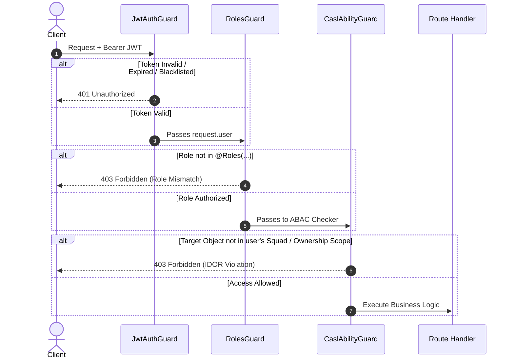
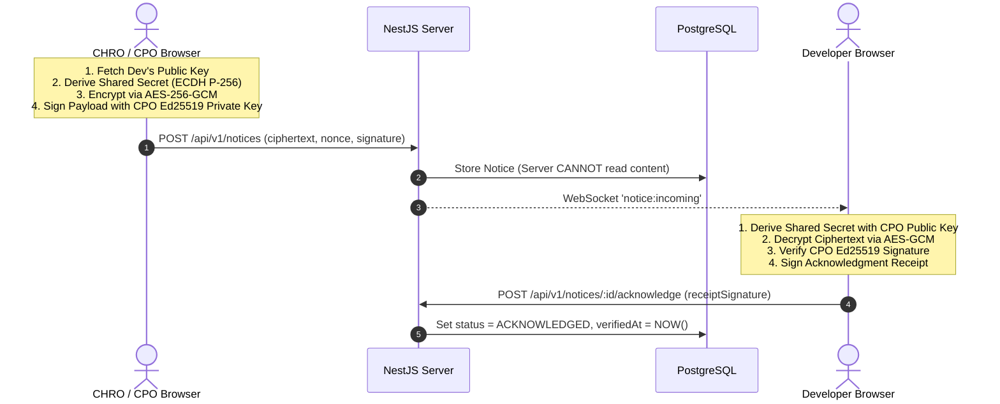

# Pointfex ERP — Security Architecture & Cryptographic Engine Specification

> **Module:** Core Security, Authorization, and Ledger Integrity  
> **Status:** Mandatory Production Specification  
> **Target Audience:** Security Architects, Backend Engineers, DevOps  
> **Revision:** 2.0.0

---

## 1. Security Architecture Overview & Threat Model

The Pointfex ERP operates in an adversarial environment where student participants (simulating rival squads, venture capitalists, and executives) possess the technical competence to exploit software vulnerabilities, race conditions, parameter tampering, and API replay attacks to inflate personal balances or squad valuations.

### 1.1 Defense-in-Depth Layers
```
┌─────────────────────────────────────────────────────────────┐
│ 1. Network Boundary: Traefik TLS Termination + Dokploy Net  │
├─────────────────────────────────────────────────────────────┤
│ 2. Edge Rate Limiter: Redis Sliding-Window Throttler        │
├─────────────────────────────────────────────────────────────┤
│ 3. Authentication: Passport-JWT + Refresh Token Rotation    │
├─────────────────────────────────────────────────────────────┤
│ 4. Authorization: Role-Based (RBAC) + CASL Policies (ABAC) │
├─────────────────────────────────────────────────────────────┤
│ 5. Concurrency & Idempotency: Redis Key Lock + ACID Locks   │
├─────────────────────────────────────────────────────────────┤
│ 6. Data Integrity: HMAC-SHA256 Chained Hash Ledger          │
├─────────────────────────────────────────────────────────────┤
│ 7. Confidentiality: Client-Side ECDH / AES-256-GCM E2EE     │
└─────────────────────────────────────────────────────────────┘
```

### 1.2 STRIDE Threat Model & Mitigations
* **Spoofing Identity:** Blocked via Ed25519 signed JWTs with 15-minute expiration and rotating one-time refresh tokens.
* **Tampering with Data:** Double-entry ledger rows are locked deterministically via `SELECT ... FOR UPDATE` and cryptographically linked with HMAC-SHA256 hashes (`prevHash` $\rightarrow$ `entryHash`).
* **Repudiation:** Disciplinary notices require client-side Ed25519 digital signatures on dispatch and signed cryptographic receipts on acknowledgment.
* **Information Disclosure:** Horizontal squad isolation via CASL guards blocks developers from inspecting rival squad backlogs, personal wallet balances, or unencrypted notices.
* **Denial of Service & Exploitation:** Per-role rate limits and velocity caps prevent automated botting of bug bounty claims or spamming consultancy slots.
* **Elevation of Privilege:** Vertical RBAC guards prohibit non-CEO accounts from triggering chaos events or altering system settings.

---

## 2. Authentication System

The authentication engine implements stateless JWT verification with stateful refresh token rotation and instant revocation via Redis.

### 2.1 Token Lifecycle
* **Access Token:** Short-lived (15 minutes), signed with `HS256` or `RS256`, containing `{ sub: userId, role: UserRole, squadIds: string[], email: string }`.
* **Refresh Token:** Long-lived (7 days), cryptographically random string (64 bytes), hashed using `bcrypt` (12 rounds) and stored in `User.refreshTokenHash`.

### 2.2 Refresh Token Rotation & Family Invalidation
When `/api/v1/auth/refresh` is invoked:
1. The submitted refresh token is compared against the stored hash.
2. If valid: The old token is invalidated immediately, a new access token and a new refresh token are generated, and the new hash is stored.
3. If an expired or previously consumed token is presented (indicating token theft): All active refresh tokens for that user family are revoked immediately in Redis, and an `ExecutiveAuditLog` with `riskSeverity = CRITICAL` is recorded.

### 2.3 NestJS Authentication Implementation

```typescript
// src/modules/auth/auth.service.ts
import { Injectable, UnauthorizedException, ForbiddenException } from '@nestjs/common';
import { JwtService } from '@nestjs/jwt';
import { PrismaService } from '../../prisma/prisma.service';
import * as bcrypt from 'bcrypt';
import { RedisService } from '../redis/redis.service';

@Injectable()
export class AuthService {
  constructor(
    private readonly prisma: PrismaService,
    private readonly jwtService: JwtService,
    private readonly redis: RedisService,
  ) {}

  async validateUser(email: string, pass: string): Promise<any> {
    const user = await this.prisma.user.findUnique({
      where: { email },
      include: { squadMemberships: true },
    });
    if (!user || !user.isActive) {
      throw new UnauthorizedException('Invalid credentials or account suspended.');
    }

    const isMatch = await bcrypt.compare(pass, user.passwordHash);
    if (!isMatch) {
      throw new UnauthorizedException('Invalid credentials.');
    }

    const { passwordHash, refreshTokenHash, ...result } = user;
    return result;
  }

  async login(user: any) {
    const payload = {
      sub: user.id,
      email: user.email,
      role: user.role,
      squadIds: user.squadMemberships.map((m: any) => m.squadId),
    };

    const accessToken = this.jwtService.sign(payload, { expiresIn: '15m' });
    const refreshToken = this.jwtService.sign({ sub: user.id }, { expiresIn: '7d' });

    const salt = await bcrypt.genSalt(12);
    const refreshTokenHash = await bcrypt.hash(refreshToken, salt);

    await this.prisma.user.update({
      where: { id: user.id },
      data: { refreshTokenHash },
    });

    return {
      accessToken,
      refreshToken,
      user: {
        id: user.id,
        email: user.email,
        fullName: user.fullName,
        role: user.role,
      },
    };
  }

  async logout(userId: string): Promise<void> {
    await this.prisma.user.update({
      where: { id: userId },
      data: { refreshTokenHash: null },
    });
    // Add token to Redis blacklist if early access token invalidation is desired
    await this.redis.set(`blacklist:user:${userId}`, 'revoked', 900); // 15 mins
  }
}
```

---

## 3. Authorization: RBAC + ABAC via CASL

Access control is dual-layered: **Role-Based Access Control (RBAC)** filters coarse endpoints, while **Attribute-Based Access Control (ABAC via CASL)** prevents Broken Object-Level Authorization (BOLA/IDOR).

### 3.1 Comprehensive Master Permission Matrix

| Capability / Entity | CEO | CFO | CTO | CPO (CHRO) | PM | Developer |
| :--- | :---: | :---: | :---: | :---: | :---: | :---: |
| **System Settings (Update / Read)** | **Full / Read** | Read | Read | Read | Read | Read |
| **Chaos Console Trigger** | **Execute** | None | None | None | None | None |
| **Audit Ledger Overrides / Freeze** | **Full** | None | None | None | None | None |
| **Sprint Pool Funding & Approval** | **Approve** | **Execute** | View | View | View | View |
| **Emergency Loans (Issue / Repay)** | Audit | **Execute** | Vote (2/3) | Vote (2/3) | Request | View |
| **Venture Stake (Buy Equity / Divs)**| Audit | **Execute** | None | None | View | None |
| **Code Smells & Citations (Fine)** | Audit | View | **Execute** | View | View | View |
| **CTO 2nd-Tier Task Verification** | Audit | View | **Audit/Gate**| View | View | View |
| **Provider Certification Gate** | Audit | View | **Verify** | None | Apply | Apply |
| **Bug Bounty (Create Target)** | Audit | View | **Manage** | View | Squad Target| View |
| **Bug Bounty (Submit Reports)** | Audit | View | Verify | View | Submit | **Submit (Cross)** |
| **Marketplace (List / Buy)** | Audit | View | **Verify/List**| None | Buy (Squad)| View |
| **Paid Consultancy (Offer / Book)** | Audit | View | **Host (50%)**| None | Book (Squad)| View |
| **Weekly Lab Payroll (Propose)** | Audit | View | View | View | **Propose** | View |
| **Weekly Lab Payroll (Approve Batch)**| Audit | View | View | **Approve** | None | View |
| **E2EE Notices (Dispatch)** | **Dispatch** | None | None | **Dispatch** | None | None |
| **E2EE Notices (Read / ACK)** | Own | Own | Own | Own | Own | **Own (Required)** |
| **Slacker Fines (Issue)** | Audit | View | View | **Execute** | Report | View |
| **Member Swaps / Firing** | Approve | Vote (2/3) | Vote (2/3) | **Execute** | Request | None |
| **Task Creation & Assignment** | View | View | View | View | **Manage (Own)**| None |
| **Task Move: TODO $\rightarrow$ IN_PROGRESS**| View | View | View | View | Manage | **Execute (Own)**|
| **Task Move: FLAGGED_COMPLETE** | View | View | View | View | None | **Execute (Commit)**|
| **Task Verification Gate 1 (PM)** | View | View | View | View | **Verify/Penalize**| None |
| **Personal Wallet (Read Balance)** | **All** | **All** | **All** | **All** | **Own Only** | **Own Only** |
| **Squad Treasury (Read Balance)** | **All** | **All** | **All** | **All** | **Own Squad** | **Own Squad** |

### 3.2 CASL Ability Factory Implementation

```typescript
// src/modules/casl/casl-ability.factory.ts
import { AbilityBuilder, PureAbility, createMongoAbility, ExtractSubjectType, InferSubjects } from '@casl/ability';
import { Injectable } from '@nestjs/common';
import { User, Task, Account, Notice, PayrollProposal } from '@prisma/client';

export type Actions = 'manage' | 'create' | 'read' | 'update' | 'delete' | 'verify' | 'penalize';
export type Subjects = InferSubjects<typeof Task | typeof Account | typeof Notice | typeof PayrollProposal | typeof User> | 'all';

export type AppAbility = PureAbility<[Actions, Subjects]>;

@Injectable()
export class CaslAbilityFactory {
  createForUser(user: { id: string; role: string; squadIds: string[] }): AppAbility {
    const { can, cannot, build } = new AbilityBuilder<AppAbility>(createMongoAbility);

    if (user.role === 'CEO') {
      can('manage', 'all'); // CEO has unconstrained access
    } else if (user.role === 'CFO') {
      can('read', 'all');
      can('manage', 'Account');
    } else if (user.role === 'CTO') {
      can('read', 'all');
      can('verify', 'Task');
    } else if (user.role === 'CPO') {
      can('read', 'all');
      can('manage', 'Notice');
      can('manage', 'PayrollProposal');
    } else if (user.role === 'PM') {
      // PM can only manage tasks within their own squad
      can('create', 'Task');
      can('read', 'Task', { squadId: { $in: user.squadIds } } as any);
      can('update', 'Task', { squadId: { $in: user.squadIds } } as any);
      can('verify', 'Task', { squadId: { $in: user.squadIds } } as any);
      can('penalize', 'Task', { squadId: { $in: user.squadIds } } as any);

      can('create', 'PayrollProposal');
      can('read', 'PayrollProposal', { squadId: { $in: user.squadIds } } as any);

      // Financial Isolation: Can only read own squad treasury and personal wallet
      can('read', 'Account', { squadId: { $in: user.squadIds } } as any);
      can('read', 'Account', { ownerId: user.id } as any);
    } else if (user.role === 'DEVELOPER') {
      // Developer can read tasks in their squads, update tasks assigned to them
      can('read', 'Task', { squadId: { $in: user.squadIds } } as any);
      can('update', 'Task', { assignedToId: user.id } as any);

      // Cannot view other people's wallets or other squads' bank accounts
      cannot('read', 'Account');
      can('read', 'Account', { ownerId: user.id } as any);
      can('read', 'Account', { squadId: { $in: user.squadIds } } as any);

      // Notices: Can only read notices addressed to them
      can('read', 'Notice', { recipientId: user.id } as any);
      can('update', 'Notice', { recipientId: user.id } as any); // To ACK
    }

    return build({
      detectSubjectType: (item) => item.constructor as ExtractSubjectType<Subjects>,
    });
  }
}
```

---

## 4. Guard Execution Pipeline

NestJS enforces authorization through a three-stage sequential guard pipeline:



---

## 5. Financial Ledger Security (ACID + HMAC Chaining)

The `LedgerService` provides zero-trust financial integrity. No balance can mutate without a valid double-entry entry.

### 5.1 Concurrency & Pessimistic Row Locking
To eliminate race conditions, double-spending, and negative balance exploits during high-concurrency batch payrolls or simultaneous consulting bookings, account records are queried using **deterministic lock ordering**:

```sql
-- Lock accounts in deterministic lexicographical order to prevent deadlocks
SELECT id, balance, "isFrozen"
FROM "Account"
WHERE id IN ('acc_alpha', 'acc_beta')
ORDER BY id ASC
FOR UPDATE;
```

### 5.2 Cryptographic Hash Chaining (Audit Merkle-Link)
Every ledger entry computes an immutable HMAC-SHA256 signature chained to the previous entry:
$$\text{EntryHash}_n = \text{HMAC-SHA256}\Big(\text{Secret}, \text{EntryHash}_{n-1} \,\|\, \text{AccountId} \,\|\, \text{Direction} \,\|\, \text{Amount} \,\|\, \text{Timestamp}\Big)$$

If an attacker modifies a historical row directly in PostgreSQL, the verification formula $\text{Verify}(\text{EntryHash}_k) \neq \text{EntryHash}_{k+1}$ immediately fails, flagging tampering on the CEO dashboard.

### 5.3 Production Secure Transfer Implementation

```typescript
// src/modules/ledger/ledger.service.ts
import { Injectable, BadRequestException, ConflictException, ForbiddenException } from '@nestjs/common';
import { PrismaService } from '../../prisma/prisma.service';
import { createHmac } from 'crypto';
import { TransactionType } from '@prisma/client';

@Injectable()
export class LedgerService {
  constructor(private readonly prisma: PrismaService) {}

  async executeDoubleEntryTransfer(params: {
    senderAccountId: string;
    recipientAccountId: string;
    amount: number;
    referenceType: TransactionType;
    referenceId?: string;
    description?: string;
    idempotencyKey: string;
    authorizedById: string;
  }) {
    if (params.amount <= 0) {
      throw new BadRequestException('Transfer amount must be strictly positive.');
    }

    return await this.prisma.$transaction(
      async (tx) => {
        // 1. Idempotency Check
        const existingTx = await tx.ledgerTransaction.findUnique({
          where: { idempotencyKey: params.idempotencyKey },
          include: { entries: true },
        });
        if (existingTx) {
          return existingTx; // Safely return existing transaction
        }

        // 2. Deterministic Account Locking (Ascending ID)
        const sortedIds = [params.senderAccountId, params.recipientAccountId].sort();
        const lockedAccounts = await tx.$queryRaw<any[]>`
          SELECT id, balance, "isFrozen"
          FROM "Account"
          WHERE id IN (${sortedIds[0]}::uuid, ${sortedIds[1]}::uuid)
          ORDER BY id ASC
          FOR UPDATE
        `;

        const sender = lockedAccounts.find((a) => a.id === params.senderAccountId);
        const recipient = lockedAccounts.find((a) => a.id === params.recipientAccountId);

        if (!sender || !recipient) {
          throw new BadRequestException('One or both specified accounts do not exist.');
        }

        if (sender.isFrozen || recipient.isFrozen) {
          throw new ForbiddenException('Cannot transfer to or from a frozen account.');
        }

        if (Number(sender.balance) < params.amount) {
          throw new ConflictException(
            `Insufficient balance. Account balance: ৳${Number(sender.balance)}, Requested: ৳${params.amount}`,
          );
        }

        // 3. HMAC Chain Generation
        const lastEntry = await tx.ledgerEntry.findFirst({
          orderBy: { sequenceNumber: 'desc' },
        });
        const prevHash = lastEntry ? lastEntry.entryHash : '0'.repeat(64); // Genesis hash

        const debitHash = createHmac('sha256', process.env.LEDGER_SECRET_KEY || 'pointfex-secret')
          .update(`${prevHash}:${params.senderAccountId}:DEBIT:${params.amount}:${Date.now()}`)
          .digest('hex');

        const creditHash = createHmac('sha256', process.env.LEDGER_SECRET_KEY || 'pointfex-secret')
          .update(`${debitHash}:${params.recipientAccountId}:CREDIT:${params.amount}:${Date.now()}`)
          .digest('hex');

        // 4. Update Balances
        await tx.account.update({
          where: { id: params.senderAccountId },
          data: { balance: { decrement: params.amount } },
        });

        await tx.account.update({
          where: { id: params.recipientAccountId },
          data: { balance: { increment: params.amount } },
        });

        // 5. Persist Immutable Transaction & Chained Entries
        return await tx.ledgerTransaction.create({
          data: {
            idempotencyKey: params.idempotencyKey,
            referenceType: params.referenceType,
            referenceId: params.referenceId,
            description: params.description,
            authorizedById: params.authorizedById,
            entries: {
              create: [
                {
                  accountId: params.senderAccountId,
                  direction: 'DEBIT',
                  amount: params.amount,
                  prevHash,
                  entryHash: debitHash,
                },
                {
                  accountId: params.recipientAccountId,
                  direction: 'CREDIT',
                  amount: params.amount,
                  prevHash: debitHash,
                  entryHash: creditHash,
                },
              ],
            },
          },
          include: { entries: true },
        });
      },
      { timeout: 10000 },
    );
  }
}
```

---

## 6. End-to-End Encrypted Notice System (E2EE)

Notices issued by the CHRO/CEO (especially disciplinary citations and salary adjustments) use zero-knowledge asymmetric encryption.



---

## 7. Anti-Exploit Velocity Guards & Rate Limiting

To prevent collusion, automated spamming, and balance laundering, the platform enforces strict velocity ceilings tracked in Redis sliding windows:

| Operation | Velocity Guard Limit | Enforcement Mechanism | Failure Action |
| :--- | :--- | :--- | :--- |
| **Paid Consultancy** | Max 2 sessions / user / week | Redis Key: `throttle:consult:{userId}` | Rejects booking with `CONSULT_CAP_EXCEEDED` |
| **Marketplace Purchases** | Max 1 purchase / squad / asset | DB Unique Index on `(listingId, buyerSquadId)` | Rejects with `409 Conflict` |
| **Bug Bounty Claims** | Max 5 verified bounties / user / sprint | Redis Counter: `bounty:count:{userId}:{sprint}` | Rejects submission with `BOUNTY_CAP_EXCEEDED` |
| **Bug Bounty Balance Drain** | Cap 25% of target squad's balance / sprint | Dynamic check against target's `Account.balance` | Truncates bounty or defers balance |
| **Cross-Squad Bounty Rule** | 2-sprint cooldown on former squads | Checks `SquadMembership.leftAt` history | Throws `BOUNTY_COOLDOWN` (403 Forbidden) |
| **Authentication Attempts** | Max 5 login attempts / IP / minute | Redis Sliding Window Rate Limiter | Temporary 15-minute IP lockout |

---

## 8. Network & Infrastructure Security (Dokploy)

1. **Port Isolation:** PostgreSQL (`5432`) and Redis (`6379`) do **not** publish ports to the public host. They communicate exclusively over the internal Docker network `pointfex-internal`.
2. **Reverse Proxy & TLS:** Traefik terminates TLS v1.3 with automatic Let's Encrypt certificates. HTTP traffic is force-redirected to HTTPS.
3. **Prisma Parameterization:** All queries execute via Prisma's prepared statements, preventing SQL injection vulnerabilities.
4. **Environment Secret Hygiene:** Production secrets (`LEDGER_SECRET_KEY`, `JWT_SECRET`, `DB_PASSWORD`) are passed as Dokploy environment variables and are never checked into version control.
